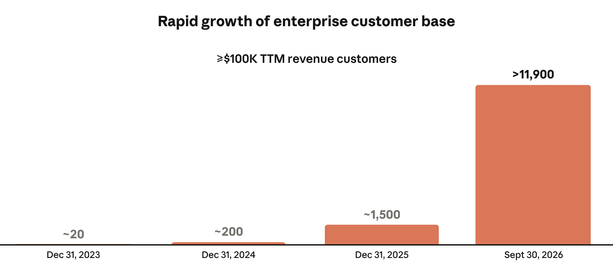
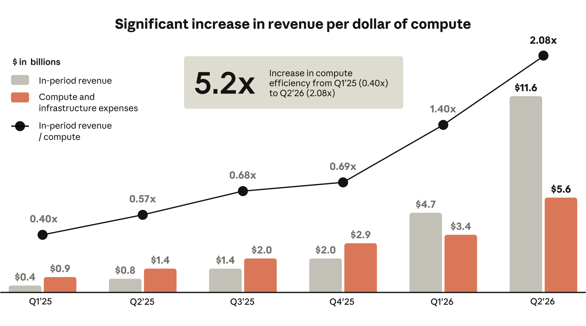
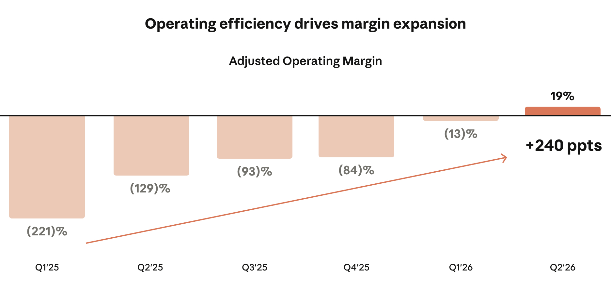

# Management’s Discussion and Analysis of Financial Condition and Results of Operations

The following discussion and analysis of our financial condition and results of operations should be read in conjunction with the section titled “Summary Consolidated Financial and Other Data” and the consolidated financial statements and related notes thereto included elsewhere in this prospectus. This discussion contains forward-looking statements that involve risks and uncertainties. Factors that could cause or contribute to such differences include those identified below and those discussed elsewhere in this prospectus, particularly in the sections titled “Risk Factors” and “Special Note Regarding Forward-looking Statements.” Financial data as of and for the years ended December 31, 2023, 2024, and 2025 have been derived from our audited consolidated financial statements appearing at the end of this prospectus. Our historical results are not necessarily indicative of the results that may be expected for any period in the future.

## Overview

Anthropic was founded in 2021 by a team of researchers responsible for many of the breakthroughs that define AI. We are first and foremost a research lab—our mission is the responsible development and maintenance of advanced AI for the long-term benefit of humanity. This mission directs our focus—along with our talent and culture, our frontier and safety research, our approach to compute, and our enterprise strategy, it is one of the core advantages that set us apart. These advantages enable us to continuously advance frontier AI and shape the standards for its safe and responsible development. Our frontier AI, Claude, is delivered to customers through our models, platform, and applications. Claude has experienced the fastest enterprise adoption of any technology in history, as demonstrated by revenue growing from $0 at commercial launch in the first quarter of 2023 to $ for the three months ended September 30, 2026.

## Our Financial Model

Our financial model is built on four primary drivers that define the trajectory of our results:

•Adoption of Claude. The advancing intelligence and capabilities of each successive version of a

Claude model drive the diffusion of Claude across the global economy. As new customers adopt Claude and existing customers expand their usage into new workflows, our revenue grows.

•Compute Efficiency. We are focused on increasing the intelligence produced and revenue generated

per dollar of compute invested and have delivered significant efficiency improvements.

•Operating Efficiency. Our high talent density, efficient go-to-market, and how extensively our

teams leverage Claude in their work help to drive improved operating margin, Adjusted Operating Margin, and revenue per employee.

•Compute Investments. Investing in compute is critical to support our long-term growth, and we

intend to continue making substantial investments in compute.

The drivers of our financial model materialize on different timelines. The adoption of Claude and associated revenue growth, compute efficiency, and operating efficiency have each increased rapidly over time. Compute is procured and committed in advance and the expense is incurred as it is brought online and added to our fungible pool, often in large, discrete steps. The fungible pool can support all workloads dynamically, including research, model development, serving customers, and internal usage of Claude. As a result, there is a lag between when investment is committed and when the full revenue associated with such investment is realized.

This dynamic has produced a financial model in which our operating margin and Adjusted Operating Margin for the nine months ended September 30, 2026 have expanded significantly year over year. As significant incremental compute is brought online in future periods, the associated expense will be recognized in advance of the full revenue that the compute will ultimately support, and we expect operating margin and Adjusted Operating Margin may compress in those periods. At our current stage, this cycle is an inherent aspect of our

134

business and will cause operating margins to fluctuate from period to period, at times meaningfully, even if the underlying economics of the business continue to improve.

In addition, the majority of our compute is contracted under multi-year commitments that we typically procure 12 to 18 months in advance of availability. When customer demand or research needs exceed this long-term capacity, we procure short-term compute, which typically carries a higher cost per unit of compute. We expect our use of short-term compute to increase in the near term and to in turn compress our operating margin and Adjusted Operating Margin as a result.

## Adoption of Claude

Each successive version of a Claude model is designed to advance the frontier with capabilities that customers value most, including coding, agentic workflows, computer use, and complex reasoning, which unlock new categories of use and drive compounding demand from new and existing customers. Claude’s intelligence is a primary driver of its diffusion and our revenue growth: because Claude leads at the AI frontier, customers rapidly adopt it, quickly see real value, and organically expand their use. We complement this intelligence-led growth with direct go-to-market and Applied AI teams and extend our reach through native availability across all three major cloud platforms—AWS, GCP, and Azure—and through partnerships with SIs, consultants, and data platforms.

We deliver this intelligence through an integrated approach. Our Claude model family is the foundation, with model classes optimized for different points along the capability-cost-speed curve. On top of our models, Claude Platform gives developers access to the primitives we use ourselves, which they can use to build their own AI solutions. We have also built first-party applications on Claude Platform for customers that prefer a ready-to- deploy option. We believe the value of this integrated approach is reflected in the increasing number of customers that use both Claude Platform and our first-party applications. For the three months ended September 30, 2026, over 50% of our customers with $100,000 or more of revenue on a TTM basis used Claude Platform and at least one of our first-party applications, up from approximately 30% for the three months ended December 31, 2025.

As more customers adopt Claude and expand their usage, we have rapidly grown our base of customers that generate meaningful revenue. We had more than 11,900 customers with $100,000 or more of revenue on a TTM basis as of September 30, 2026, up from more than 950 as of September 30, 2025. In addition, as customers further embed Claude into their most critical workflows and growth initiatives, many rapidly expand their deployments into higher revenue tiers. As of September 30, 2026, we had more than 1,900 customers with $1 million or more of revenue on a TTM basis and approximately 250 customers with $10 million or more of revenue on a TTM basis.



135

This customer momentum is driven by significant usage expansion as customers realize the value of deploying Claude across their organizations. The value that Claude delivers to customers has helped drive our Net Revenue Retention of approximately 900% as of September 30, 2026.

The growth in our business reflects the degree to which enterprises are embedding Claude directly into their business-critical workflows. Despite these trends, adoption across the global economy remains nascent. As Claude’s capabilities continue to advance, we believe the addressable opportunity will expand, and Claude will continue its rapid diffusion across more enterprises.

## Compute Efficiency

Compute is the most significant operating cost in our business, and compute efficiency is a critical determinant of our operating efficiency and revenue. Our research-driven algorithmic improvements in training and inference optimization and multi-chip compute architecture have combined to dramatically increase our compute efficiency as our revenue has scaled. The result is that we are able to continue increasing the intelligence our research can produce and the revenue our business can generate per dollar of compute investment.

We define compute efficiency as maximizing the intelligence produced and revenue generated per dollar of compute invested. Three pillars drive our compute efficiency:

•Training Efficiency. Our researchers regularly innovate compute multipliers. Increasingly, Claude

itself assists in the research and engineering that produce each successive version of our models, which is a recursive dynamic we refer to as “closing the loop,” with successive versions of our models accelerating the development of the next and compounding these gains across model generations.

•Inference Efficiency. Our researchers have delivered meaningful compute multipliers for inference

—reducing the compute required to serve a given level of model performance—while our engineering teams have driven significant optimizations in how efficiently that compute is utilized in production. This allows us to provide greater value for customers and generate greater revenue from our compute base over time, which is critical as we have consistently operated in a compute-constrained environment where customer demand exceeds available compute.

•Multi-Chip Compute Approach. We train and serve Claude natively across four major chip

families (AWS Trainium, Google TPUs, NVIDIA GPUs, and AMD GPUs) using a proprietary orchestration layer that enables us to optimize workloads for price and performance. This flexibility, which took years and significant investment to build and we believe is difficult to replicate at scale, expands our available compute, reduces dependence on any single vendor, and enables us to continuously route workloads to the most optimal hardware for those workloads. This foundation, paired with Claude’s increasing understanding of chip and model architectures, allows us to onboard new chip platforms in a fraction of the time this once required.

136



Revenue per dollar of compute has expanded meaningfully, even as we have accelerated research and product velocity and expanded our internal Claude usage. For example, our revenue grew 1,368% year over year for the three months ended June 30, 2026, compared to our compute and infrastructure expenses that grew 300% during the same period. While serving our growing customer demand, we also made significant research advances to the frontier with new leading models, including Mythos 5, Fable 5, and Opus 5, and launched new products, including Claude Cowork and Claude Design.

## Operating Efficiency

Our operating efficiency is derived from our high talent density, our efficient go-to-market, and how extensively our teams leverage Claude in their work. Claude is the common thread, amplifying the output of our employees. For example, over 90% of the contributions to our codebase in September 2026 were written by Claude. Additionally, the average daily volume of code contributed to our codebase per engineer in the three months ended September 30, 2026 was over 45 times the average daily volume in the year ended December 31, 2024.

From September 30, 2025 to September 30, 2026, TTM revenue increased approximately 1,200% while headcount increased approximately 170%, driving TTM revenue per employee from $1.4 million to over $6.6 million, a reflection of extraordinary talent density and a culture built to compound it.

Our go-to-market model reflects this as well—intelligence-led growth and broad distribution partnerships enable us to rapidly expand customer adoption and revenue without being limited by the rate at which we can grow our sales and marketing organization, resulting in greater sales efficiency as compared to typical enterprise technology companies.

Our revenue was $16.3 billion for the six months ended June 30, 2026, up from $1.2 billion for the six months ended June 30, 2025. Our operating loss was $693 million for the six months ended June 30, 2026, down from $2.1 billion for the six months ended June 30, 2025. The result of our revenue growth, compute efficiency, and operating efficiency has been a significant improvement in Adjusted Operating Income, which was $1.6 billion for the six months ended June 30, 2026, up from Adjusted Operating Loss of $1.8 billion for the six months ended June 30, 2025. We expect operating margin and Adjusted Operating Margin to fluctuate over time, particularly in periods when substantial incremental compute is delivered to us and we incur the associated expenses. See the section titled “—Non-GAAP Financial Measures” for a description of and information about

137

Adjusted Operating Income (Loss) and Adjusted Operating Margin, as well as a reconciliation of these measures to the most directly comparable financial measures calculated in accordance with GAAP.



## Compute Investments

Investing in compute is a prerequisite for long-term growth. We invest in compute for research, model development, serving customers, and internal usage of Claude. Our commercial traction, research progress, and the scale of the opportunity ahead give us the conviction to continue investing aggressively in compute. An increasing portion of these investments relates to building out our own compute and infrastructure and vertically integrating across the compute supply chain to secure long-term compute at the scale required for frontier model development. These investments take the form of capital expenditures and other commitments, including lease obligations, that we incur well in advance of the related compute becoming operational and generating revenue. As a result, we expect this build-out to change the cash flow profile of our business and to be a significant use of net cash in operating and investing activities for the foreseeable future. See the section titled “—Liquidity and Capital Resources” for more information.

In addition, as our compute needs have grown substantially, we are shifting from sourcing compute solely through fixed-term cloud agreements to a hybrid model that also includes leasing chips directly and hosting them in dedicated facilities operated on our behalf. We refer to this additional source of compute as Anthropic Direct, which helps to address our scaling compute requirements and we believe will provide long-term economic advantages. Anthropic Direct represents a more flexible use of capital by allowing us to separate our commitments for data center capacity from our commitments for the compute infrastructure deployed inside them. Because data centers require longer lead times but represent a smaller fraction of total compute costs, this approach enables us to secure data center capacity early while deferring larger accelerator investments until our specific compute needs are more certain.

As of and subsequent to September 30, 2026, we have entered into purchase commitments and lease agreements, including short-term commitments, as well as leases not yet commenced, with an aggregate committed spend of more than $ . These commitments include approximately $ expected to be incurred before December 31, 2030, and substantially all of the remainder is expected to be incurred between 2031 and 2045. Approximately $ of these commitments are due in the next 12 months. A significant portion of this total committed spend relates to Anthropic Direct, and we expect it to represent a growing share of our compute investments over time. The flexibility from Anthropic Direct allows us to backfill the short-term compute we procure during periods of high demand with more cost-effective, long-term compute as our dedicated infrastructure comes online.

138

We intend to fund these investments through the revenue we generate and the capital that we raise. As of September 30, 2026, and prior to taking into account the net proceeds to us from this offering, we had $ of liquidity, comprised of $ of cash and cash equivalents, $ of short-term investments, and $ of availability under our A&R Credit Facility (as defined below). We also maintain significant funding support from our strategic partners, including up to $ in available financing capacity under our note purchase agreements and up to $ in equity commitments. In addition, we estimate that the net proceeds to us from this offering will be approximately $ , based upon the assumed initial public offering price of $ per share, which is the midpoint of the estimated offering price range set forth on the cover page of this prospectus, and after deducting estimated underwriting discounts and commissions and estimated offering expenses payable by us, or approximately $ if the underwriters’ option to purchase additional shares of our Class A common stock from us is exercised in full.

## How We Generate Revenue

At the foundation of our business is our family of four Claude model classes—Mythos (including Fable), Opus, Sonnet, and Haiku—each optimized for a different point on the capability-cost-speed curve. Our frontier models allow customers to match the right model to each use case. Customers typically use higher-capability models for complex reasoning, coding, and agentic workflows where greater model intelligence is required. Customers also frequently adopt our full range of models, routing individual tasks to the models that are most optimized to meet their needs along the capability-cost-speed curve. The model a customer uses and the volume of usage are the primary drivers of customer spend. We establish a direct contractual relationship with the customer and offer customers the flexibility to purchase directly from us or through CSP marketplaces, and many customers utilize both channels.

Pay-for-intelligence, our consumption-based revenue model, is our primary revenue model and currently represents the substantial majority of our total revenue. Under this model, customers pay for usage, which is metered in tokens and priced according to the model selected. Our pay-for-intelligence revenue is primarily generated from customers building applications incorporating Claude or utilizing our first-party applications.

In addition, we offer certain of our applications on a subscription basis, serving both enterprises and prosumers. Under this model, customers pay a subscription fee for a specified level of usage and capabilities during the subscription term, which is generally 12 months or less.

Depending on the model, platform, or applications chosen by our customers, they enter into pay-for- intelligence pricing, subscription-based pricing, or both. For example, when subscribers approach or exhaust the usage capacity included in their tier, they may utilize a higher subscription tier or purchase more intelligence directly, creating a seamless bridge from subscription to incremental pay-for-intelligence revenue.

A growing number of enterprise customers agree to non-cancelable annual or multi-year contracts with minimum spend commitments in exchange for a committed price list. These contracts result primarily in consumption-based revenue.

Consumption-based revenue increased from $288 million, or 75% of total revenue, for the year ended December 31, 2024, to $3.8 billion, or 83% of total revenue, for the year ended December 31, 2025, to $13.1

billion, or 80% of total revenue, for the six months ended June 30, 2026. Subscription-based revenue increased

from $98 million, or 25% of total revenue, to $789 million, or 17% of total revenue, to $3.2 billion, or 20% of total revenue, over the same periods. The higher increase in consumption-based revenue reflects the growth in customers with $100,000 or more of revenue on a TTM basis. For 2023, our revenue of $41 million was substantially all consumption-based, reflecting our early operations. We expect consumption-based revenue to continue to represent the substantial majority of total revenue for the foreseeable future.

Our recent growth may reflect early-stage adoption dynamics, the nascency of the AI market, and rapid initial customer expansion that may not be sustainable over time. We expect our revenue growth rate to decline over time, and it may decline significantly and more rapidly than we anticipate as our revenue base increases and as the market matures.

139

## Our Customers and Approach to Claude Diffusion

### Our Customers

We serve enterprises of all sizes and across industries, in nearly every region of the world. Organizations that use Claude range from the world’s largest enterprises to AI-native startups, research institutions, and mission- driven organizations working on some of the world’s most consequential problems. Customers realize value from Claude in three primary ways: more productive employees, faster processes, and embedded intelligence in their products. As enterprise customers push Claude into increasingly complex workflows, we engage with them to understand their evolving requirements, which helps shape our product roadmap. This feedback loop deepens customer relationships with each release and makes Claude more capable for all customers.

Software developers have been core to our strategy: they are simultaneously the architects of applications built on our platform, and they encode their workflows and institutional knowledge into Claude-powered agents. Developers have been our earliest adopters and often most discerning users: they apply models to unanticipated use cases quickly and surface the edge cases that sharpen each successive version of a Claude model. Claude Code is now embedded in software development workflows across major organizations, with these relationships often beginning with individual engineers who recognized the value of autonomous coding agents and accelerated adoption across their enterprises.

The same intelligence and capabilities we deliver to enterprises are also valuable to prosumers in their personal endeavors. These users provide strategic value as a top-of-funnel engine for our enterprise business— individuals who utilize Claude for their personal work and then champion it inside their organizations.

We are seeing broad-based growth across customer use cases, from software development to financial analysis, content creation, and complex knowledge work. Claude is extensible: regardless of entry point, enterprises quickly discover that frontier AI applies to a wide and expanding range of tasks across their organizations. As a result, what sometimes begins as a single use case frequently expands into broader adoption spanning coding, legal analysis, financial modeling, customer operations, and other knowledge-intensive work.

### Our Approach to Claude Diffusion

A core driver of Claude’s diffusion is its intelligence—as Claude’s capabilities advance, value to customers expands, and that value drives greater adoption. Ensuring the accessibility of such intelligence is also critical, and we do that in the following ways: through our composable platform and applications that meet customers where they are, through our go-to-market and Applied AI teams directly, and through partnerships that extend our reach at scale.

Intelligence-Led Growth. Our platform and applications are the primary mechanism through which Claude’s

intelligence can reach users. As users begin building, brainstorming, and problem-solving with Claude, they quickly come to rely on it as a trusted partner in their work. As Claude becomes part of how people work, they experience firsthand what frontier AI makes possible, and such individual adoption reshapes how entire organizations operate. This pattern repeats across organizations: prosumers become internal champions, teams expand their use of Claude, and what begins as a single workflow grows into something that impacts how an entire organization operates. This pattern has been core to our revenue growth.

Direct Teams. This organic adoption is complemented and enhanced through our direct go-to-market teams

who help scale Claude to organizations with complex workflows and business processes. By the time our direct teams engage a customer, Claude is often already in use. Our go-to-market teams use this organic momentum to build executive sponsorship and drive enterprise-wide adoption.

Applied AI Teams. Our Applied AI teams embed more deeply with select customers, building solutions that

make it easier for organizations to benefit from Claude’s intelligence. They work with enterprises to design and deploy custom solutions, specialized workflows, and domain-specific implementations tailored to the customer’s own requirements. This work drives deeper adoption within individual customers and generates the feedback and information from users that help to shape our platform and product roadmap.

140

Cloud Partnerships. Claude is accessible on all three major cloud platforms, AWS, GCP, and Azure, allowing

enterprises to deploy Claude within the infrastructure, security perimeters, and commitment structures they already operate. These CSPs extend our reach through their large combined field teams that are empowered to sell our platform and applications, accelerating market adoption at a scale we believe would be difficult for any single organization to directly replicate. We have a joint go-to-market approach with these CSPs through which we establish direct contractual relationships with our customers while paying a fee to each CSP. This structure allows us to foster stronger commercial alignment with these CSPs, avoid channel conflict, set pricing, and realize the financial benefits of ongoing compute efficiency improvements.

Ecosystem Partnerships. Major global SIs have built dedicated Claude practices with teams trained to deploy

our platform and applications. Go-to-market alliances with leading data platforms embed Claude into data infrastructure that enterprises already operate, facilitating adoption of Claude within existing workflows and making it easier for enterprises to realize value from Claude.

Ode with Anthropic. We recently launched an AI services company in partnership with leading private equity

firms to bring Claude’s capabilities to mid-sized companies across sectors, building solutions on the Claude Platform and supporting customers over the long term. Ode with Anthropic will partner closely with our Applied AI and go-to-market teams.

Together, these approaches have led to a structurally efficient approach to facilitating the diffusion of Claude in the economy, with our sales, marketing, and partnerships expenses representing 19% of revenue for the six months ended June 30, 2026.

## Key Factors Affecting Our Performance

### Remaining at the Frontier of AI

We believe enterprises consistently choose the most capable and trustworthy AI systems, making our position at the frontier an important driver of our success. Our ability to rapidly grow our revenue is partially dependent on our continued delivery of more intelligent and capable models. Our experience is that as we deliver models with meaningfully improved capabilities that deliver higher intelligence per dollar spent, customers find new applications for AI across their businesses, accelerating adoption and revenue growth.

This can be seen in the trajectory of our model family adoption. Successive versions of our most intelligent generally available model have delivered meaningfully greater intelligence and capabilities. With each release, we have seen most customers utilize the latest version of our models, reinforcing the direct relationship between frontier model quality and revenue generation. As we deliver more capable models, customers have expanded their usage into new use cases and increased their spending accordingly.

We expect our ability to deliver innovation in intelligence and capability at the frontier to remain a key driver of revenue growth in future periods, and maintaining a leading position requires continued investment in research and compute, top technical talent, and access to capital sufficient to support our growth trajectory.

### Securing Sufficient Compute and Optimizing its Utilization

Our ability to continue advancing intelligence at the frontier depends on securing sufficient compute for research, model development, serving customers, and internal usage of Claude. Our ability to leverage heterogeneous compute helps us to secure compute at sufficient scale and optimal price-performance. If any of our chip partners are unable to deliver committed compute or experience delays, or if we need to procure incremental compute, we benefit from having a range of partners as opposed to being overly reliant on any one partner. The availability, timing, and cost of compute are subject to factors largely outside our control, including the concentration of chip and memory manufacturing among a limited number of suppliers and geographies, constraints on the availability of power and data center capacity, and evolving export controls. We have historically operated in a compute-constrained environment in which demand for compute has exceeded the supply available to us. In addition, certain of the CSPs on which we rely for compute are also strategic investors in us, are our customers, and offer AI models and services that compete with ours. These multifaceted relationships could give rise to conflicts of interest or competitive dynamics that adversely affect our access to compute, its cost, or the prioritization of our workloads.

141

As our compute needs have grown substantially, we are shifting from sourcing compute solely through fixed- term cloud agreements to a hybrid model that also includes leasing chips directly and hosting them in dedicated facilities operated on our behalf. We refer to this additional source of compute as Anthropic Direct, which helps to address our scaling compute requirements and provides potential long-term economic advantages of direct hosting. Anthropic Direct provides us with a more flexible use of capital by allowing us to separate our commitments for data center capacity from our commitments for the AI accelerators deployed inside them. Because data centers require longer lead times but represent a smaller fraction of total compute costs, this approach enables us to secure data center capacity early while deferring larger accelerator investments until our specific compute needs are more certain.

Optimizing the utilization of our compute is equally important to our success in satisfying customer demand. We continuously direct compute to its highest-value use case, balancing the need to advance research and model development with the need to serve our customers and support internal usage of Claude. We rely on compute efficiencies, such as the discovery of compute multipliers, to get the most out of the compute that we procure. Our ability to effectively direct compute and drive compute efficiencies will be an important determinant of both our pace of innovation and our financial results over time.

### Attracting and Retaining Technical Talent

Advancing the frontier and maximizing the return on our compute investment require that we attract, hire, and retain top technical talent. Talent attraction and retention start with our seven co-founders, all of whom have remained with the company. We believe our culture and mission alignment enable us to hire and retain the talent required to continuously push the frontier of AI forward in a safe and responsible way. We expect our ability to continue attracting and retaining top technical talent to remain a key determinant of our pace of innovation and our financial results in future periods.

### Our Continued Access to Capital

We must make significant investments in compute for research, model development, serving customers, and internal usage of Claude. Our compute requires substantial upfront commitments and ongoing payments as the compute becomes available to us. Our compute commitments will continue to grow as we scale our business. Our ability to secure sufficient compute is directly linked to our ability to access capital on favorable terms, such as through equity or debt financing or cash flow from operations.

In order to maintain our access to capital, we must continue to demonstrate that we are able to invest that capital in a highly productive way. The best measures of our progress are Claude’s intelligence and capability, and customer adoption of Claude. Our ability to convert compute investment into frontier model performance, and then increase customer adoption, will be a key determinant of our access to capital.

Our ability to sustain access to capital depends in part on demonstrating a credible trajectory toward profitability. Our revenue growth, compute efficiency, and operating efficiency have significantly improved our operating margin and Adjusted Operating Margin, but we plan to keep investing heavily, which will adversely impact our results of operations. Our compute commitments are substantial and generally must be satisfied regardless of our revenue or utilization, while our access to additional capital depends on a number of conditions, many of which are outside our control, including market conditions and investor demand. In addition, a portion of our compute and infrastructure build-out has been funded or supported by capital or credit support provided or facilitated by certain of our CSPs and chip partners. Our ability to reduce this reliance over time is a function in part of our ability to obtain financing from independent sources on our own credit.

### Our Ability to Diffuse Claude in the Enterprise

Our financial performance depends on the pace and breadth at which AI, and in particular Claude, is adopted across the global economy. While Claude’s capabilities already address a wide range of enterprise use cases, we believe that enterprise adoption remains nascent. We believe that our ability to capture this opportunity and drive revenue growth in future periods will depend on three dynamics:

142

First, our ability to translate model improvements into accessible products and platform capabilities.

In the nine months ended September 30, 2026, we launched an aggregate of 250 new model versions, platform features, and applications, including new capabilities in Claude Code, Claude Cowork, and vertical solutions for key industries. Our growth depends on continuing this pace of product innovation and reducing the friction between Claude’s capabilities and customer workflows. Our growth also depends on how quickly new capabilities reach customers, which in turn depends on the steps we take to assess and mitigate the risks of each model during development and before and after release. In the past, these steps have included delaying the release of new models and limiting their initial availability, such as our initial release of Mythos through Project Glasswing and our later release of Fable 5 as a generally-available model with safety restrictions, and in the future, as we learn more about model capabilities and behavior, could include additional measures that affect whether, how, and when we develop or release new models or capabilities. We evaluate whether to delay or restrict a release based on the results of our pre-release capability and safety evaluations and our assessment of whether available safeguards adequately mitigate the identified risks, and we may also take such steps where those evaluations are inconclusive. For more information, see the section titled “Business—Safety Research is Core to Our Business—Our Approach to Model Releases.” These measures, and any laws, regulations, or standards governing frontier AI development that may be adopted, could cause new use cases to emerge more slowly and slow the enterprise adoption and expansion on which our revenue growth depends. We believe that enterprises prefer models that are safe and aligned, and that our continued investment in safety strengthens customer trust and supports long-term adoption.

Second, our ability to expand and diversify distribution.

A large portion of our growth to date has been self-service and organic. As AI adoption extends further into enterprises and more regulated industries, we are investing in direct go-to-market, Applied AI teams, and partnerships across all three major cloud platforms, SIs, consultants, and data platforms. We are also expanding our ability to serve international customers through the growth of regional offices and partnerships in key markets, and we expect international expansion to be a meaningful driver of revenue growth as global demand for AI accelerates. The effectiveness of these investments, and our ability to hire and retain go-to- market talent, will be a meaningful determinant of growth.

Third, our ability to land new customers and expand within existing accounts.

The number of customers with $100,000 or more of revenue on a TTM basis grew from approximately 20 as of December 31, 2023, to approximately 200 as of December 31, 2024, to approximately 1,500 as of December 31, 2025, and to more than 11,900 as of September 30, 2026. Total revenue from these customers grew from approximately $37 million to $220 million to $3.5 billion to $ and represented 90%, 57%, 76%, and % of total revenue for the years ended December 31, 2023, 2024, and 2025, and the trailing twelve months ended September 30, 2026, respectively. The remaining % of total revenue for the trailing twelve months ended September 30, 2026 was generated by approximately 40 million customers, each with less than $100,000 of revenue on a TTM basis.

In addition, as of September 30, 2026, we had more than 1,900 customers with $1 million or more of revenue on a TTM basis and approximately 250 customers with $10 million or more of revenue on a TTM basis. Despite this growth, our penetration into the largest enterprises remains early. Over 50% of the Fortune 500 and over 30% of the Global 2000 were customers with $100,000 or more of revenue on a TTM basis as of September 30, 2026. We believe we are in the early stages of our expansion within these customers, with our revenue from these Fortune 500 customers representing, on average, less than 0.1% of their total expenses for the three months ended September 30, 2026.

We compare this measure against our largest Fortune 500 customers, who are further along in their adoption of AI. For the three months ended September 30, 2026, revenue from our top 10 Fortune 500 customers represented, on average, less than 1% of their total expenses—still a small fraction of their overall spend, but over eight times the average of our Fortune 500 customers with $100,000 or more of revenue on a TTM basis.

5 For purposes of this measure, we include only Fortune 500 customers that are publicly traded and calculate the measure using total

expenses as reported in their publicly available financial statements.

143

We believe the difference reflects the substantial runway we have to deepen adoption, both within our largest customers and within customers earlier in their adoption of Claude.5

Claude adoption is broad-based. No single customer represented more than 10% of our revenue for the nine months ended September 30, 2026. Approximately 79% of our revenue came from customers outside of our top five customers for the three months ended September 30, 2026, up from approximately 64% for the three months ended March 31, 2026. At the same time, our largest customers continue to expand. For the three months ended September 30, 2026, our revenue from each of our top five customers reached a record high.

### Customer Usage Patterns

Our revenue is influenced by customer usage patterns, which are impacted by the frequency and capability of new model version releases, as well as seasonal trends, each of which can create variability in our results from period to period. The continuous and overlapping cadence of new model version releases is inherent to remaining at the frontier of AI development. For example, model versions released in the six months ended September 30, 2026 accounted for over 80% of our revenue for the three months ended September 30, 2026. As we have released successive versions of Claude models, we have continued to see revenue growth as new capabilities unlock additional use cases, prompting new customers to adopt Claude and existing customers to expand their usage.

Our customer usage patterns have also typically exhibited seasonality, particularly around holiday and vacation periods in the summer and winter, when certain workflows slow down and overall customer activity declines. For example, developer commits and feature launches are typically slower during the code freezes that many companies schedule over holidays. Consistent with this pattern, for the two weeks ended January 2, 2026, total customer spend declined by approximately 20% compared to the prior two weeks ended December 19, 2025. However, our historical growth rates may mask the impact of seasonal trends on our results. These dynamics are inherent aspects of a pay-for-intelligence revenue model and may be important determinants of our financial results in future periods.

Because of these seasonal patterns, our results of operations have varied, and are expected to continue to vary, from period to period, and our results for any one period may not be indicative of our results for any future period. As our revenue growth rate declines over time, we expect seasonal effects to become more apparent in, and to have a greater effect on, our period-to-period results, and to make it more difficult to forecast our results of operations.

### Our Commitment to Public Benefit

Our commitment to public benefit extends to how we deploy our resources. We intend to direct a meaningful portion of our resources toward ensuring that frontier AI is safe and its benefits are broadly distributed, which we refer to as our public benefit initiatives. This may include significant contributions to nonprofit organizations, research institutions, and other third parties working on problems where AI can have the greatest positive impact, as well as programs designed to make Claude accessible to underserved communities, educators, and public institutions.

As part of these initiatives, we contributed 846,840,960 shares of our Class N common stock, representing 5% of our fully diluted shares as of June 30, 2026 (assuming full conversion of the Amazon Notes), to the Anthropic Public Benefit Fund, our wholly owned subsidiary dedicated to the Company Purpose, which we refer to as the Initial Public Benefit Issuance. As the value we create grows, we intend for the public benefit to share meaningfully in that growth as well. To that end, our board of directors has approved a framework for additional contributions tied to future increases in our share price. Following this offering, our board of directors, in its discretion, may issue shares of our Class N common stock to the Anthropic Public Benefit Fund (or other designee) representing up to an additional 2% of our then-outstanding shares (plus any shares subject to options, RSUs, and other convertible securities and any shares held by the Anthropic Public Benefit Fund) each time our share price appreciates 50% above the prior share price milestone, beginning with our initial public offering price. A share price milestone is reached only when our closing share price has exceeded the applicable threshold on at least 90 of the trailing 120 consecutive trading days, and our average closing share

144

price over the ten trading days prior to such issuance also exceeds that threshold. Although our board of directors has approved this framework, any future contributions will be made at the discretion of our board of directors. The shares that are contributed to the Anthropic Public Benefit Fund, including the Initial Public Benefit Issuance, may be transferred or donated to a third party, or otherwise sold in a registered public offering or private placement transaction in furtherance of our public benefit initiatives. Our board of directors will determine the allocations and distributions from the Anthropic Public Benefit Fund until it approves a specific governance structure for the entity, at which point decision-making authority is expected to transition to designated managers of the Anthropic Public Benefit Fund operating under that structure. The initial managers are Dario Amodei, Daniela Amodei, Jack Clark, and Dr. Neil “Buddy” Shah. The Initial Public Benefit Issuance and the additional share contribution framework represent one of the ways in which we intend to pursue the Company Purpose, but it is not the exclusive means of doing so. We expect to dedicate additional resources, and to make other business and operational decisions, in furtherance of our Company Purpose outside of, and in addition to, these equity contributions.

In addition, we maintain a donation matching program through which employees can pledge a meaningful portion of their equity awards or equivalent cash proceeds to a donor-advised fund or other nonprofit organization, and we match those donations with shares of our Class N common stock. In the same way the Company Purpose defines how we direct our work as an organization, our donation matching program reflects a parallel commitment by our employees to direct their personal financial value created by that work toward the public good. We view our donation matching program as a meaningful expression of the Company Purpose and a reflection of the values that define our culture. In addition, our co-founders have each pledged to dedicate 80% of their personal equity in Anthropic to philanthropic causes, separate from and not eligible for our donation matching program.

Decisions we make to advance our public benefit initiatives may, in any given period, reduce our revenue, increase our expenses, lower our Adjusted Operating Margin, contribute to dilution, and reduce our profitability on a per share basis relative to what we would otherwise report. Our public benefit-related expenses, which currently consist primarily of charitable donations under our donation matching program, have not historically been significant. For the year ended December 31, 2025, expenses related to our donation matching program were $541 million, representing approximately 4% of our total operating expenses. However, we expect the cadence and magnitude of resources directed toward our public benefit initiatives to increase in future periods and remain a factor affecting our results of operations.

## Components of Results of Operations

### Revenue

We generate revenue as customers use Claude through our platform and applications, including Claude Code, Claude Cowork, and vertical solutions for key industries. Claude is powered by our proprietary Claude model family, a set of frontier models, each with varying levels of capability, cost, and speed. Enterprise customers access our intelligence service directly from us or through CSP marketplaces, where we maintain direct contractual relationships with our customers.

Depending on the model, platform, or applications chosen by our customers, they enter into pay-for- intelligence pricing, subscription-based pricing, or both. A growing number of enterprise customers agree to annual or multi-year contracts with minimum spend commitments.

Revenue is recognized when customers use our intelligence service, based on the quantity of tokens consumed. Subscriptions are generally prepaid on a monthly or annual basis, and are subject to usage limits that reset over short periods, which results in revenue being recognized on a ratable basis over the subscription period, which is generally 12 months or less.

We expect our revenue growth rate to decline over time and to fluctuate from period to period. Revenue growth in any period may be affected by customer usage patterns, customer adoption, the deployment of our models, platform, and applications, the pricing of our offerings, the timing and success of new model and product releases, measures we decide to implement to safely deploy new capabilities, our ability to continue meeting customer requirements, and other factors affecting demand for our models, platform, and applications, including those described in the section titled “Risk Factors—We are at an early stage of our revenue growth, we

145

have experienced rapid growth in recent periods, and our historical growth rates are not indicative of future performance or our ability to sustain or forecast future revenue growth.”

In addition, our revenue has included, and we expect will continue to include, amounts from customers that we subsequently determine are using our models, platform, and applications in violation of our usage policy or commercial terms. We believe this dynamic is common in our industry. Because detection, investigation, and enforcement take time, we recognize revenue from such customers when the related services are provided, before restricting or terminating their access. Based on our detection and review process, we estimate that revenue from such customers represented approximately 5% to 7% of our revenue for the nine months ended September 30, 2026. This estimate requires judgment and may change as our detection methodologies evolve and we identify previously undetected usage. We expect the percentage of revenue from customers using our models, platform, and applications in violation of our usage policy or commercial terms to decline in future periods as we have enhanced our detection and enforcement efforts, in particular in August and September 2026; however, the timing and magnitude of any resulting adverse effect on our revenue and revenue growth are uncertain.

### Operating Expenses

#### Compute and Infrastructure

Compute and infrastructure expenses primarily consist of costs attributable to operating our technology infrastructure, which supports the full range of workloads for our models, including research, model development, serving customers, and internal usage of Claude. These costs primarily consist of compute fees paid to CSPs under committed and on-demand arrangements, including storage, networking, and connectivity, and related support costs, infrastructure costs associated with serving customer workloads through partner channels, colocation facility costs, equipment leases and committed power costs associated with our data center operations, and third-party application infrastructure software costs directly related to our compute operations. Beginning in 2026, as our obligations commence under compute and infrastructure leases, these expenses also include operating lease costs, amortization of finance lease assets, variable lease costs, and depreciation and amortization on owned servers, networking equipment, and related data center assets. See Note 8 to our consolidated financial statements included elsewhere in this prospectus for a functional presentation of our operating expenses, including cost of revenue, and a description of the workloads underlying the compute and infrastructure expenses within each functional caption. Within that functional presentation, substantially all of the cost of revenue consists of compute and infrastructure expenses associated with customer-serving workloads. Additionally, cost of revenue includes certain personnel-related costs and allocated overhead costs.

Customers adopt and retain our technology based on whether our models are at the frontier of AI capability and maintaining that frontier position is essential to revenue generation. Each model release represents continuous intelligence improvements, making ongoing model development a critical factor in revenue generation. We operate an iterative cycle in which compute deployed to model development yields more capable and efficient models. Those efficiency gains free compute to serve additional customer workloads. In turn, serving our customers at scale generates feedback that informs research and model development. In this cycle, customer- serving activity and model development are each a direct input that informs the other, and we therefore view compute and infrastructure costs as critical to our ability to generate revenue within a short time of incurring such costs.

We expect compute and infrastructure expenses to increase in absolute dollars and remain our largest operating expense for the foreseeable future as additional committed compute becomes available to us under multi-year arrangements with CSPs, and as we continue to invest in additional compute. These expenses are paid and recognized as compute becomes available to us, rather than when committed, and are generally fixed in the near term given the majority of our compute is contracted under multi-year commitments that we typically procure 12 to 18 months in advance of availability. We deploy this committed compute as a single, shared resource across all workloads, and thus plan, incur, and assess it on a total basis rather than by individual workload. As a result, compute and infrastructure expenses as a percentage of revenue will depend primarily on how our revenue scales relative to our total committed compute cost base. In addition, as part of our public benefit initiatives, we intend to direct a meaningful portion of our resources, which may include compute, toward ensuring that the benefits of frontier AI are broadly accessible, and we expect to significantly scale these efforts over time.

146

#### Personnel

Personnel expenses primarily consist of stock-based compensation, including expense related to stock options, RSUs, and restricted stock awards (“RSAs”), cash compensation, including base salaries and bonuses, employee benefits, including health and welfare benefits, and employer payroll taxes.

We expect personnel expenses to increase in absolute dollars as we continue to expand our headcount to support the growth of our business. We also expect to incur additional stock-based compensation expense in connection with this offering, including for certain RSUs for which the performance condition will be satisfied upon the effectiveness of the registration statement of which this prospectus forms a part. We expect that personnel expenses may fluctuate as a percentage of revenue depending on the timing and magnitude of stock- based compensation expense, and the pace of hiring across our organization.

#### Bartz settlement

Bartz settlement consists of the charge we recorded in 2025 to settle the Bartz litigation. See Note 13 to our consolidated financial statements included elsewhere in this prospectus for additional information.

#### Sales, Marketing, and Partnerships

Sales, marketing, and partnerships expenses primarily consist of fees paid to channel partners and marketing and advertising costs, including media and public relations spend.

We expect sales, marketing, and partnerships expenses to increase in absolute dollars as we continue to invest in activities to drive continued adoption and expanded usage of our models. We expect that sales, marketing, and partnerships expenses may fluctuate as a percentage of revenue depending on the timing of and spend on marketing campaigns and changes in the terms of our channel partner distribution arrangements and the cost to deliver our intelligence service.

#### Other Operating and Administrative

Other operating and administrative expenses primarily consist of charitable donations expense related to our donation matching program, vendor costs related to data quality and performance evaluation services, information technology and cloud software costs, payment processing and platform fees, facility and occupancy costs, non-income taxes, professional services costs, bad debt expense, and depreciation and amortization related to non-data center assets.

We expect that other operating and administrative expenses will increase in absolute dollars as our business grows and as a result of operating as a public company, including expenses related to compliance with SEC rules and regulations, the listing standards of the Nasdaq Global Select Market, additional costs for directors’ and officers’ liability insurance, and professional services. We also expect other operating and administrative expenses to fluctuate as a percentage of our revenue over time as our business grows, in part as we significantly scale our public benefit initiatives, including expanded programs to make Claude accessible to underserved communities, increased charitable donation matching, contributions to philanthropic vehicles or foundations we may establish or support in the future, and other efforts aligned with our mission.

### Interest Income

Interest income consists of interest earned on our cash and cash equivalents and short-term investments which primarily consist of debt securities, including U.S. Treasury and agency securities, corporate debt, and commercial paper.

### Change in Fair Value of Convertible Notes, Derivative Liabilities, and SAFEs

Change in fair value of convertible notes, derivative liabilities, and SAFEs consists of gains and losses as a result of recording our convertible promissory notes, derivative liabilities, and SAFE liabilities at fair value at the end of each reporting period. Because these instruments are marked to market, increases in our enterprise valuation drive increases in this expense. We will continue to recognize changes in the fair value of our

147

convertible notes until they are converted into equity, repaid, or otherwise settled. For more information, see Note 4 to our consolidated financial statements included elsewhere in this prospectus.

### Other Income (Expense), Net

Other income (expense), net consists primarily of the change in fair value of strategic investments and financial instruments, the change in fair value of certain derivative instruments in connection with an acquisition of a privately-held company in December 2025, interest expense from finance leases, and foreign currency exchange gains and losses. For more information on the acquisition, see Note 15 to our consolidated financial statements included elsewhere in this prospectus.

### Provision for Income Taxes

The provision for income taxes primarily consists of income taxes in certain federal, state, local, and foreign jurisdictions in which we conduct business. Our effective tax rates will vary depending on the impact of the valuation allowance and nondeductible fair value adjustments to derivatives, as well as the relative proportion of foreign income to domestic income, generation of tax credits, changes in the valuation of our deferred tax assets and liabilities, and changes in tax laws.

## Results of Operations

The following table sets forth our consolidated statements of operations data for the periods indicated:

|  |  |  |  |  |  |  |  |  |
| --- | --- | --- | --- | --- | --- | --- | --- | --- |
|  | Year Ended December 31, | Year Ended December 31, | Year Ended December 31, | Year Ended December 31, | Year Ended December 31, | Six Months Ended June 30, | Six Months Ended June 30, | Six Months Ended June 30, |
| (in millions) | 2023 |  | 2024 |  | 2025 | 2025 |  | 2026 |
| Revenue | $41 |  | $386 |  | $4,585 | $1,163 |  | $16,286 |
| Operating expenses: |  |  |  |  |  |  |  |  |
| Compute and infrastructure | 433 |  | 2,522 |  | 7,326 | 2,334 |  | 8,945 |
| Personnel(1) | 95 |  | 454 |  | 1,839 | 538 |  | 3,152 |
| Bartz settlement | — |  | — |  | 1,500 | — |  | — |
| Sales, marketing, and partnerships | 2 |  | 43 |  | 568 | 120 |  | 3,168 |
| Other operating and administrative | 62 |  | 347 |  | 1,412 | 306 |  | 1,714 |
| Total operating expenses | 592 |  | 3,366 |  | 12,645 | 3,298 |  | 16,979 |
| Operating loss | (551) |  | (2,980) |  | (8,060) | (2,135) |  | (693) |
| Interest income | 69 |  | 106 |  | 431 | 115 |  | 1,111 |
| Change in fair value of convertible notes, derivative liabilities, and SAFEs | (1,045) |  | (5,434) |  | (34,308) | (10,942) |  | (72,388) |
| Other income (expense), net | (2) |  | — |  | (8) | — |  | (8,757) |
| Total other income (expense), net | (978) |  | (5,328) |  | (33,885) | (10,827) |  | (80,034) |
| Loss before provision for income taxes | (1,529) |  | (8,308) |  | (41,945) | (12,962) |  | (80,727) |
| Provision for income taxes | 2 |  | 1 |  | 20 | 7 |  | 21 |
| Net loss(2) | $(1,531) |  | $(8,309) |  | $(41,965) | $(12,969) |  | $(80,748) |

\_____________\_

(1) Includes stock-based compensation expense of $29 million, $192 million, and $1.2 billion for the years ended December 31,

2023, 2024, and 2025, respectively, and $286 million and $2.2 billion for the six months ended June 30, 2025 and 2026, respectively.

(2)Includes change in fair value of convertible notes, derivative liabilities, and SAFEs, which were $1.0 billion, $5.4 billion, and

$34.3 billion for the years ended December 31, 2023, 2024, and 2025, respectively, and $10.9 billion and $72.4 billion for the six months ended June 30, 2025 and 2026, respectively. These changes were primarily driven by an increase in the fair value of

148

our outstanding convertible promissory notes resulting from an increase in our enterprise valuation during each of the respective periods.

The following table sets forth our consolidated statements of operations as a percentage of revenue data for the periods indicated:

|  |  |  |  |  |  |  |  |  |
| --- | --- | --- | --- | --- | --- | --- | --- | --- |
|  | Year Ended December 31, | Year Ended December 31, | Year Ended December 31, | Year Ended December 31, | Year Ended December 31, | Six Months Ended June 30, | Six Months Ended June 30, | Six Months Ended June 30, |
|  | 2023 |  | 2024 |  | 2025 | 2025 |  | 2026 |
| Revenue | 100% |  | 100% |  | 100% | 100% |  | 100% |
| Operating expenses: |  |  |  |  |  |  |  |  |
| Compute and infrastructure | 1,056 |  | 653 |  | 160 | 201 |  | 55 |
| Personnel | 232 |  | 118 |  | 40 | 46 |  | 19 |
| Bartz settlement | — |  | — |  | 33 | — |  | — |
| Sales, marketing, and partnerships | 5 |  | 11 |  | 12 | 10 |  | 19 |
| Other operating and administrative | 151 |  | 90 |  | 31 | 26 |  | 11 |
| Total operating expenses | 1,444 |  | 872 |  | 276 | 284 |  | 104 |
| Operating loss | (1,344) |  | (772) |  | (176) | (184) |  | (4) |
| Interest income | 168 |  | 27 |  | 9 | 10 |  | 7 |
| Change in fair value of convertible notes, derivative liabilities, and SAFEs | (2,549) |  | (1,408) |  | (748) | (941) |  | (444) |
| Other income (expense), net | (5) |  | — |  | — | — |  | (54) |
| Total other income (expense), net | (2,385) |  | (1,380) |  | (739) | (931) |  | (491) |
| Loss before provision for income taxes | (3,729) |  | (2,152) |  | (915) | (1,115) |  | (496) |
| Provision for income taxes | 5 |  | — |  | — | 1 |  | — |
| Net loss | (3,734)% |  | (2,153)% |  | (915)% | (1,115)% |  | (496)% |

\_____________\_

Note: Totals of percentage of revenue table may not foot due to rounding.

## Comparison of the Six Months Ended June 30, 2025 and 2026

### Revenue

|  |  |  |  |  |  |
| --- | --- | --- | --- | --- | --- |
|  | Six Months Ended June 30, | Six Months Ended June 30, | Six Months Ended June 30, |  |  |
| (in millions, except for percentages) | 2025 |  | 2026 | $ Change | % Change |
| Revenue | $1,163 |  | $16,286 | $15,123 | 1,300% |

Revenue for the six months ended June 30, 2026 increased by $15.1 billion, or 1,300%, compared to the six months ended June 30, 2025. Consumption-based and subscription-based revenue increased by $12.1 billion and $3.0 billion, respectively, for the six months ended June 30, 2026 compared to the six months ended June 30, 2025. The increase was driven by successive model and product releases that drove higher usage, expansion, and broader adoption across our offerings. The number of customers with $100,000 or more of revenue on a TTM basis grew from more than 600 as of June 30, 2025 to more than 6,000 as of June 30, 2026. Total revenue from these customers grew from $870 million for the six months ended June 30, 2025 to $12.0 billion for the six months ended June 30, 2026 and represented approximately 75% and 74% of total revenue for the six months ended June 30, 2025 and 2026, respectively.

149

### Operating Expenses

#### Compute and Infrastructure

|  |  |  |  |  |  |
| --- | --- | --- | --- | --- | --- |
|  | Six Months Ended June 30, | Six Months Ended June 30, | Six Months Ended June 30, |  |  |
| (in millions, except for percentages) | 2025 |  | 2026 | $ Change | % Change |
| Compute and infrastructure | $2,334 |  | $8,945 | $6,611 | 283% |
| Percentage of revenue | 201% |  | 55% |  |  |

Compute and infrastructure expenses for the six months ended June 30, 2026 increased by $6.6 billion, or 283%, compared to the six months ended June 30, 2025. The increase was driven by the delivery of committed compute throughout the first half of 2026 under our CSP arrangements. As our compute and infrastructure capacity grows, the associated compute and infrastructure expenses have increased accordingly.

Compute and infrastructure expenses as a percentage of revenue decreased as revenue increased significantly in the six months ended June 30, 2026 compared to the six months ended June 30, 2025, against a compute base that was primarily committed in advance and did not fluctuate with in-period demand.

#### Personnel

|  |  |  |  |  |  |
| --- | --- | --- | --- | --- | --- |
|  | Six Months Ended June 30, | Six Months Ended June 30, | Six Months Ended June 30, |  |  |
| (in millions, except for percentages) | 2025 |  | 2026 | $ Change | % Change |
| Personnel | $538 |  | $3,152 | $2,614 | 486% |
| Percentage of revenue | 46% |  | 19% |  |  |

Personnel expenses for the six months ended June 30, 2026 increased by $2.6 billion, or 486%, compared to the six months ended June 30, 2025. The increase was driven by a $1.9 billion increase in stock-based compensation expense and a $510 million increase in cash compensation, both as a result of headcount growth.

#### Sales, Marketing, and Partnerships

|  |  |  |  |  |  |
| --- | --- | --- | --- | --- | --- |
|  | Six Months Ended June 30, | Six Months Ended June 30, | Six Months Ended June 30, |  |  |
| (in millions, except for percentages) | 2025 |  | 2026 | $ Change | % Change |
| Sales, marketing, and partnerships | $120 |  | $3,168 | $3,048 | 2,540% |
| Percentage of revenue | 10% |  | 19% |  |  |

Sales, marketing, and partnerships expenses for the six months ended June 30, 2026 increased by $3.0 billion, or 2,540%, compared to the six months ended June 30, 2025. The increase was primarily driven by a $2.7 billion increase in fees paid to channel partners, reflecting the growth of our business, and a $273 million increase in marketing and advertising expenses, reflecting higher media spend to support product launches.

#### Other Operating and Administrative

|  |  |  |  |  |  |
| --- | --- | --- | --- | --- | --- |
|  | Six Months Ended June 30, | Six Months Ended June 30, | Six Months Ended June 30, |  |  |
| (in millions, except for percentages) | 2025 |  | 2026 | $ Change | % Change |
| Other operating and administrative | $306 |  | $1,714 | $1,408 | 460% |
| Percentage of revenue | 26% |  | 11% |  |  |

Other operating and administrative expenses for the six months ended June 30, 2026 increased by $1.4 billion, or 460%, compared to the six months ended June 30, 2025. The increase was primarily driven by a $251 million increase in vendor costs related to data quality and performance evaluation services, a $223 million increase in information technology and cloud software costs, a $222 million increase in payment processing fees, a $205 million increase in professional services costs, a $126 million increase in non-cash charges related to our donation matching program, and a $68 million increase in facility and occupancy costs.

150

### Interest Income

|  |  |  |  |  |  |
| --- | --- | --- | --- | --- | --- |
|  | Six Months Ended June 30, | Six Months Ended June 30, | Six Months Ended June 30, |  |  |
| (in millions, except for percentages) | 2025 |  | 2026 | $ Change | % Change |
| Interest income | $115 |  | $1,111 | $996 | 866% |

Interest income for the six months ended June 30, 2026 increased by $996 million, or 866%, compared to the six months ended June 30, 2025. The increase was primarily driven by an increase in investment income due to higher average cash and cash equivalents balances and new short-term investments balances in the first half of 2026.

### Change in Fair Value of Convertible Notes, Derivative Liabilities, and SAFEs

|  |  |  |  |  |  |
| --- | --- | --- | --- | --- | --- |
|  | Six Months Ended June 30, | Six Months Ended June 30, | Six Months Ended June 30, |  |  |
| (in millions, except for percentages) | 2025 |  | 2026 | $ Change | % Change |
| Change in fair value of convertible notes, derivative liabilities, and SAFEs | $(10,942) |  | $(72,388) | $(61,446) | 562% |

Change in fair value of convertible notes, derivative liabilities, and SAFEs for the six months ended June 30, 2026 increased by $61.4 billion, or 562%, compared to the six months ended June 30, 2025. This change was primarily driven by an increase in the fair value of our outstanding convertible promissory notes resulting from an increase in our enterprise valuation from 2025 to 2026.

### Other Income (Expense), Net

|  |  |  |  |  |  |
| --- | --- | --- | --- | --- | --- |
|  | Six Months Ended June 30, | Six Months Ended June 30, | Six Months Ended June 30, |  |  |
| (in millions, except for percentages) | 2025 |  | 2026 | $ Change | % Change |
| Other income (expense), net | $— |  | $(8,757) | $(8,757) | NM |

\_____________\_

NM – Not meaningful.

Other income (expense), net for the six months ended June 30, 2026 decreased by $8.8 billion compared to the six months ended June 30, 2025. The decrease was primarily driven by the initial fair value recognition and change in fair value of the assets and liabilities recognized under the note purchase agreements described in Note 4 to our consolidated financial statements included elsewhere in this prospectus.

### Provision for Income Taxes

|  |  |  |  |  |  |
| --- | --- | --- | --- | --- | --- |
|  | Six Months Ended June 30, | Six Months Ended June 30, | Six Months Ended June 30, |  |  |
| (in millions, except for percentages) | 2025 |  | 2026 | $ Change | % Change |
| Provision for income taxes | $7 |  | $21 | $14 | 200% |

Provision for income taxes was not material for the periods presented.

## Comparison of the Years Ended December 31, 2024 and 2025

### Revenue

|  |  |  |  |  |  |
| --- | --- | --- | --- | --- | --- |
|  | Year Ended December 31, | Year Ended December 31, | Year Ended December 31, |  |  |
| (in millions, except for percentages) | 2024 |  | 2025 | $ Change | % Change |
| Revenue | $386 |  | $4,585 | $4,199 | 1,088% |

Revenue for the year ended December 31, 2025 increased by $4.2 billion, or 1,088%, compared to the year ended December 31, 2024. Consumption-based and subscription-based revenue increased by approximately $3.5 billion and $691 million, respectively, for the year ended December 31, 2025 compared to the year ended December 31, 2024. The increase was driven by successive model and product releases during the year that

151

drove higher usage, expansion, and broader adoption across our offerings. The number of customers with $100,000 or more of revenue on a TTM basis grew from approximately 200 as of December 31, 2024 to approximately 1,500 as of December 31, 2025. Total revenue from these customers grew from approximately $220 million to $3.5 billion and represented approximately 57% and 76% of total revenue for the years ended December 31, 2024 and 2025, respectively.

### Operating Expenses

#### Compute and Infrastructure

|  |  |  |  |  |  |
| --- | --- | --- | --- | --- | --- |
|  | Year Ended December 31, | Year Ended December 31, | Year Ended December 31, |  |  |
| (in millions, except for percentages) | 2024 |  | 2025 | $ Change | % Change |
| Compute and infrastructure | $2,522 |  | $7,326 | $4,804 | 190% |
| Percentage of revenue | 653% |  | 160% |  |  |

Compute and infrastructure expenses for the year ended December 31, 2025 increased by $4.8 billion, or 190%, compared to the year ended December 31, 2024. The increase was driven by the delivery of committed compute in tranches throughout 2025 under our CSP arrangements entered into in prior years. As each tranche became available to use, compute and infrastructure expenses increased accordingly.

Compute and infrastructure expenses as a percentage of revenue decreased as revenue increased significantly in 2025 compared to 2024, against a compute base that was committed in advance and did not fluctuate with in- period demand.

#### Personnel

|  |  |  |  |  |  |
| --- | --- | --- | --- | --- | --- |
|  | Year Ended December 31, | Year Ended December 31, | Year Ended December 31, |  |  |
| (in millions, except for percentages) | 2024 |  | 2025 | $ Change | % Change |
| Personnel | $454 |  | $1,839 | $1,385 | 305% |
| Percentage of revenue | 118% |  | 40% |  |  |

Personnel expenses for the year ended December 31, 2025 increased by $1.4 billion, or 305%, compared to the year ended December 31, 2024. The increase was primarily driven by a $973 million increase in stock-based compensation expense and a $339 million increase in cash compensation, both as a result of headcount growth.

#### Bartz Settlement

|  |  |  |  |  |  |
| --- | --- | --- | --- | --- | --- |
|  | Year Ended December 31, | Year Ended December 31, | Year Ended December 31, |  |  |
| (in millions, except for percentages) | 2024 |  | 2025 | $ Change | % Change |
| Bartz settlement | $— |  | $1,500 | $1,500 | NM |
| Percentage of revenue | —% |  | 33% |  |  |

\_____________\_

NM – Not meaningful.

Bartz settlement for the year ended December 31, 2025 increased by $1.5 billion compared to the year ended December 31, 2024. The increase was entirely driven by the preliminary legal settlement for Bartz reached during the period.

#### Sales, Marketing, and Partnerships

|  |  |  |  |  |  |
| --- | --- | --- | --- | --- | --- |
|  | Year Ended December 31, | Year Ended December 31, | Year Ended December 31, |  |  |
| (in millions, except for percentages) | 2024 |  | 2025 | $ Change | % Change |
| Sales, marketing, and partnerships | $43 |  | $568 | $525 | 1,221% |
| Percentage of revenue | 11% |  | 12% |  |  |

152

Sales, marketing, and partnerships expenses for the year ended December 31, 2025 increased by $525 million, or 1,221%, compared to the year ended December 31, 2024. The increase was primarily driven by a $341 million increase in fees paid to channel partners, reflecting the growth of our business, and a $170 million increase in marketing and advertising expenses, reflecting higher media and public relations spend to support product launches.

#### Other Operating and Administrative

|  |  |  |  |  |  |
| --- | --- | --- | --- | --- | --- |
|  | Year Ended December 31, | Year Ended December 31, | Year Ended December 31, |  |  |
| (in millions, except for percentages) | 2024 |  | 2025 | $ Change | % Change |
| Other operating and administrative | $347 |  | $1,412 | $1,065 | 307% |
| Percentage of revenue | 90% |  | 31% |  |  |

Other operating and administrative expenses for the year ended December 31, 2025 increased by $1.1 billion, or 307%, compared to the year ended December 31, 2024. The increase was primarily driven by a $541 million increase in non-cash charges related to our donation matching program, a $165 million increase in vendor costs related to data quality and performance evaluation services, and a $102 million increase in information technology and cloud software costs.

### Interest Income

|  |  |  |  |  |  |
| --- | --- | --- | --- | --- | --- |
|  | Year Ended December 31, | Year Ended December 31, | Year Ended December 31, |  |  |
| (in millions, except for percentages) | 2024 |  | 2025 | $ Change | % Change |
| Interest income | $106 |  | $431 | $325 | 307% |

Interest income for the year ended December 31, 2025 increased by $325 million, or 307%, compared to the year ended December 31, 2024. The increase was primarily driven by a $305 million increase in investment income due to higher average cash and cash equivalents balances and new short-term investments entered into during 2025.

### Change in Fair Value of Convertible Notes, Derivative Liabilities, and SAFEs

|  |  |  |  |  |  |
| --- | --- | --- | --- | --- | --- |
|  | Year Ended December 31, | Year Ended December 31, | Year Ended December 31, |  |  |
| (in millions, except for percentages) | 2024 |  | 2025 | $ Change | % Change |
| Change in fair value of convertible notes, derivative liabilities, and SAFEs | $(5,434) |  | $(34,308) | $(28,874) | 531% |

Change in fair value of convertible notes, derivative liabilities, and SAFEs for the year ended December 31, 2025 increased by $28.9 billion, or 531%, compared to the year ended December 31, 2024. This change was primarily driven by an increase in the fair value of our outstanding convertible promissory notes resulting from an increase in our enterprise valuation from 2024 to 2025.

### Other Income (Expense), Net

|  |  |  |  |  |  |
| --- | --- | --- | --- | --- | --- |
|  | Year Ended December 31, | Year Ended December 31, | Year Ended December 31, |  |  |
| (in millions, except for percentages) | 2024 |  | 2025 | $ Change | % Change |
| Other income (expense), net | $— |  | $(8) | $(8) | NM |

\_____________\_

NM – Not meaningful.

Other income (expense), net was not material for the periods presented.

153

### Provision for Income Taxes

|  |  |  |  |  |  |
| --- | --- | --- | --- | --- | --- |
|  | Year Ended December 31, | Year Ended December 31, | Year Ended December 31, |  |  |
| (in millions, except for percentages) | 2024 |  | 2025 | $ Change | % Change |
| Provision for income taxes | $1 |  | $20 | $19 | NM |

\____________\_

NM – Not meaningful.

Provision for income taxes for the year ended December 31, 2025 increased by $19 million compared to the year ended December 31, 2024. The increase was largely driven by an increase in foreign taxes associated with our international operations.

## Comparison of the Years Ended December 31, 2023 and 2024

### Revenue

|  |  |  |  |  |  |
| --- | --- | --- | --- | --- | --- |
|  | Year Ended December 31, | Year Ended December 31, | Year Ended December 31, |  |  |
| (in millions, except for percentages) | 2023 |  | 2024 | $ Change | % Change |
| Revenue | $41 |  | $386 | $345 | 841% |

Revenue for the year ended December 31, 2024 increased by $345 million, or 841%, compared to the year ended December 31, 2023. Consumption-based and subscription-based revenue increased by approximately $249 million and $96 million, respectively, for the year ended December 31, 2024 compared to the year ended December 31, 2023. The increase was primarily driven by growth in new customers and reflected the broader commercial availability of our AI platform following the launch of the Claude 3 family of Opus, Sonnet, and Haiku models in 2024, which expanded the range of supported use cases and drove adoption. The number of customers with $100,000 or more of revenue on a TTM basis grew from approximately 20 as of December 31, 2023 to approximately 200 as of December 31, 2024. Total revenue from these customers grew from approximately $37 million to $220 million and represented approximately 90% and 57% of total revenue for the years ended December 31, 2023 and 2024, respectively.

### Operating Expenses

#### Compute and Infrastructure

|  |  |  |  |  |  |
| --- | --- | --- | --- | --- | --- |
|  | Year Ended December 31, | Year Ended December 31, | Year Ended December 31, |  |  |
| (in millions, except for percentages) | 2023 |  | 2024 | $ Change | % Change |
| Compute and infrastructure | $433 |  | $2,522 | $2,089 | 482% |
| Percentage of revenue | 1,056% |  | 653% |  |  |

Compute and infrastructure expenses for the year ended December 31, 2024 increased by $2.1 billion, or 482%, compared to the year ended December 31, 2023. The increase primarily reflected the staged delivery of committed compute under our CSP arrangements entered into in 2023, with the substantial majority of that compute delivered in tranches during 2024. Compute and infrastructure expenses as a percentage of revenue decreased as revenue scaled against a compute base that is committed in advance and does not fluctuate with in-period demand.

#### Personnel

|  |  |  |  |  |  |
| --- | --- | --- | --- | --- | --- |
|  | Year Ended December 31, | Year Ended December 31, | Year Ended December 31, |  |  |
| (in millions, except for percentages) | 2023 |  | 2024 | $ Change | % Change |
| Personnel | $95 |  | $454 | $359 | 378% |
| Percentage of revenue | 232% |  | 118% |  |  |

154

Personnel expenses for the year ended December 31, 2024 increased by $359 million, or 378%, compared to the year ended December 31, 2023. The increase was primarily driven by a $164 million increase in cash compensation and a $163 million increase in stock-based compensation expense, both as a result of headcount growth.

#### Sales, Marketing, and Partnerships

|  |  |  |  |  |  |
| --- | --- | --- | --- | --- | --- |
|  | Year Ended December 31, | Year Ended December 31, | Year Ended December 31, |  |  |
| (in millions, except for percentages) | 2023 |  | 2024 | $ Change | % Change |
| Sales, marketing, and partnerships | $2 |  | $43 | $41 | 2,050% |
| Percentage of revenue | 5% |  | 11% |  |  |

Sales, marketing, and partnerships expenses for the year ended December 31, 2024 increased by $41 million, or 2,050%, compared to the year ended December 31, 2023. The increase was primarily driven by a $39 million increase in marketing and advertising expenses reflecting higher media and public relations spend to support product launches.

#### Other Operating and Administrative

|  |  |  |  |  |  |
| --- | --- | --- | --- | --- | --- |
|  | Year Ended December 31, | Year Ended December 31, | Year Ended December 31, |  |  |
| (in millions, except for percentages) | 2023 |  | 2024 | $ Change | % Change |
| Other operating and administrative | $62 |  | $347 | $285 | 460% |
| Percentage of revenue | 151% |  | 90% |  |  |

Other operating and administrative expenses for the year ended December 31, 2024 increased by $285 million, or 460%, compared to the year ended December 31, 2023. The increase was primarily driven by a $165 million increase in vendor costs related to data quality and performance evaluation services, a $30 million increase in professional services costs, a $28 million increase in information technology and cloud software costs, and a $24 million increase in facility and occupancy costs due to headcount growth.

### Interest Income

|  |  |  |  |  |  |
| --- | --- | --- | --- | --- | --- |
|  | Year Ended December 31, | Year Ended December 31, | Year Ended December 31, |  |  |
| (in millions, except for percentages) | 2023 |  | 2024 | $ Change | % Change |
| Interest income | $69 |  | $106 | $37 | 54% |

Interest income for the year ended December 31, 2024 increased by $37 million, or 54%, compared to the year ended December 31, 2023. The increase was primarily due to higher average cash and cash equivalents balances, driven by the growth of our money market funds portfolio.

### Change in Fair Value of Convertible Notes, Derivative Liabilities, and SAFEs

|  |  |  |  |  |  |
| --- | --- | --- | --- | --- | --- |
|  | Year Ended December 31, | Year Ended December 31, | Year Ended December 31, |  |  |
| (in millions, except for percentages) | 2023 |  | 2024 | $ Change | % Change |
| Change in fair value of convertible notes, derivative liabilities, and SAFEs | $(1,045) |  | $(5,434) | $(4,389) | 420% |

Change in fair value of convertible notes, derivative liabilities, and SAFEs for the year ended December 31, 2024 increased by $4.4 billion, or 420%, compared to the year ended December 31, 2023. The increase was primarily driven by an increase in the fair value of our outstanding convertible promissory notes resulting from an increase in our enterprise valuation from 2023 through 2024.

155

### Other Income (Expense), Net

|  |  |  |  |  |  |
| --- | --- | --- | --- | --- | --- |
|  | Year Ended December 31, | Year Ended December 31, | Year Ended December 31, |  |  |
| (in millions, except for percentages) | 2023 |  | 2024 | $ Change | % Change |
| Other income (expense), net | $(2) |  | $— | $2 | NM |

\______________\_

NM – Not meaningful.

Other income (expense), net was not material for the periods presented.

### Provision for Income Taxes

|  |  |  |  |  |  |
| --- | --- | --- | --- | --- | --- |
|  | Year Ended December 31, | Year Ended December 31, | Year Ended December 31, |  |  |
| (in millions, except for percentages) | 2023 |  | 2024 | $ Change | % Change |
| Provision for income taxes | $2 |  | $1 | $(1) | NM |

\_____________\_

NM – Not meaningful.

Provision for income taxes was not material for the periods presented.

## Non-GAAP Financial Measures

To supplement our consolidated financial statements prepared and presented in accordance with GAAP, we use certain non-GAAP financial measures, as described below, to facilitate analysis of our operating performance and for internal planning and forecasting purposes.

We use Adjusted Operating Income (Loss), Adjusted Operating Margin, and Adjusted Net Income (Loss) to evaluate our operating performance, formulate business plans, prepare budgets and forecasts, and make strategic decisions, including those relating to operating expenses and the allocation of internal resources. By excluding certain items that management believes are not directly reflective of the ongoing operating performance of our business, we believe these non-GAAP financial measures provide investors, analysts, and others with meaningful insight and enhance their overall understanding of our business and financial performance by providing a more consistent and comparable overview of our financial performance across periods.

Other companies in our industry, including those with similar business models, may define or calculate similarly titled measures in different ways, which may limit the usefulness of these measures for direct comparison. In addition, other companies may not publish these or similar metrics. Further, these metrics have certain limitations in that they do not include the impact of certain expenses that are reflected on our consolidated statements of operations. Thus, our non-GAAP financial measures should not be viewed in isolation or as a replacement for the most directly comparable measures prepared in accordance with GAAP. We encourage investors and others to review our business, financial condition, and results of operations in their entirety, not to rely on any single financial measure, and to view our non-GAAP financial measures in conjunction with their respective most directly comparable financial measures calculated in accordance with GAAP, as well as our consolidated financial statements and accompanying notes included elsewhere in this prospectus.

### Adjusted Operating Income (Loss) and Adjusted Operating Margin

We define Adjusted Operating Income (Loss) as operating loss excluding (i) stock-based compensation expense, (ii) non-cash charitable contributions, and (iii) the Bartz settlement. We define Adjusted Operating Margin as Adjusted Operating Income (Loss) divided by revenue.

156

A reconciliation of our Adjusted Operating Income (Loss) and Adjusted Operating Margin to operating loss and operating margin, the most directly comparable GAAP financial measures, respectively, is presented below:

|  |  |  |  |  |  |  |  |  |
| --- | --- | --- | --- | --- | --- | --- | --- | --- |
|  | Year Ended December 31, | Year Ended December 31, | Year Ended December 31, | Year Ended December 31, | Year Ended December 31, | Six Months Ended June 30, | Six Months Ended June 30, | Six Months Ended June 30, |
| (in millions, except for percentages) | 2023 |  | 2024 |  | 2025 | 2025 |  | 2026 |
| Operating loss | $(551) |  | $(2,980) |  | $(8,060) | $(2,135) |  | $(693) |
| Stock-based compensation expense | 29 |  | 192 |  | 1,165 | 286 |  | 2,185 |
| Non-cash charitable contributions(1) | — |  | — |  | 541 | — |  | 126 |
| Bartz settlement(2) | — |  | — |  | 1,500 | — |  | — |
| Adjusted Operating Income (Loss) | $(522) |  | $(2,788) |  | $(4,854) | $(1,849) |  | $1,618 |
|  |  |  |  |  |  |  |  |  |
| Revenue | $41 |  | $386 |  | $4,585 | $1,163 |  | $16,286 |
| Operating margin | (1,344)% |  | (772)% |  | (176)% | (184)% |  | (4)% |
| Adjusted Operating Margin | (1,273)% |  | (722)% |  | (106)% | (159)% |  | 10% |

\_____________\_

(1)Relates to non-cash charges from our donation matching program, the value of which is linked to employee equity awards and

recorded in other operating and administrative expenses.

(2)Excluded from our calculation of Adjusted Operating Income (Loss) as it is not indicative of ongoing operations.

### Adjusted Net Income (Loss)

We define Adjusted Net Income (Loss) as net loss excluding (i) stock-based compensation expense, (ii) non- cash charitable contributions, (iii) the Bartz settlement, (iv) the change in fair value of convertible notes, derivative liabilities, and SAFEs, and (v) change in fair value of certain mark-to-market financial instruments.

A reconciliation of Adjusted Net Income (Loss) to net loss, the most directly comparable GAAP financial measure, is presented below:

|  |  |  |  |  |  |  |  |  |
| --- | --- | --- | --- | --- | --- | --- | --- | --- |
|  | Year Ended December 31, | Year Ended December 31, | Year Ended December 31, | Year Ended December 31, | Year Ended December 31, | Six Months Ended June 30, | Six Months Ended June 30, | Six Months Ended June 30, |
| (in millions) | 2023 |  | 2024 |  | 2025 | 2025 |  | 2026 |
| Net loss(1) | $(1,531) |  | $(8,309) |  | $(41,965) | $(12,969) |  | $(80,748) |
| Stock-based compensation expense | 29 |  | 192 |  | 1,165 | 286 |  | 2,185 |
| Non-cash charitable contributions(2) | — |  | — |  | 541 | — |  | 126 |
| Bartz settlement(3) | — |  | — |  | 1,500 | — |  | — |
| Change in fair value of convertible notes, derivative liabilities, and SAFEs | 1,045 |  | 5,434 |  | 34,308 | 10,942 |  | 72,388 |
| Change in fair value of certain mark-to-market financial instruments | — |  | — |  | 3 | — |  | 8,720 |
| Adjusted Net Income (Loss) | $(457) |  | $(2,683) |  | $(4,448) | $(1,741) |  | $2,671 |

\_____________\_

(1)Includes change in fair value of convertible notes, derivative liabilities, and SAFEs, which were $1.0 billion, $5.4 billion, $34.3

billion, $10.9 billion, and $72.4 billion for the years ended December 31, 2023, 2024, and 2025, and the six months ended June 30, 2025 and 2026, respectively, primarily driven by an increase in the fair value of our outstanding convertible promissory notes resulting from an increase in our enterprise valuation during each of the respective periods.

(2)Relates to non-cash charges from our donation matching program, the value of which is linked to employee equity awards and

recorded in other operating and administrative expenses.

(3)Excluded from our calculation of Adjusted Net Income (Loss) as it is not indicative of ongoing operations.

157

## Quarterly Results of Operations

The following table sets forth our unaudited quarterly consolidated statements of operations data for each of the quarterly periods indicated. The unaudited quarterly statements of operations data has been prepared on the same basis as our audited consolidated financial statements included elsewhere in this prospectus and includes all adjustments, consisting only of normal recurring adjustments that, in our opinion, are necessary to state fairly the results of operations for these periods. Our historical results are not necessarily indicative of the results that may be expected in the future and the results for any particular quarter are not necessarily indicative of the results to be expected for a full year or any other period. You should read the following unaudited quarterly consolidated results of operations in conjunction with our consolidated financial statements and related notes included elsewhere in this prospectus.

### Quarterly Consolidated Statements of Operations

|  |  |  |  |  |  |  |  |  |  |  |  |
| --- | --- | --- | --- | --- | --- | --- | --- | --- | --- | --- | --- |
|  | Three Months Ended | Three Months Ended | Three Months Ended | Three Months Ended | Three Months Ended | Three Months Ended | Three Months Ended | Three Months Ended | Three Months Ended | Three Months Ended | Three Months Ended |
| (in millions) | March 31, 2025 |  | June 30, 2025 |  | September 30, 2025 |  | December 31, 2025 |  | March 31, 2026 |  | June 30, 2026 |
| Revenue | $376 |  | $787 |  | $1,382 |  | $2,040 |  | $4,731 |  | $11,555 |
| Operating expenses: |  |  |  |  |  |  |  |  |  |  |  |
| Compute and infrastructure | 944 |  | 1,390 |  | 2,047 |  | 2,945 |  | 3,387 |  | 5,558 |
| Personnel(1) | 218 |  | 320 |  | 489 |  | 812 |  | 1,295 |  | 1,857 |
| Bartz settlement | — |  | — |  | 1,500 |  | — |  | — |  | — |
| Sales, marketing, and partnerships | 24 |  | 96 |  | 202 |  | 246 |  | 1,033 |  | 2,135 |
| Other operating and administrative | 125 |  | 181 |  | 233 |  | 873 |  | 683 |  | 1,031 |
| Total operating expenses | 1,311 |  | 1,987 |  | 4,471 |  | 4,876 |  | 6,398 |  | 10,581 |
| Operating income (loss) | (935) |  | (1,200) |  | (3,089) |  | (2,836) |  | (1,667) |  | 974 |
| Interest income | 51 |  | 64 |  | 124 |  | 192 |  | 349 |  | 762 |
| Change in fair value of convertible notes, derivative liabilities, and SAFEs | (5,701) |  | (5,241) |  | (9,165) |  | (14,201) |  | (12,791) |  | (59,597) |
| Other income (expense), net | — |  | — |  | (3) |  | (5) |  | (309) |  | (8,448) |
| Total other income (expense), net | (5,650) |  | (5,177) |  | (9,044) |  | (14,014) |  | (12,751) |  | (67,283) |
| Loss before provision for income taxes | (6,585) |  | (6,377) |  | (12,133) |  | (16,850) |  | (14,418) |  | (66,309) |
| Provision for income taxes | 7 |  | — |  | 5 |  | 8 |  | 21 |  | — |
| Net loss | $(6,592) |  | $(6,377) |  | $(12,138) |  | $(16,858) |  | $(14,439) |  | $(66,309) |

\_____________\_

(1)Includes stock-based compensation expense of $105 million, $181 million, $305 million, $574 million, $924 million, and $1.3

billion for the three months ended March 31, 2025, June 30, 2025, September 30, 2025, December 31, 2025, March 31, 2026, and June 30, 2026, respectively.

158

### Quarterly Consolidated Statements of Operations, as a Percentage of Revenue

|  |  |  |  |  |  |  |  |  |  |  |  |
| --- | --- | --- | --- | --- | --- | --- | --- | --- | --- | --- | --- |
|  | Three Months Ended | Three Months Ended | Three Months Ended | Three Months Ended | Three Months Ended | Three Months Ended | Three Months Ended | Three Months Ended | Three Months Ended | Three Months Ended | Three Months Ended |
|  | March 31, 2025 |  | June 30, 2025 |  | September 30, 2025 |  | December 31, 2025 |  | March 31, 2026 |  | June 30, 2026 |
| Revenue | 100% |  | 100% |  | 100% |  | 100% |  | 100% |  | 100% |
| Operating expenses: |  |  |  |  |  |  |  |  |  |  |  |
| Compute and infrastructure | 251 |  | 177 |  | 148 |  | 144 |  | 72 |  | 48 |
| Personnel | 58 |  | 41 |  | 35 |  | 40 |  | 27 |  | 16 |
| Bartz settlement | — |  | — |  | 109 |  | — |  | — |  | — |
| Sales, marketing, and partnerships | 6 |  | 12 |  | 15 |  | 12 |  | 22 |  | 18 |
| Other operating and administrative | 33 |  | 23 |  | 17 |  | 43 |  | 14 |  | 9 |
| Total operating expenses | 349 |  | 252 |  | 324 |  | 239 |  | 135 |  | 92 |
| Operating income (loss) | (249) |  | (152) |  | (224) |  | (139) |  | (35) |  | 8 |
| Interest income | 14 |  | 8 |  | 9 |  | 9 |  | 7 |  | 7 |
| Change in fair value of convertible notes, derivative liabilities, and SAFEs | (1,516) |  | (666) |  | (663) |  | (696) |  | (270) |  | (516) |
| Other income (expense), net | — |  | — |  | — |  | — |  | (7) |  | (73) |
| Total other income (expense), net | (1,503) |  | (658) |  | (654) |  | (687) |  | (270) |  | (582) |
| Loss before provision for income taxes | (1,751) |  | (810) |  | (878) |  | (826) |  | (305) |  | (574) |
| Provision for income taxes | 2 |  | — |  | — |  | — |  | — |  | — |
| Net loss | (1,753)% |  | (810)% |  | (878)% |  | (826)% |  | (305)% |  | (574)% |

\_____________\_

Note: Totals of percentage of revenue may not foot due to rounding.

## Quarterly Trends

### Revenue

Revenue increased sequentially in each of the quarters presented, from $376 million for the three months ended March 31, 2025 to $11.6 billion for the three months ended June 30, 2026. The increases in each quarter were driven by successive model and product releases that drove higher usage, expansion, and broader adoption across our offerings, with both consumption-based and subscription-based revenue contributing. Growth in customers generating meaningful revenue contributed across the periods: customers with $100,000 or more of revenue on a TTM basis grew from approximately 400 as of March 31, 2025 to more than 6,000 as of June 30, 2026.

### Operating Expenses

#### Compute and Infrastructure

Compute and infrastructure expenses increased sequentially in each of the quarters presented, from $944 million for the three months ended March 31, 2025 to $5.6 billion for the three months ended June 30, 2026, driven by the delivery of committed compute under our multi-year CSP arrangements. Because we typically procure compute 12 to 18 months in advance of availability, these expenses are generally fixed in the near term and increased as committed compute became available to us rather than in response to in-period demand.

159

Compute and infrastructure expenses as a percentage of revenue decreased from 251% to 48% over the same period, as revenue growth outpaced the growth of our committed compute cost base.

#### Personnel

Personnel expenses increased sequentially in each of the quarters presented, driven by headcount growth and the associated increases in compensation, including stock-based compensation.

#### Bartz settlement

In the three months ended September 30, 2025, we recorded a $1.5 billion charge to settle the Bartz litigation. See Note 13 to our consolidated financial statements included elsewhere in this prospectus.

#### Sales, Marketing, and Partnerships

Sales, marketing, and partnerships expenses increased sequentially in each of the quarters presented, with the most significant increases observed in the three months ended March 31, 2026 and June 30, 2026. The increases were primarily driven by fees paid to channel partners, reflecting the growth of our business, and increased marketing and advertising expenses, reflecting higher media spend to support product launches.

#### Other Operating and Administrative

Other operating and administrative expenses increased over the quarters presented, other than in the three months ended March 31, 2026, which reflected lower donation matching program charges than in the three months ended December 31, 2025. The overall increase reflected vendor costs related to data quality and performance evaluation services, information technology and cloud software costs, payment processing and platform fees, and professional services costs as our business scaled. The increase in the three months ended December 31, 2025 was primarily driven by non-cash charges related to our donation matching program.

### Operating Income (Loss)

Our operating loss widened in the three months ended June 30, 2025, primarily driven by the delivery of additional committed compute under our CSP arrangements, the associated expenses of which grew faster than our revenue in the period, and in the three months ended September 30, 2025, which included the Bartz settlement. Our operating loss narrowed in the three months ended December 31, 2025 and March 31, 2026, and we generated operating income of $1.0 billion for the three months ended June 30, 2026, as revenue growth outpaced the growth in total operating expenses. We expect our operating results to continue to fluctuate from quarter to quarter, particularly as the amount of incremental compute we receive, and the associated expenses we incur, may vary from period to period.

### Interest Income

Interest income increased sequentially in each of the quarters presented, from $51 million for the three months ended March 31, 2025 to $762 million for the three months ended June 30, 2026, primarily driven by higher average cash and cash equivalents and short-term investments balances.

### Change in Fair Value of Convertible Notes, Derivative Liabilities, and SAFEs

Changes in the fair value of our convertible notes, derivative liabilities, and SAFEs resulted in expense in each of the quarters presented, primarily driven by increases in the fair value of our outstanding convertible promissory notes resulting from increases in our enterprise valuation during each period. The expense was largest in the three months ended June 30, 2026, reflecting the increase in our enterprise valuation in connection with our Series H financing. We will continue to recognize changes in fair value until these instruments are converted into equity, repaid, or otherwise settled. See Note 4 and Note 9 to our consolidated financial statements included elsewhere in this prospectus.

160

### Other Income (Expense), Net

Other income (expense), net was not material for the quarters presented prior to 2026. Other income (expense), net of $(309) million and $(8.4) billion for the three months ended March 31, 2026 and June 30, 2026, respectively, was primarily driven by the initial fair value recognition and subsequent change in fair value of the assets and liabilities recognized under the note purchase agreements. See Note 4 to our consolidated financial statements included elsewhere in this prospectus.

### Provision for Income Taxes

Provision for income taxes was not material for the quarters presented.

### Quarterly Adjusted Operating Income (Loss) and Adjusted Operating Margin

|  |  |  |  |  |  |  |  |  |  |  |  |
| --- | --- | --- | --- | --- | --- | --- | --- | --- | --- | --- | --- |
|  | Three Months Ended | Three Months Ended | Three Months Ended | Three Months Ended | Three Months Ended | Three Months Ended | Three Months Ended | Three Months Ended | Three Months Ended | Three Months Ended | Three Months Ended |
| (in millions, except for percentages) | March 31, 2025 |  | June 30, 2025 |  | September 30, 2025 |  | December 31, 2025 |  | March 31, 2026 |  | June 30, 2026 |
| Operating income (loss) | $(935) |  | $(1,200) |  | $(3,089) |  | $(2,836) |  | $(1,667) |  | $974 |
| Stock-based compensation expense | 105 |  | 181 |  | 305 |  | 574 |  | 924 |  | 1,261 |
| Non-cash charitable contributions(1) | — |  | — |  | — |  | 541 |  | 126 |  | — |
| Bartz settlement(2) | — |  | — |  | 1,500 |  | — |  | — |  | — |
| Adjusted Operating Income (Loss) | $(830) |  | $(1,019) |  | $(1,284) |  | $(1,721) |  | $(617) |  | $2,235 |
|  |  |  |  |  |  |  |  |  |  |  |  |
| Revenue | $376 |  | $787 |  | $1,382 |  | $2,040 |  | $4,731 |  | $11,555 |
| Operating margin | (249)% |  | (152)% |  | (224)% |  | (139)% |  | (35)% |  | 8% |
| Adjusted Operating Margin | (221)% |  | (129)% |  | (93)% |  | (84)% |  | (13)% |  | 19% |

\_____________\_

(1)Relates to non-cash charges from our donation matching program, the value of which is linked to employee equity awards and

recorded in other operating and administrative expenses.

(2)Excluded from our calculation of Adjusted Operating Income (Loss) as it is not indicative of ongoing operations.

### Quarterly Adjusted Net Income (Loss)

|  |  |  |  |  |  |  |  |  |  |  |  |
| --- | --- | --- | --- | --- | --- | --- | --- | --- | --- | --- | --- |
|  | Three Months Ended | Three Months Ended | Three Months Ended | Three Months Ended | Three Months Ended | Three Months Ended | Three Months Ended | Three Months Ended | Three Months Ended | Three Months Ended | Three Months Ended |
| (in millions) | March 31, 2025 |  | June 30, 2025 |  | September 30, 2025 |  | December 31, 2025 |  | March 31, 2026 |  | June 30, 2026 |
| Net loss(1) | $(6,592) |  | $(6,377) |  | $(12,138) |  | $(16,858) |  | $(14,439) |  | $(66,309) |
| Stock-based compensation expense | 105 |  | 181 |  | 305 |  | 574 |  | 924 |  | 1,261 |
| Non-cash charitable contributions(2) | — |  | — |  | — |  | 541 |  | 126 |  | — |
| Bartz settlement(3) | — |  | — |  | 1,500 |  | — |  | — |  | — |
| Change in fair value of convertible notes, derivative liabilities, and SAFEs | 5,701 |  | 5,241 |  | 9,165 |  | 14,201 |  | 12,791 |  | 59,597 |
| Change in fair value of certain mark-to-market financial instruments | — |  | — |  | — |  | 3 |  | 288 |  | 8,432 |
| Adjusted Net Income (Loss) | $(786) |  | $(955) |  | $(1,168) |  | $(1,539) |  | $(310) |  | $2,981 |

161

\_____________\_

(1)Includes change in fair value of convertible notes, derivative liabilities, and SAFEs, which were $5.7 billion, $5.2 billion, $9.2

billion, $14.2 billion, $12.8 billion, and $59.6 billion for the three months ended March 31, 2025, June 30, 2025, September 30, 2025, December 31, 2025, March 31, 2026, and June 30, 2026, respectively, primarily driven by an increase in the fair value of our outstanding convertible promissory notes resulting from an increase in our enterprise valuation during each of the respective periods.

(2)Relates to non-cash charges from our donation matching program, the value of which is linked to employee equity awards and

recorded in other operating and administrative expenses.

(3)Excluded from our calculation of Adjusted Net Income (Loss) as it is not indicative of ongoing operations.

## Liquidity and Capital Resources

Since inception, we have financed our operations, corporate investments, and capital expenditures primarily through proceeds from the issuance of convertible promissory notes, redeemable convertible preferred stock, cash generated from sales, and SAFEs. To date, we have financed our compute and infrastructure primarily under arrangements with our CSPs, as well as through proceeds from the financing activities described above and cash generated from operations. As of June 30, 2026, we had cash and cash equivalents of $112.4 billion, $19.3 billion of short-term investments, and $3.2 billion available under the Credit Facility, as described below. Cash and cash equivalents consist of cash held in checking and interest-bearing accounts, money market funds, and other highly liquid investments with original maturities of three months or less from the date of purchase.

We have generated losses from our operations, as reflected in our accumulated deficit of $132.9 billion, which includes $113.2 billion related to changes in the fair value of our convertible notes driven by increases in our enterprise valuation and derivative liabilities since 2023, including $72.4 billion during the six months ended June 30, 2026. Additionally, we have generated negative cash flows from operating and investing activities in 2023, 2024, and 2025, driven by ongoing expenditures to support business growth including investments to secure access to more compute and infrastructure capacity. We continue to invest in our own data center infrastructure and enter into compute and infrastructure capacity arrangements to support anticipated demand for our intelligence service. Given the long lead times between contracting for, purchasing, or leasing compute and that compute becoming available to serve workloads, we secure these arrangements well in advance of anticipated demand. To secure certain data center development projects, which require significant capital commitments in advance of deployment, we have in some cases relied, and expect to continue to rely, on arrangements with financing sources or partners who guarantee the lease obligations to support the development of data center capacity that is expected to host such partner’s chips or computing infrastructure. Our ability to expand compute and infrastructure capacity through these arrangements in the future may depend on the continued willingness and ability of a limited number of CSPs, partners, and financing sources to enter into and perform under such arrangements. In some cases, we may also make payments in advance of the delivery of the equipment or infrastructure. We anticipate making significant and increased investments for the foreseeable future, including for owned or leased compute and infrastructure in advance of delivery. These investments help ensure we have the technological resources to maintain and expand our position at the frontier of AI.

Our increasing efforts to build out our compute and infrastructure require substantial capital expenditures and are changing the cash flow profile of our business. Whereas the compute purchased through our CSP arrangements is generally paid as the compute becomes available to us, we expect an increasing portion of our compute and infrastructure investment to take the form of capital expenditures and other commitments, including lease obligations, that require significant upfront payments well in advance of the related compute becoming operational. We expect our capital expenditures to increase significantly as we expand our build-out, and we expect these investments to result in significant net cash used in operating and investing activities for the foreseeable future. Our net cash used in these activities may increase regardless of whether our financial performance improves. The magnitude and timing of these investments are inherently uncertain and may change materially over short periods, including as a result of decisions to accelerate or expand our build-out, and such changes could rapidly and significantly affect our cash flows for a given period. In addition, these investments are subject to known trends and uncertainties that could adversely affect our results of operations. The compute and chips necessary for frontier model development are available from a limited number of suppliers and geographies and are subject to intense competition, supply constraints, and evolving export controls, and we have historically operated in a compute-constrained environment in which demand for compute has exceeded the supply available to us. In addition, certain of the CSPs and chip partners on which we rely provide us capital or credit support, serve as our infrastructure vendors, and develop and offer AI models

162

and services that compete with ours. These relationships could give rise to conflicts of interest that affect our access to compute, its cost, the prioritization of our workloads, or the terms on which such capital or credit support is provided. For a discussion of these and other risks, see the section titled “Risk Factors.”

We believe our existing available cash and cash equivalents, together with cash generated from sales and amounts available under our A&R Credit Facility (as defined below), will be sufficient to support working capital, operating and finance lease payments, and capital expenditure requirements for at least the next 12 months from the date of this prospectus. However, our future capital requirements will depend on many factors, including our revenue growth, the timing and extent of our investments in compute and infrastructure capacity, including additional or expanded CSP, equipment lease, and data center arrangements, the success and expansion of our sales, marketing, and business development strategies, any potential future investment in complementary businesses, products, technologies, assets, and talent, risks associated with the AI industry, and other factors described under “Key Factors Affecting Our Performance.” As a result of these and other factors, we may be required to seek additional financing sooner than we currently anticipate. Even if we determine that additional financing is required, we may not be able to raise it on terms acceptable to us or at all. Any such financing, if completed, may be costly, dilutive, or lead to restrictions on how we operate our business. If we are unable to raise additional capital when required, or if we cannot expand our operations or otherwise capitalize on our business opportunities because we lack sufficient capital, our business, financial condition, results of operations, and cash flows would be adversely affected.

Over the longer term, we expect to have significant cash requirements as we continue to invest in our business, primarily for compute and infrastructure, including our data center infrastructure build-out, as well as for general operating needs. We expect to fund these long-term cash requirements through a combination of cash flows from operations, proceeds from equity financings, including the net proceeds from this offering, proceeds from debt financings and potential future indebtedness, and financing arrangements with our partners, including under our note purchase agreements and our equipment lease and data center arrangements. Our ability to meet these requirements over the long term depends on our ability to grow our revenue and generate cash flows from operations and to access additional capital on acceptable terms. If sufficient funds are not available, we may be required to reduce, defer, or forgo planned investments, which could adversely affect our business, competitive position, and results of operations.

### Revolving Credit Agreement

In May 2025, we entered into a Credit Agreement (as amended from time to time prior to the A&R Credit Agreement (as defined below), the “Credit Agreement”) with certain lenders from time to time party thereto and Morgan Stanley Senior Funding, Inc., as administrative agent and collateral agent for the lenders, which initially provided for a $2.5 billion senior secured revolving credit facility with a $400 million letter of credit sublimit (the “Initial Credit Facility”). In September 2025, we amended the Initial Credit Facility to increase the aggregate revolving commitments to $2.75 billion and in November 2025, we further amended the Initial Credit Facility to increase the aggregate revolving commitments to $3.25 billion (the Initial Credit Facility, as amended, the “Credit Facility”). As of June 30, 2026, we had no borrowings drawn under the Credit Facility and $78 million of standby letters of credit outstanding. As of June 30, 2026, we were in compliance with all covenants under the Credit Agreement.

In September 2026, we entered into an Amended and Restated Credit Agreement (the “A&R Credit Agreement”), which amended and restated the Credit Agreement to provide for a $15 billion senior secured revolving credit facility with the full amount thereof available for letters of credit (the “A&R Credit Facility”). The A&R Credit Facility will mature on September 4, 2031, subject to earlier springing maturity if more than $500 million in aggregate scheduled cash principal payments on certain of our indebtedness are required within the 91-day period preceding the date on which any such scheduled principal payment is due, and we do not have sufficient liquidity to make all such payments then due and remain in pro forma compliance with our financial covenant, subject to certain other exceptions and conditions set forth in the A&R Credit Agreement. The proceeds of the A&R Credit Facility may be used for working capital, general corporate purposes, and other lawful purposes. We may request borrowings in U.S. dollars or certain other agreed currencies, subject to the terms of the A&R Credit Agreement.

We may borrow, repay, and reborrow amounts under the A&R Credit Facility from time to time. We are required to pay commitment fees on the unused portion of the A&R Credit Facility and fees in connection with

163

letters of credit. On and after the Guarantee and Collateral Release Date (as defined below), such commitment fees will vary depending on our credit ratings, as set forth in the A&R Credit Agreement. Our obligations under the A&R Credit Facility are required to be guaranteed by certain of our material subsidiaries and secured by substantially all of our assets and the assets of such subsidiary guarantors, subject to certain exceptions and exclusions set forth in the A&R Credit Agreement. The A&R Credit Agreement further provides that, on and after the date we have obtained an Investment Grade Rating (as defined in the A&R Credit Agreement) from at least two out of three of Moody’s, S&P, and Fitch, at our election, all guarantees and security interests securing the obligations under the A&R Credit Facility will be released, discharged, and terminated, subject to certain conditions set forth in the A&R Credit Agreement (such date, the “Guarantee and Collateral Release Date”).

Borrowings under the A&R Credit Facility bear interest at rates based on either the Alternate Base Rate (as defined in the A&R Credit Agreement), Term SOFR Rate (as defined in the A&R Credit Agreement), or other applicable benchmark rates in the case of foreign currencies, plus an applicable margin. From and after the Guarantee and Collateral Release Date, such applicable margin will vary depending on our credit ratings, as more fully set forth in the A&R Credit Agreement. In addition, the A&R Credit Agreement includes customary affirmative and negative covenants, including, but not limited to, restrictions on additional indebtedness, liens, asset sales, investments, mergers, and restricted payments. On and after the Guarantee and Collateral Release Date, the negative covenants limiting asset sales, investments, restricted payments, and affiliate transactions will cease to apply and the negative covenants restricting additional indebtedness and liens will be modified in certain respects, including to permit additional indebtedness, subject to a cap on certain indebtedness that is secured by assets that do not secure the A&R Credit Facility or that is incurred or guaranteed by restricted subsidiaries that are not guarantors under the A&R Credit Facility. The A&R Credit Agreement includes a financial covenant requiring that we maintain liquidity of at least $5.0 billion as of the last day of each fiscal quarter, beginning with the fiscal quarter ending December 31, 2026. The A&R Credit Agreement also includes customary events of default, which, if triggered, could result in the acceleration of amounts due under the A&R Credit Facility and termination of the commitments thereunder.

### AMD Agreement

In July 2026, we entered into a hardware supply framework agreement (the “Hardware Supply Agreement”) with Advanced Micro Devices, Inc. (“AMD”) to purchase, lease, or access AMD-based Helios rack-scale systems featuring AMD Instinct™ MI450 series GPUs. Pursuant to the terms of the Hardware Supply Agreement, AMD has provided a commitment to purchase up to $5.0 billion of our Class N common stock, which becomes available for us to draw on in increments following the achievement of specified AMD GPU delivery and deployment milestones. Based on the deployment schedule contemplated by the Hardware Supply Agreement, we expect the first of such milestones to be achieved in 2027. Following the completion of this offering, any purchases of our Class N common stock will be made at a price per share equal to the volume-weighted average price of our Class A common stock over the 30 trading days immediately preceding the applicable closing date of such purchase, and we must make any draw request within 12 months following the final delivery and deployment of AMD GPU capacity under the Hardware Supply Agreement.

### Convertible Notes

#### Overview

We have entered into NPAs with each of Google (through Google LLC), Amazon (through Amazon Web Services, Inc.), and Broadcom that provide for the issuance of convertible promissory notes and, in certain cases, shares of our non-voting capital stock. Our NPAs with Google consist of agreements entered into in September 2023 and August 2024, pursuant to which all convertible promissory notes previously issued thereunder have been fully converted into non-voting redeemable convertible preferred stock and under which no additional notes may be issued, and an agreement entered into in March 2026 (“Google 2026 NPA”), which provides for potential future financing capacity, subject to certain conditions described below. Our NPAs with Amazon consist of the Amazon 2023 NPA and the Amazon 2024 NPA, pursuant to which we previously issued convertible promissory notes, approximately $6.2 billion aggregate principal amount of which remains outstanding as described below under “—Outstanding Notes,” and under which no additional notes may be issued, and the 2026 Stock Purchase and Convertible Note Facility Agreement, dated as of April 20, 2026, by and between us and Amazon (“Amazon 2026 NPA”), which provides for potential future financing capacity, subject to certain conditions described below. The Infrastructure Partner 2026 NPA provides for potential

164

future financing capacity, if needed, subject to certain conditions described below. The principal economic terms of the NPAs that relate to our outstanding notes and potential future financing capacity are summarized in the tables below. To the extent an NPA creates an obligation to issue notes in the future, that obligation is accounted for as a derivative liability on our consolidated balance sheets until the related note is issued. For additional information, including the historical issuance and conversion of notes under these agreements, see Notes 9 and 16 to our consolidated financial statements included elsewhere in this prospectus.

#### Outstanding Notes

The following table summarizes the notes outstanding under our NPAs as of June 30, 2026, which consist entirely of non-interest-bearing rollover notes issued to Amazon under the Amazon 2023 NPA and the Amazon 2024 NPA, neither of which provides for the issuance of additional notes. Under the terms of the applicable notes, and unless Amazon elects in its sole discretion to waive the limitation, no portion of a note converts to the extent that, immediately following the conversion, Amazon would hold more than 12% of our capitalization, calculated for this purpose to include all of our outstanding capital stock on an as-converted basis together with shares underlying our outstanding equity awards and other outstanding convertible securities. The portion of each note that could not convert without exceeding this ownership cap was reissued as a rollover note in lieu of the shares of our non-voting redeemable convertible preferred stock that would otherwise have been issued to Amazon.

|  |  |  |  |  |
| --- | --- | --- | --- | --- |
| Counterparty | Agreement | Principal Amount Outstanding (in millions) | Conversion Price Per Share(1) | Class N Shares Issuable on Conversion(2) |
| Amazon | Amazon 2023 NPA(3) | $2,186 | $2.0928 | 1,044,716,970 |
| Amazon | Amazon 2024 NPA(4) | 4,017 | $5.0478 | 795,727,992 |
| Total |  | $6,203 |  | 1,840,444,962 |

\_____________\_

(1)In connection with this offering, the notes will convert, subject to Amazon’s ownership cap, which may be waived at Amazon’s

election, into shares of Class N common stock at the lower of the fixed conversion price per share reflected in the table and the initial price per share of Class A common stock set forth on the cover of this prospectus (“IPO Price”). Following this offering, any notes that could not convert in connection with this offering due to the holder’s ownership cap will convert at the end of each fiscal quarter at the lowest of such fixed price, the IPO Price, and the 10-day trailing volume-weighted average price of our Class A common stock, subject to such continued ownership cap.

(2)Assumes conversion at the applicable price in the column titled “Conversion Price Per Share” and represents the aggregate

number of shares of Class N common stock issuable upon conversion of the notes, without giving effect to the holder’s ownership cap. The principal amount of any notes that cannot convert without exceeding the applicable ownership cap will be re-issued as a non-interest-bearing “rollover note” with substantially identical terms (other than any reduction in principal as a result of any partial conversion up to Amazon’s ownership cap). The remaining rollover notes would remain outstanding following this offering and would automatically convert at the end of each subsequent fiscal quarter as described above, to the extent such conversion would not exceed Amazon’s ownership cap, which may be waived at Amazon’s election. The number of shares of Class N common stock issued upon conversion at the completion of this offering, and the aggregate principal amount of notes remaining outstanding as rollover notes following this offering, will be determined based on the final offering size and Amazon’s election with respect to the ownership cap.

(3)Matures March 2034, subject to earlier repayment or conversion.

(4)Reflects the aggregate principal amount of notes outstanding under the Amazon 2024 NPA, which were issued across three

tranches, and will mature in January 2035, May 2035, and November 2035, as applicable, in each case subject to earlier repayment or conversion.

165

#### Note Purchase Agreements

The following table summarizes the aggregate principal amounts of notes that may be issued and the aggregate principal amounts outstanding under our undrawn NPA facilities as of June 30, 2026. The principal terms of each facility are described under the applicable counterparty heading below.

|  |  |  |  |  |  |
| --- | --- | --- | --- | --- | --- |
| Counterparty |  | Agreement | Aggregate Amount Available for Issuance (in millions) | Principal Amount Outstanding (in millions) | Draw Period Ends |
| Google |  | Google 2026 NPA | $ 20,000(1) | $— | December 2030 |
| Amazon |  | Amazon 2026 NPA | 15,000 | — | (2) |
| Broadcom(3) |  | Infrastructure Partner 2026 NPA | 42,000 | — | (4) |
| Total | Total | Total | $77,000 | $— |  |

\_____________\_

(1)Subject to reduction by up to $10.0 billion if Google exercises its option to purchase shares of our Class N common stock in a

private placement concurrent with this offering at the public offering price. See the section titled “—Google” for more information.

(2)30 months following the completion of this offering, or earlier upon the termination of certain commercial agreements with

Amazon.

(3)Broadcom may assign the Infrastructure Partner 2026 NPA to a designated financial partner, subject to our consent (not to be

unreasonably withheld).

(4)Five years from the start of the draw period, subject to earlier termination. See the section titled “—Broadcom” for more

information.

#### Amazon

The following table summarizes the principal terms of the Amazon 2026 NPA, which provides for potential future issuances of convertible promissory notes subject to the limitations described below. As described above under the section titled “—Outstanding Notes,” due to Amazon’s ownership cap, notes issued under the Amazon 2023 NPA and Amazon 2024 NPA were previously converted into non-interest-bearing rollover notes.

|  |  |  |  |  |  |  |  |  |
| --- | --- | --- | --- | --- | --- | --- | --- | --- |
|  |  |  |  |  |  | Conversion Terms | Conversion Terms | Conversion Terms |
| Agreement | Original Principal Amount Available for Issuance | Remaining Principal Amount Available for Issuance(1) | Principal Amount Outstanding (1) | Interest Rate | Maturity | At IPO |  | Post-IPO |
| Amazon 2026 NPA | $15.0 billion | $15.0 billion(2) | $— | N/A | 10 years from date of issuance | N/A(2) |  | Each draw is settled by issuing shares of our Class N common stock at a price equal to the 30-day trailing volume-weighted average price of our Class A common stock as of the date the relevant compute capacity milestone is achieved, subject to the ownership cap. |

\_____________\_

(1)As of June 30, 2026.

(2)We do not expect any notes to be issued under the Amazon 2026 NPA prior to the completion of this offering.

Note or share issuances under the Amazon 2026 NPA may be made until the earlier of (i) 30 months after this offering and (ii) the termination of certain commercial agreements between us and Amazon. Amounts under the Amazon 2026 NPA will become available to us in $5.0 billion increments following the achievement of the relevant compute capacity milestones pursuant to certain commercial agreements between us and Amazon, and

166

notes issued prior to our initial public offering may be issued in $1.0 billion increments upon our draw requests.

To the extent shares of our Class N common stock cannot be issued upon conversion of the notes without exceeding Amazon’s ownership cap, the principal amount of such note that could not be converted will be re- issued as a non-interest-bearing rollover note maturing 10 years from issuance and convertible into shares of our Class N common stock at the end of each fiscal quarter, with any unconverted balance payable in cash at maturity or, at Amazon’s election, by set-off against certain amounts Amazon owes us under our commercial agreements. See the section titled “—Convertible Notes—Outstanding Notes” for more information on our outstanding notes issued to Amazon.

In connection with certain liquidation transactions, Amazon may elect to receive cash in lieu of conversion. Upon specified events of default, we may be required to repay the outstanding principal amount of notes and accrued interest in five equal installments.

#### Broadcom

The following table summarizes the principal terms of the Infrastructure Partner 2026 NPA under which we may issue, if needed, convertible promissory notes solely to finance quarterly rent obligations under the 2026 Lease Arrangement. See the section titled “—Contractual Obligations—Infrastructure Equipment Leases.”

|  |  |  |  |  |  |  |  |  |
| --- | --- | --- | --- | --- | --- | --- | --- | --- |
|  |  |  |  |  |  | Conversion Terms | Conversion Terms | Conversion Terms |
| Agreement | Original Principal Amount Available for Issuance | Remaining Principal Amount Available for Issuance(1) | Principal Amount Outstanding(1) | Interest Rate | Maturity | At IPO |  | Post-IPO |
| Infrastructure Partner 2026 NPA(2) | $42.0 billion | $42.0 billion(3) | $— | 9.00% per annum(4) | 60 months from the start of the draw period for the first $24.0 billion of notes issued, 63 months for amounts exceeding $24.0 billion but less than $32.0 billion, and 57 months for amounts exceeding $32.0 billion | N/A(3) |  | The holder may elect to convert any outstanding notes into shares of our Class N common stock at a conversion price equal to 90% of the 30-day trailing volume- weighted average price of our Class A common stock(4) |

\_____________\_

(1)As of June 30, 2026.

(2)Broadcom may assign the Infrastructure Partner 2026 NPA to a designated financial partner, subject to our consent (not to be

unreasonably withheld).

(3)We do not expect any notes to be issued under the Infrastructure Partner 2026 NPA prior to the completion of this offering.

(4)Interest on the notes is paid in kind by capitalizing accrued interest into principal. Any notes issued during a period in which

certain revenue performance conditions are not met bear interest at 13.00% per annum and convert at 85%, rather than 90%, of the applicable price.

We may issue notes under the Infrastructure Partner 2026 NPA, if needed, through the fifth anniversary of the start of the draw period (which has not yet commenced and which will begin upon the serviceability of the infrastructure equipment pursuant to the terms of the 2026 Lease Arrangement), subject to earlier termination in certain circumstances, solely to finance quarterly rent payments under the 2026 Lease Arrangement. Our ability to issue notes under the Infrastructure Partner 2026 NPA is subject to various conditions, including certain revenue growth rate conditions that are significantly below our actual revenue growth rates during all

167

quarters of 2025 and thus far in 2026, our continued compliance with the minimum liquidity requirement under the A&R Credit Facility, and our continued performance under the Lease Arrangements (as defined below), and our ability to issue these notes terminates if these conditions are not met for a sustained period. Our obligations under the notes are guaranteed by certain of our subsidiaries and, together with such guarantees, are secured on a junior basis by the collateral securing the 2026 Lease Arrangement.

Upon an early buy-out of leased equipment at our election or if Broadcom or a designated financial partner demands a stipulated loss payment under the 2026 Lease Arrangement, Broadcom or a designated financial partner may require us to settle a portion of the notes in cash or in shares of our Class N common stock at the conversion price described above. If we experience a change of control or similar liquidation event, Broadcom or a designated financial partner may elect to receive cash equal to 150% of the then-outstanding principal amount of and accrued interest on the notes or to convert such notes immediately prior to the closing of such liquidation transaction.

The Infrastructure Partner 2026 NPA contains customary events of default, including payment defaults under the Lease Arrangements and cross-defaults to material indebtedness, upon which Broadcom or a designated financial partner that holds the notes may accelerate any outstanding notes and terminate any remaining commitment. In connection with the Infrastructure Partner 2026 NPA, we entered into a registration rights agreement with Broadcom with respect to any shares of Class N common stock issued upon conversion of the notes. See “Description of Capital Stock—Registration Rights.”

#### Google

The following table summarizes the principal terms of the Google 2026 NPA, which provides for potential future issuances of notes subject to the limitations described below.

|  |  |  |  |  |  |  |  |  |
| --- | --- | --- | --- | --- | --- | --- | --- | --- |
|  |  |  |  |  |  | Conversion Terms | Conversion Terms | Conversion Terms |
| Agreement | Original Principal Amount Available for Issuance | Remaining Principal Amount Available for Issuance(1) | Principal Amount Outstanding(1) | Interest Rate | Maturity | At IPO |  | Post-IPO |
| Google 2026 NPA | $20.0 billion | $20.0 billion(2) | $— | N/A(2) | N/A(2) | N/A(2) |  | For post- IPO draws, Google may elect to receive either (i) a convertible promissory note on terms to be mutually agreed or (ii) shares of our Class N common stock at the 30-day trailing volume- weighted average price of our Class A common stock.(3) |

\_____________\_

(1)As of June 30, 2026.

(2)We do not expect any amounts to be issued under the Google 2026 NPA prior to the completion of this offering. If Google elects

to receive any convertible promissory notes following the offering, the terms will be mutually agreed by us and Google. See the “Post-IPO” column.

(3)To the extent the terms of a convertible promissory note cannot be agreed by us and Google, the draw is settled in shares of

Class N common stock at the 30-day trailing volume-weighted average price of our Class A common stock.

Requests for note issuances under the Google 2026 NPA can be made through December 31, 2030 and are driven by the achievement of certain conditions under certain third-party compute agreements and specified

168

TTM revenue targets, which we have historically surpassed. Each note issuance is funded over five quarterly closings unless Google elects to fund it in a single closing, and Google may elect to defer funding of revenue- linked draws. To the extent shares cannot be issued without exceeding Google’s ownership cap, which limits issuances of shares under the Google 2026 NPA to the extent such issuances would cause Google’s ownership of us to exceed 14.99% of our outstanding capitalization on a post-money, as-converted basis as calculated in accordance with the terms of the Google 2026 NPA, unless Google elects to waive it in its sole discretion, the excess will be funded through a non-interest-bearing rollover note maturing 10 years from issuance and convertible into Class N common stock at the end of each fiscal quarter, with any unconverted balance payable in cash at maturity.

In connection with the Google 2026 NPA, we granted Google an option to purchase up to $10.0 billion of our Class N common stock in a private placement concurrent with this offering at the public offering price, which would reduce the amount of notes available for issuance under the Google 2026 NPA by a corresponding amount if exercised. We also entered into a registration rights agreement with Google. See “Description of Capital Stock—Registration Rights.”

### Cash Flows

The following table shows a summary of our cash flows for the periods presented:

|  |  |  |  |  |  |  |  |  |
| --- | --- | --- | --- | --- | --- | --- | --- | --- |
|  | Year Ended December 31, | Year Ended December 31, | Year Ended December 31, | Year Ended December 31, | Year Ended December 31, | Six Months Ended June 30, | Six Months Ended June 30, | Six Months Ended June 30, |
| (in millions) | 2023 |  | 2024 |  | 2025 | 2025 |  | 2026 |
| Net cash provided by (used in) |  |  |  |  |  |  |  |  |
| Operating activities | $(1,627) |  | $(5,692) |  | $(2,637) | $(1,513) |  | $3,929 |
| Investing activities | (2) |  | (22) |  | (3,077) | (49) |  | (17,181) |
| Financing activities | 2,320 |  | 7,248 |  | 19,960 | 4,749 |  | 110,774 |

### Operating Activities

Net cash used in operating activities for the year ended December 31, 2025 decreased by $3.1 billion compared to the year ended December 31, 2024. The decrease was primarily driven by a decrease in prepaid hosting services reflecting the consumption during 2025 of hosting capacity that had been prepaid in prior periods and an increase in accounts payable, accrued expenses, and other current liabilities due to increased CSP costs and the timing of related payments. The decrease was partially offset by higher cash payments, including a payment related to the Bartz settlement, higher cash compensation costs from headcount growth, and an increase in accounts receivable.

Net cash used in operating activities for the year ended December 31, 2024 increased by $4.1 billion compared to the year ended December 31, 2023. The increase was primarily driven by an increase in prepaid hosting services due to business expansion requiring additional hosting capacity.

Cash provided by operating activities was $3.9 billion for the six months ended June 30, 2026 as compared to cash used in operating activities of $1.5 billion for the six months ended June 30, 2025. Our operating cash flows result primarily from cash received from our customers, offset by cash payments we make for products and services, employee compensation, operating leases, and interest payments. The increase in operating cash flow was primarily driven by an improvement in net loss adjusted for non-cash items, and changes in working capital, primarily reflecting the timing of payments to vendors and cash receipts from customers. Working capital at any point in time is subject to many variables, including the timing of billings and cash collections, vendor payment terms, and the timing of invoice receipt and payment.

### Investing Activities

Net cash used in investing activities for the year ended December 31, 2025 increased by $3.1 billion compared to the year ended December 31, 2024. The increase was primarily driven by increased purchases of new marketable securities, including U.S. Treasury and agency securities and corporate debt securities, as well as higher capital expenditures related to servers, networking and infrastructure equipment, and purchases of

169

intangible assets. These increases were partially offset by proceeds from sales and maturities of marketable securities.

Net cash used in investing activities for the year ended December 31, 2024 increased by $20 million compared to the year ended December 31, 2023. The increase was primarily driven by increased capital investments in leasehold improvements and purchases of intangible assets.

Cash used in investing activities was $17.2 billion for the six months ended June 30, 2026 as compared to cash used in investing activities of $49 million for the six months ended June 30, 2025, which primarily reflects the increased purchases of short-term investments, including commercial paper, U.S. Treasury and agency securities and corporate debt securities, in addition to higher capital expenditures related to servers, networking and infrastructure equipment. This was partially offset by proceeds from sales and maturities of marketable securities.

### Financing Activities

Net cash provided by financing activities for the year ended December 31, 2025 increased by $12.7 billion compared to the year ended December 31, 2024. The increase was primarily driven by increased proceeds from the issuance of redeemable convertible preferred stock, net of issuance costs.

Net cash provided by financing activities for the year ended December 31, 2024 increased by $4.9 billion compared to the year ended December 31, 2023. The increase was primarily driven by increased proceeds from the issuance of convertible notes for cash and increased proceeds from the issuance of redeemable convertible preferred stock, net of issuance costs.

Cash provided by financing activities was $110.8 billion for the six months ended June 30, 2026 as compared to cash provided by financing activities of $4.7 billion for the six months ended June 30, 2025. Cash inflows from financing activities primarily resulted from proceeds from the issuance of redeemable convertible preferred stock, net of issuance costs.

### Off-Balance Sheet Arrangements

Other than hosting services and lease commitments incurred in the normal course of business, funding commitments related to our equity method investments, and guaranty and cost reimbursement arrangements with developers to support data center capacity development (see Notes 3, 7 and 13 to our consolidated financial statements included elsewhere in this prospectus for more information), we did not have during the periods presented, and we do not currently have, any off-balance sheet financing arrangements or any relationships with unconsolidated entities or financial partnerships.

### Contractual Obligations

In aggregate, the contractual obligations in the table below plus the short-term and subsequent commitments, as well as leases not yet commenced, each described in the paragraphs below are approximately $ , substantially all of which is related to compute and infrastructure.

The following table summarizes our contractual obligations as of :

|  |  |  |  |  |  |  |  |  |  |  |  |  |  |
| --- | --- | --- | --- | --- | --- | --- | --- | --- | --- | --- | --- | --- | --- |
|  | Payments Due by Year | Payments Due by Year | Payments Due by Year | Payments Due by Year | Payments Due by Year | Payments Due by Year | Payments Due by Year | Payments Due by Year | Payments Due by Year | Payments Due by Year | Payments Due by Year | Payments Due by Year | Payments Due by Year |
| (in millions) | Total |  | 2026 |  | 2027 |  | 2028 |  | 2029 |  | 2030 |  | Thereafter |
| Operating leases(1) |  |  |  |  |  |  |  |  |  |  |  |  |  |
| Finance leases(2) |  |  |  |  |  |  |  |  |  |  |  |  |  |
| Purchase commitments(3) |  |  |  |  |  |  |  |  |  |  |  |  |  |
| Total(4)(5) |  |  |  |  |  |  |  |  |  |  |  |  |  |

\_____________\_

(1)Consists of operating leases for corporate offices and compute and infrastructure with a weighted-average remaining lease term

of years as of . See Note 7 to our consolidated financial statements for more information.

(2)Consists of finance leases for compute and infrastructure with a weighted-average remaining lease term of years as of

. See Note 7 to our consolidated financial statements for more information.

170

(3)Primarily consists of future minimum payments under CSP hosting and other third-party infrastructure service agreements.

The table reflects future minimum payments under our non-cancelable purchase commitments with a remaining term in excess of one year. See Note 13 to our consolidated financial statements for more information.

(4)Excludes $ aggregate principal amount outstanding under convertible promissory notes as of , which are expected to

be settled in shares rather than cash. We may issue up to an additional $ of convertible promissory notes, subject to applicable conditions. See the section titled “—Convertible Notes” for more information.

(5)Excludes certain other compute and infrastructure agreements that do not specify a fixed dollar commitment which are not

included in the aggregate above. Payments under these agreements will depend on the capacity made available and deployed, delivery timing, pricing mechanics, and the satisfaction of certain other deployment conditions. Because these factors are not yet determinable, the total amount of payments under these agreements is uncertain, but we currently estimate such payments to be approximately $ to $ . We expect these amounts to be payable over time after the capacity is delivered. See “— Infrastructure Service Arrangements” below.

The table above reflects our contractual obligations as of , and includes obligations that are fixed and determinable as of such date. For agreements with variable terms, the amounts described above include only minimum payments and/or pricing to which we are contractually committed and exclude variable payments in excess of such minimums.

The table above does not include short-term commitments that are cancelable without penalty within one year or amounts under agreements with a remaining contractual term of one year or less. Minimum payments under such contracts were approximately $ as of .

Further, the table above does not include leases executed and not yet commenced as of , with total estimated future undiscounted lease obligations of approximately $ . Generally, these lease obligations will commence between and , with lease terms ranging from less than years to years.

In addition, the table above does not reflect commitments entered into after , with aggregate future minimum payment obligations of approximately $ . We also entered into certain agreements after that are short term in nature. Minimum payments under such contracts are approximately $ . See Note 17 to our consolidated financial statements included elsewhere in this prospectus for more information on commitments entered into subsequent to .

Approximately $ of our contractual obligations are expected to be paid in the next 12 months.

Consistent with our compute and data center strategy, we expect to continue to enter into additional arrangements to secure compute and infrastructure capacity, and to make significant related investments as we scale our business.

The following describes certain of our most significant existing arrangements. We are also party to other compute infrastructure service arrangements and leases that are not described below.

#### Infrastructure Service Arrangements

In November 2025, we entered into an agreement with Microsoft, which was subsequently amended in February and October 2026, pursuant to which we committed to spend an aggregate of at least $44.9 billion between November 2026 and May 2033, regardless of actual usage. Our commitment under such agreement is non-cancelable except in the event of Microsoft’s uncured material breach or, on a per-tranche basis, for undelivered tranches.

In March 2026, we entered into an agreement with Google, which was subsequently amended between May and August 2026, and pursuant to which we committed to spend at least approximately $114.5 billion between April 2026 and July 2033, regardless of actual usage. If our actual spend falls short, we must pay Google the difference as a true-up subject to certain adjustments and exceptions if available. Our commitments under such agreement are non-cancelable except in the event of Google’s uncured material breach. In addition, we also committed to procure additional TPU compute from TPU providers, including Google, to be delivered between 2028 and 2031. The payment obligations for such additional compute are determined by the capacity made available, the manner in which it is deployed, the pricing mechanics, and the satisfaction of certain deployment conditions. We estimate the aggregate future payments for such additional compute to be approximately $125.0 billion to $150.0 billion, which are not included in the contractual commitments table above.

171

In April 2026, we entered into an agreement with Amazon, pursuant to which we committed to spend an aggregate of at least $110.0 billion between May 2026 and April 2036, regardless of actual usage. If our actual spend falls short, we must pay Amazon the difference as a true-up subject to certain adjustments and exceptions if available. Our commitment under such agreement is non-cancelable except in the event of Amazon’s uncured material breach.

Between May and October 2026, we entered into and amended several agreements with SpaceX.AI LLC (formerly known as X.AI LLC) (“SpaceXAI”), a wholly owned subsidiary of Space Exploration Technologies Corp. (collectively, the “SpaceXAI Arrangements”), to access compute powered by NVIDIA GPUs. Under the SpaceXAI Arrangements, we agreed to spend an aggregate of up to $120.5 billion over terms extending into 2029, consisting of approximately $3.1 billion in the aggregate per month once all capacity has been delivered, which we expect in December 2026, with different fees during capacity ramping periods. Following initial non- cancelable periods ending in January 2027 and March 2027 under the respective agreements, each agreement may be cancelled by either party upon 90 days’ advance written notice.

Under the Hardware Supply Agreement with AMD, we committed to obtain an initial tranche of compute capacity in calendar year 2027 by purchasing AMD-based Helios rack-scale systems from approved manufacturers or by accessing such systems through third-party service providers, provided certain conditions related to deployment proposals are met. The agreement does not specify a fixed dollar commitment. If we procure the full amount of this initial committed capacity, we expect aggregate expenditures to exceed $20.0 billion over the term of the agreement, which are not included in the contractual commitments table above. The agreement also provides for the potential procurement of additional capacity of up to approximately the amount of our initial commitment. Our agreement with AMD is non-cancelable by us except in the event of AMD’s uncured material breach and will automatically terminate 12 months after both parties fulfill their commitments under the agreement and all ordered AMD GPU capacity has been delivered.

In August 2026, we entered into GPU services agreements (collectively, the “Nscale Services Agreements”) with wholly owned subsidiaries of Nscale Global Holdings Limited (together with its affiliates, “Nscale”) to access compute powered by NVIDIA GPUs. Under the Nscale Services Agreements, we agreed to spend an aggregate of up to approximately $44.6 billion over terms extending into 2033, with fees accruing only as capacity is delivered to and accepted by us. Nscale is required to use best efforts to obtain qualifying financing for the NVIDIA GPUs and data center infrastructure within a specified period following the effective date of such agreements (or such later date as may be mutually agreed by the parties and subject to additional negotiation). Otherwise, our commitment under each agreement is non-cancelable except in limited circumstances, including Nscale’s failure to meet specified delivery or service availability requirements or an uncured material breach by the applicable Nscale entity.

In May, June and August 2026, we entered into agreements (collectively, the “Lambda Agreements”) with Lambda, Inc. (“Lambda”) to access compute powered by NVIDIA GPUs. Under the Lambda Agreements, we agreed to spend an aggregate of approximately $41.3 billion over terms extending into 2034, with fees accruing only as capacity is delivered to and accepted by us. Under our August 2026 agreement, which represents approximately $34.9 billion of the aggregate commitment, either party may terminate if Lambda does not timely secure the facility lease. Otherwise, our commitment under each of the Lambda Agreements is non- cancelable except in the event of Lambda’s uncured material breach or certain other limited circumstances and, for certain of the Lambda Agreements, on a per-tranche basis if Lambda fails to meet specified delivery milestones for that tranche.

#### Infrastructure Equipment Leases

We have entered into five-year master equipment leases with Broadcom, pursuant to which we receive such hardware for deployment in dedicated data center facilities operated by others on our behalf (the “Lease Arrangements”). These Lease Arrangements are accounted for as finance leases. Our rent payments over the life of these leases are equal to an aggregate of approximately $161.2 billion excluding interest, with rent payable in quarterly installments and payment obligations typically commencing upon AI infrastructure equipment becoming “ready for service” at the applicable data center facility. Rent payments may commence earlier in certain circumstances, such as when the readiness of a data center facility is delayed. The Lease Arrangements provide us with access to TPU-based compute capacity, a portion of which began to come online in 2026, with additional capacity expected to come online starting in 2027. The Lease Arrangements are non-cancelable by

172

either party during the applicable lease period except in the case of a default. In connection with the 2026 Lease Arrangement, we deposited cash into a restricted cash account for the benefit of Broadcom and may be required to deposit additional cash under certain circumstances for the benefit of Broadcom. Our two special purpose subsidiaries entered into agreements for the Lease Arrangements, the obligations of which are guaranteed by Anthropic, PBC, and such obligations are secured by the leased equipment. Further, we agreed to customary events of default, including cross-defaults, upon which our obligations may be accelerated. We may, if needed, finance a certain amount of our quarterly rent payments under the 2026 Lease Arrangement through the issuance of convertible promissory notes under the Infrastructure Partner 2026 NPA in certain circumstances. See the section titled “—Convertible Notes—Broadcom” for more information. In the second quarter of 2026, Broadcom assigned a portion of its rights under one of the master equipment leases to another third party.

## Quantitative and Qualitative Disclosures about Market Risk

We are exposed to market risks in the ordinary course of our business. Market risk represents the risk of loss that may impact our financial position due to adverse changes in financial market prices and rates. Our market risk exposure is primarily the result of fluctuations in interest rates and foreign currency exchange rates.

### Interest Rate Risk

As of June 30, 2026, we had $112.4 billion of cash and cash equivalents and $19.3 billion of short-term investments in a variety of securities, including money market funds, U.S. Treasury and agency securities, corporate debt securities, and commercial paper. In addition, we had $2.5 billion of restricted cash primarily due to amounts held as collateral for our lease and other obligations. Our cash, cash equivalents, and short- term investments are held for working capital purposes, and we do not enter into investments for trading or speculative purposes. Due to the relatively short-term nature of our investment portfolio, a hypothetical 100 basis point increase or decrease in interest rates would not have had a material effect on the fair value of our investment portfolio as of June 30, 2026.

### Foreign Currency Exchange Risk

We transact business globally in multiple currencies, with the vast majority of our revenue denominated in U.S. dollars and, to a lesser extent, other currencies such as euros and British pounds. Our international revenue, as well as costs and expenses denominated in foreign currencies, and intercompany transactions with our foreign subsidiaries, expose us to the risk of fluctuations in foreign currency exchange rates against the U.S. dollar. A hypothetical 10% change in foreign currency exchange rates applicable to our business would not have a material impact on our consolidated financial statements as of June 30, 2026. We have not entered into derivative or hedging transactions, but we may enter into such arrangements in the future if our exposure to foreign currency becomes more significant.

## Critical Accounting Estimates

Our discussion and analysis of our financial condition and results of operations are based upon our financial statements, which have been prepared in accordance with GAAP. GAAP requires us to make certain estimates and judgments that affect the amounts reported in our financial statements. We base our estimates on historical experience, anticipated future trends, and other assumptions we believe to be reasonable under the circumstances. Because these accounting policies require significant judgment, our actual results may differ materially from our estimates.

We believe that of our significant accounting policies, which are described in Note 1 to our consolidated financial statements included elsewhere in this prospectus, the following accounting policies involve a greater degree of judgment and complexity. Accordingly, these are the policies we believe are the most critical to aid in fully understanding and evaluating our consolidated financial condition, results of operations, and cash flows.

### Stock-Based Compensation

We measure compensation expense for all stock-based payment awards, including stock options and RSUs, granted to employees, directors, and other service providers, based on the estimated fair value of the awards on the date of grant. The most significant input in determining the fair value of a stock option is the estimated fair

173

value of our common stock. The estimated fair value of our common stock is also used to measure the grant date fair value of RSUs and RSAs, including those subject to performance-based vesting conditions.

#### Stock Options

We estimate the fair value of stock options granted to employees, consultants, officers, and directors using the Black-Scholes-Merton option pricing model on the date of grant. The fair value of stock options that are expected to vest is recognized as compensation expense on a straight-line basis over the requisite service period. Forfeitures are accounted for when they occur.

The Black-Scholes-Merton model considers several variables and assumptions in estimating the fair value of stock-based awards. These variables include:

▪Fair Value of Common Stock. Because our common stock is not yet publicly traded, we must estimate

the fair value of our common stock. Our board of directors considers numerous objective and subjective factors to determine the fair value of our common stock as discussed in the section titled “— Common Stock Valuations” below.

▪Expected Volatility. Since we have no trading history of our common stock, the expected volatility of

our underlying common stock is estimated by taking the weighted-average historical volatility of a group of comparable publicly traded companies over a period equal to the expected life of the options.

•Expected Term. Expected term represents the period over which we anticipate stock-based awards to

be outstanding. We estimate the expected term based on the options’ vesting term and contractual terms, such that the expected life is equal to the average of the stock-based award’s weighted-average vesting period and its contractual term.

•Risk-free Rate. The expected risk-free rate assumption is based on the U.S. Treasury instruments

whose term is consistent with the expected term of the stock options.

•Expected Dividend Yield. The expected dividend yield is zero, as we have never declared or paid any

dividends and have no current plans to do so.

As of June 30, 2026, there was approximately $2.8 billion of total unrecognized compensation cost related to unvested stock options, which is expected to be recognized over a weighted-average period of 1.2 years.

#### Restricted Stock Units and Restricted Stock Awards

We have granted RSUs to our employees and non-employee service providers under our 2021 Plan. RSUs outstanding as of June 30, 2026 have both service-based and performance-based vesting conditions. The service-based vesting period for these awards is typically four years. Upon satisfaction of the performance condition, RSUs for which the service-based vesting condition has also been satisfied will vest immediately, and any remaining unvested RSUs will vest ratably over the remaining service period. The performance condition is generally satisfied upon the occurrence of a change in control event or the effective date of the registration statement of which this prospectus forms a part.

As of June 30, 2026, no stock-based compensation expense had been recognized for such RSUs because the performance condition was not satisfied. In connection with this offering, we will begin recording stock-based compensation expense based on the grant-date fair value of the RSUs using the accelerated attribution method. As of June 30, 2026, there was approximately $26.6 billion of total unrecognized stock-based compensation expense related to RSUs. Of that amount, $2.9 billion relates to RSUs for which the service-based vesting condition had been satisfied or partially satisfied. Following the completion of this offering, stock-based compensation expense related to our RSUs will result in increases in our expenses in future periods, in particular the quarter in which this offering is completed, as the performance-based vesting condition applicable to a significant portion of our outstanding RSUs will be satisfied upon the effectiveness of the registration statement of which this prospectus forms a part. Upon the completion of this offering, we will record cumulative stock-based compensation expense of approximately $ related to RSUs outstanding as of the date of this prospectus, for which (i) the service-based vesting condition is fully or partially satisfied as of

174

such date and (ii) the performance-based vesting condition is satisfied upon the effectiveness of the registration statement of which this prospectus forms a part.

We have granted RSAs to founders, early employees, advisors, and in connection with acquisitions. The RSAs consist of awards with a service-based vesting condition. RSAs are measured at fair value of the underlying common stock on the date of grant. We record compensation cost for these awards using the straight-line method over the requisite service period.

### Common Stock Valuations

Prior to our initial public offering, given the absence of a public trading market of our Class A common stock, and in accordance with the American Institute of Certified Public Accountants Accounting and Valuation Guide,

Valuation of Privately-Held Company Equity Securities Issued as Compensation, our board of directors

exercised reasonable judgment and considered numerous objective and subjective factors to determine the best estimate of the fair value of our common stock, including:

•contemporaneous third-party valuations of our common stock;

•the prices paid for common or redeemable convertible preferred stock sold to third-party investors by

us and prices paid in secondary transactions, including any tender offers;

•the rights, preferences, and privileges of our redeemable convertible preferred stock relative to those of

our common stock;

•actual and forecasted operating and financial performance;

•our stage of development;

•the industry outlook;

•the lack of marketability of our common stock;

•the likelihood of achieving a liquidity event, such as an initial public offering or a sale of our company,

given prevailing market conditions;

•the history and nature of our business, industry trends, and competitive environment; and

•general economic outlook, including economic growth, inflation and unemployment, interest rate

environment, and global economic trends.

Our board of directors determined the fair value of our common stock by first determining the enterprise value of our business and then allocating the value among the various classes of our securities to derive a per share value of our common stock. The enterprise value of our business was primarily estimated by reference to the closest round of equity financing to the date of the valuation.

In allocating the enterprise value of our business among the various classes of stock prior to this offering, we used a hybrid method based on a contingent claims analysis (“CCA”) and a common stock equivalent (“CSE”) method. The CCA is based on the Black-Scholes-Merton option pricing model, which models each class of stock as a call option with a unique claim on our assets. The CSE method presumes that all shares of redeemable convertible preferred stock convert into common stock based upon their conversion terms and other differences in the rights and preferences of the shares of redeemable convertible preferred stock are ignored.

After the allocation of enterprise value to the various classes of stock, a discount for lack of marketability (“DLOM”) is applied to arrive at a fair value of the common stock. A DLOM is meant to account for the lack of opportunity to sell a private company stock that is not traded on public exchanges. In making the final determination of common stock value, consideration is also given to the recent sales and/or expected sales of common stock.

Application of these approaches involves the use of estimates, judgment, and assumptions that are complex and subjective, such as those regarding our expected future revenue, expenses, and future cash flows, discount

175

rates, market multiples, the selection of comparable companies, and the probability of possible future events. Changes in any or all of these estimates and assumptions or the relationships between those assumptions impact our valuations as of each valuation date and may have a material impact on the valuation of our common stock.

Following this offering, it will not be necessary to determine the fair value of our common stock, as the shares of our common stock will be traded in the public market.

### Fair Value of Convertible Notes, Derivative Liabilities, and SAFEs

We elected to account for our convertible notes at fair value pursuant to Accounting Standards Codification (“ASC”) Topic 825, Financial Instruments. The convertible notes are recognized at their estimated fair value on our consolidated balance sheet, and changes in fair value are recorded in change in fair value of convertible notes, derivative liabilities, and SAFEs in our consolidated statement of operations. We elected the fair value option to eliminate the accounting complexity that would otherwise result from separately accounting for the liability and equity components of the convertible notes under the traditional bifurcation model.

In connection with the 2023 and 2024 note purchase agreements with both Amazon and Google, we recognized derivative liabilities representing obligations to issue future convertible notes pursuant to the terms of those agreements. The derivative liabilities were measured at estimated fair value, with changes in fair value recorded in change in fair value of convertible notes, derivative liabilities, and SAFEs in the consolidated statement of operations.

The estimated fair value of the convertible promissory notes is determined using a hybrid approach comprising a CCA and a CSE method. The analysis estimates the fair value of the convertible promissory notes using a scenario-based analysis that considers the probability-weighted present value of the instruments across the range of possible outcomes available to the note holders, including conversion into redeemable convertible preferred stock, Class N common stock, cash repayment at maturity, and cash settlement at a premium upon a change of control. The scenarios included consider the probability-weighted value of the instruments in the CCA and CSE framework.

The application of this methodology involves the use of complex and subjective estimates, judgments, and assumptions, including the probability and timing of each settlement scenario such as a qualified equity financing, initial public offering, direct listing, or change of control; the estimated fair value of our equity securities into which the notes may convert; the applicable conversion prices, which vary by note series and are contingent on factors such as elapsed time since issuance and contractual caps and percentage discounts; and the ownership thresholds and rollover provisions that determine the extent to which principal balances convert into equity versus being reissued as rollover notes. In particular, the ownership cap and rollover mechanism— whereby conversion is capped at specified ownership thresholds and any unconverted principal balance is re- issued as a non-interest bearing rollover note that remains subject to fair value measurement—requires significant judgment in estimating what proportion of each note financing will convert versus roll over, because this determination depends on the size and structure of future equity financings that are inherently uncertain. Changes in any or all of these estimates and assumptions, or the relationships between those assumptions, impact our valuations as of each measurement date and may have a material impact on the amounts recognized in our consolidated statement of operations.

The fair value option election described above also applied to the SAFEs that we issued during the year ended December 31, 2023. The SAFEs were measured at estimated fair value using the same scenario-based framework, with the monetary settlement amount fixed at inception and the number of equity shares received upon conversion being variable; consistent with the convertible notes, changes in fair value were recorded in change in fair value of convertible notes, derivative liabilities, and SAFEs in the consolidated statement of operations. All SAFEs were converted into redeemable convertible preferred stock during the years ended December 31, 2023 and 2024, and no SAFEs remained outstanding as of December 31, 2024 or 2025. No SAFEs were outstanding at any point during the six months ended June 30, 2026. Accordingly, the primary ongoing estimation exposure under the fair value option relates to the convertible notes and rollover notes described above.

176

For additional information regarding our convertible notes, derivative liabilities, and SAFEs, including descriptions of the individual instruments, their key terms, conversion activity, and balances during the periods presented, see Note 9 to our consolidated financial statements included elsewhere in this prospectus.

### Leases

We lease facilities and equipment, including compute and infrastructure capacity, under operating and finance leases. We determine whether an arrangement is or contains a lease at inception and evaluate the classification of our leases at lease commencement and, as necessary, upon modification. Accounting for leases requires significant judgment, including determining whether an arrangement is or contains a lease, and significant estimates, including the expected lease term, the fair value of the leased property, and our incremental borrowing rate.

Given the size and duration of our lease portfolio, changes in our estimate of the fair value of the underlying leased asset, the expected lease term, or the determination of our incremental borrowing rate could result in a different lease classification or a materially different measurement of our right-of-use assets and lease liabilities.

### Income Taxes

We account for income taxes using the asset and liability method, recognizing deferred tax assets and liabilities for temporary differences between the financial reporting and tax bases of assets and liabilities, as well as for net operating loss and credit carryforwards, measured at enacted tax rates applicable in the years of expected reversals. We establish valuation allowances when necessary to reduce deferred tax assets to amounts more- likely-than-not expected to be realized, based on the weighting of positive and negative evidence.

Assessing the realizability of our deferred tax assets is an area of significant management judgment. We evaluate our deferred tax assets for recoverability based on historical taxable income, projected future taxable income, reversal patterns of existing temporary differences, and available tax planning strategies. As an AI company operating in a rapidly evolving market with significant ongoing investment in compute and infrastructure, our projections of future taxable income are inherently uncertain. Should our assessment of the recoverability of deferred tax assets change, our income tax provision would be adjusted in that period, which could materially impact our results of operations.

We account for uncertain tax positions in accordance with ASC Topic 740, Income Taxes. Tax benefits from uncertain positions are recognized when it is more likely than not that the position will be sustained on examination based on its technical merits, measured at the amount that is more likely than not to be realized upon settlement. These assessments require judgment, particularly with respect to the qualification and documentation of research and development tax credits, where supporting evidence may be subject to differing interpretations. The actual outcome of these matters may differ materially from our current estimates. We recognize interest and penalties related to unrecognized tax benefits within our provision for income taxes.

### Loss Contingencies

We are involved in legal claims, proceedings, and other regulatory and administrative matters that arise in the ordinary course of business, certain of which may include speculative claims for substantial or indeterminate amounts of damages.

We routinely assess each significant matter and its potential financial exposure. We record a liability when we believe it is both probable that a loss has been incurred and the amount can be reasonably estimated, and we disclose matters for which a loss is reasonably possible and the loss or range of loss can be estimated. These assessments require significant judgment in determining both the likelihood and estimated amount of potential losses. We base our accruals on the best information available at the time, taking into account the specific facts and circumstances of each matter, the merits of our defenses, and the impact of negotiations, settlements, regulatory proceedings, rulings, and advice of legal counsel. Our estimates are subject to change as additional information becomes available and as matters develop, and we have in prior periods revised our assessments based on updated information.

177

## Recent Accounting Pronouncements

See Note 1 to our consolidated financial statements included elsewhere in this prospectus for a description of recently adopted accounting pronouncements and recently issued accounting pronouncements not yet adopted.


179

```flowui
component: Sources
```
