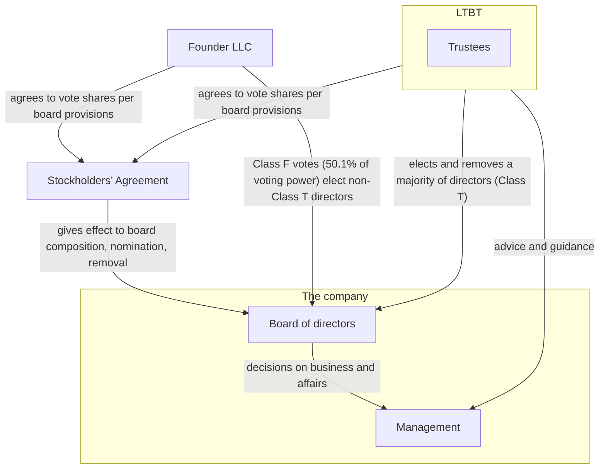

# Prospectus Summary

This summary highlights selected information that is presented in greater detail elsewhere in this prospectus. This summary does not contain all of the information you should consider before investing in our Class A common stock. You should read this entire prospectus carefully, including the sections titled “Risk Factors,” “Special Note Regarding Forward-looking Statements,” “Management’s Discussion and Analysis of Financial Condition and Results of Operations,” “Business,” and “Our Governance Structure and Its Goals,” as well as our consolidated financial statements and the related notes included elsewhere in this prospectus, before making an investment decision. Unless the context otherwise requires, the terms “Anthropic,” “the company,” “we,” “us,” and “our” in this prospectus refer to Anthropic, PBC and its consolidated subsidiaries, and references to our “common stock” refer to our Class A common stock, Class N common stock, and Class F common stock (and, where the context requires, our Class T common stock and our Class E common stock).

## Overview

For the first time in history, intelligence is something humans can build. The cognitive capability to reason, analyze, synthesize, decide, and create is producible at scale and accessible on demand. We believe this abundance of AI will rapidly transform every sector of the global economy in ways greater than the impact of industrialization, electricity, semiconductors, and the internet. AI that truly delivers on its potential—with the risks well managed—could significantly accelerate global growth and dramatically improve quality of life for people around the world.

Anthropic was founded in 2021 by a team of researchers responsible for many of the breakthroughs that define AI. We are first and foremost a research lab—our mission is the responsible development and maintenance of advanced AI for the long-term benefit of humanity. This mission directs our focus—along with our talent and culture, our frontier and safety research, our approach to compute, and our enterprise strategy, it is one of the core advantages that set us apart. These advantages enable us to continuously advance frontier AI and shape the standards for its safe and responsible development. Our frontier AI, Claude, is delivered to customers through our models, platform, and applications. Claude has experienced the fastest enterprise adoption of any technology in history, as demonstrated by revenue growing from $0 at commercial launch in the first quarter of 2023 to $ for the three months ended September 30, 2026. This rapid and growing adoption generates two self-reinforcing dynamics—an improvement loop that advances Claude and an investment loop that helps fund our continued research in frontier AI.

### Our Core Advantages

Mission & Focus. All of our efforts are guided by a singular focus on our mission. This focus enables us to

concentrate talent, research, and compute investment on the highest-value work for humanity and to avoid conflicting priorities. Achieving our mission means the world gains the enormous benefits of frontier AI while mitigating the most significant risks, and we believe this requires safety and capability to advance together.

Talent & Culture. Our mission and focus enable us to attract and retain world-class talent, including

researchers and engineers who want their work to shape a better future. We also have a culture that promotes a low-ego, truth-seeking environment, where frontier AI capability and safety are mutually reinforcing. We believe our culture has driven our talent density as we have scaled.

Frontier & Safety Research. We believe that sustained, focused research at the frontier of intelligence is

required to build the most capable and safest AI systems. Our frontier capabilities and safety research are deeply integrated and directly shape model design, training, and deployment, helping us produce systems that are more reliable, steerable, and well-suited for real-world deployment, particularly in demanding enterprise environments. We translate our research leadership into innovation velocity, and have consistently released better models, platform capabilities, and applications. Each version of a Claude model assists in building the next, helping to compress development timelines and produce compounding improvements in the speed at which we innovate. We refer to this recursive dynamic as “closing the loop,” and we believe it is one of the most significant structural advantages in frontier AI.

6

Our Approach to Compute. We manage compute as a single, fungible pool from multiple strategic partners, and

we dynamically direct available compute between workloads based on where the marginal unit is expected to be most productive at any given time. We believe that this approach to compute enables us to deliver superior models, serve more customers, and achieve greater productivity from our compute investment. This compute efficiency creates the foundation for us to advance the frontier of AI capabilities through research and model development, meet growing demand from customers, and provide for internal usage of Claude. We have achieved this through our research breakthroughs and our multi-chip compute architecture across AWS Trainium, Google TPUs, NVIDIA GPUs, and AMD GPUs, enabling us to orchestrate workloads to optimize for price and performance. To support our research, model development, customer demand, and internal usage of Claude, we continue to invest at scale. As of and subsequent to September 30, 2026, we have entered into purchase commitments and lease agreements, including short-term commitments, as well as leases not yet commenced, with an aggregate committed spend of more than $ , substantially all of which is related to compute and infrastructure. These commitments include approximately $ expected to be incurred before December 31, 2030, and substantially all of the remainder is expected to be incurred between 2031 and 2045. Approximately $ of these commitments are due in the next 12 months. See the section titled “Management’s Discussion and Analysis of Financial Condition and Results of Operations—Liquidity and Capital Resources—Contractual Obligations” for more information.

Enterprise Strategy. Our enterprise strategy is built on the belief that frontier AI is most valuable in real-world

settings, as deployment across enterprises is where economic impact is greatest and where the improvement loops from customer feedback are richest. Accordingly, we have organized our research priorities, our product roadmap, and our go-to-market and Applied AI teams around enterprise use cases, which range from routine knowledge work to the most complex problems. The customer feedback we gather directs our research focus and makes Claude more capable over time. This broadens where Claude can be deployed and further expands enterprise adoption, which helps ensure that the benefits of our AI reach people and organizations at scale.

### AI is Transforming Intelligence

We believe that Powerful AI, a highly capable and impactful form of frontier AI characterized by the following key attributes, will become widely available within a few years:

•cognitive capabilities matching or exceeding those of top human experts across most professional and

scientific disciplines;

•the ability to navigate all interfaces available to a human working virtually, including text, audio, video,

and direct computer control;

•the ability to reason through complex tasks autonomously over extended periods—lasting hours, days,

or weeks—and seek clarification and feedback when needed;

•the ability to coordinate across multiple instances and collaborate with both humans and other AI

systems; and

•the ability to interface with the physical world by digitally controlling laboratory equipment, robotic

systems, and other machines through digital connections.

If Powerful AI is directed at solving humanity’s hardest problems and the risks are managed responsibly, the potential is extraordinary. The possibilities include compressing decades of scientific progress into years; accelerating drug discovery, disease detection, and the delivery of personalized therapy; providing individually tailored education and expert financial and legal advice; advancing power grids and battery design for greater efficiency and reliability; and extending to the developing world capabilities that took wealthy nations generations to build.

### A Near-Term Opportunity to Transform Cognitive Work

Frontier AI is transforming cognitive work—the application of knowledge, reasoning, and judgment to produce economic value. We believe it will make humans far more capable and expand the world’s overall capacity for that work, including accelerating scientific discovery and helping businesses grow. Knowledge workers are the leading edge of this opportunity. As frontier AI advances, more capable models can unlock entirely new use

1 See the section titled “Industry, Market, and Other Data” for a description of how we calculate annual economic value attributable

to knowledge workers globally.

2 IDC, The Economic Impact of AI: 2026 Edition, doc # US54452226, April 2026. Reflects the annual value created across AI

solutions and services, investments in the AI infrastructure supply chain, and enhancements in enterprise productivity and efficiency unlocked by AI.

3 IQVIA Institute for Human Data Science, Global Medicine Use Trends 2026, February 2026.

7

cases while also efficiently serving a wide range of cognitive work at scale across the capability-cost-speed curve. We believe the work that knowledge workers perform represented more than $40 trillion in economic value globally in 2025,1 and with frontier AI’s potential to make them meaningfully more productive, our near- term opportunity is to expand this value and accelerate economic growth. While it is still early to forecast frontier AI’s full impact across the economy, International Data Corporation (“IDC”) estimates that investment in AI solutions and services will yield a cumulative global economic impact of $22.5 trillion by 2031.2 We believe the impact could be even greater.

### Frontier AI May Reshape Entire Sectors and Accelerate Novel Discoveries

We believe frontier AI represents a larger opportunity than any prior technology cycle, and Claude is already demonstrating this potential. Claude can now execute complex projects autonomously and turn open-ended tasks into finished, high-quality deliverables. These capabilities enable it to transform the largest sectors of the economy, driving meaningful gains in productivity and output. Frontier AI’s capabilities may extend beyond current markets to open entirely new ones, reaching domains such as robotics, advanced manufacturing, and logistics, and accelerating progress in scientific research, including drug discovery and materials science. For example, in the life sciences sector, where annual global pharmaceutical spend is expected to exceed $2 trillion in 2026,3 Claude is used in drug discovery and development by our customers, our biotechnology partners, and our own researchers. We are also extending Claude into robotics, where our Model Hardware Standard enables AI agents to operate lab and manufacturing equipment such as microscopes, liquid handlers, and off-the-shelf robotic arms. Ultimately, we believe frontier AI will help drive global economic growth. As frontier AI makes workers and organizations more productive, becomes embedded in the products and services they deliver, and unlocks new business models, it creates economic output that did not previously exist. We believe our opportunity is to capture a share not only of today’s economic activity but also of that newly created output as the global economy expands.

### The Importance of Safety and Ethical Behavior

While the potential benefits of AI are extraordinary, its rapid advancement will impact the economy and society in ways that could create significant disruption, particularly if the technology is not developed and deployed responsibly. For example, bad actors have already conducted high-profile cyberattacks using AI’s capabilities to discover vulnerabilities, generate malware, and evade detection tools; other risks associated with misuse, including in the domain of biology, could result in even greater harm. AI deployed at scale also has the potential to concentrate power and wealth both within and between countries in ways that could erode trust, harm society, and destabilize the geopolitical order. Misaligned AI systems could corrupt institutional decision- making or cause large-scale harm through autonomous actions that are not visible or understandable to their users and operators. We believe that frontier AI companies must invest in safety and alignment to help ensure the responsible diffusion of this technology. We also believe that safety, alignment, and ethical behavior resonate particularly strongly with enterprises, where rigorous safeguards, predictable model behavior, and demonstrable accountability have become decisive criteria in selecting an AI partner for mission-critical workloads.

### Claude as a Virtual Collaborator

We believe we have reached an inflection point where AI systems can function as genuine collaborators in professional work. They quickly complete substantive tasks that might otherwise occupy a skilled professional for several hours, a full day, or longer. AI systems are also becoming increasingly capable of performing tasks that were previously too difficult or costly to complete or surfacing original insights and analyses. We refer to these AI systems that work alongside humans to perform complex, multi-step work at professional levels as Virtual Collaborators. Virtual Collaborators carry the access rights, system connections, and context that their organizations grant them, which allows them to function more accurately and reliably. They can navigate and use internal tools and execute workflows that span multiple steps that require sustained reasoning. Virtual

4 IDC, Worldwide Developer Population Growth Forecast, 2025–2029, doc # US53789825, September 2025.

8

Collaborators are AI designed to be embedded where work gets done, and our aim is to continue extending them to knowledge workers globally, a population that is estimated to exceed one billion in 2028.4

Claude Code. The clearest manifestation of Virtual Collaborators today is Claude Code, our coding agent and

the product we believe has most concretely defined what autonomous AI work looks like. Claude Code shifted the market’s understanding of what an AI system could do in collaboration with software developers: the model suggests the next line of code and goes further by planning, writing, testing, and debugging—a process that results in production-grade code. Within months of its release, autonomous coding became the reference point for measuring the progress of frontier AI. For enterprise AI use cases, we believe the launch of Claude Code was comparable in its impact to the introduction of the first widely adopted conversational AI assistants. What makes Claude Code a Virtual Collaborator is its sustained reasoning, a harness that translates intent into actions, an execution environment that maintains a persistent state whether on a developer’s machine or in a sandboxed cloud environment, integration with existing tools and systems, and a user-friendly interface. Its uses are highly varied and often surprising: for example, NASA engineers used Claude Code to plan and write navigation commands for the Mars Perseverance rover, resulting in the first AI-planned drive on Mars.

Software developers are powerful advocates for Claude—they understand how systems work, have credibility evaluating technical tools, and often serve as internal champions for adopting new technologies. Winning their trust creates a foundation for broader diffusion of Virtual Collaborators across enterprise workforces. We are already seeing this pattern play out with non-technical teams increasingly adopting Claude Code and Claude Cowork to manage their own workflows.

Claude Cowork. All digital work is ultimately an expression of code, and Claude’s mastery of it powers Virtual

Collaborators capable of handling complex work far beyond software development. Claude Cowork extends the same agentic architecture of Claude Code to knowledge workers broadly by translating a user’s intent into completed work, autonomously reading files, navigating applications, and executing multi-step workflows on a user’s desktop while the underlying code is abstracted away. By extending beyond Claude Code with applications purpose-built for specific professions and industry verticals, we accelerate Claude’s diffusion into new categories of knowledge work and deepen our presence across the enterprise. As of September 30, 2026, adoption of Claude Cowork, which we made available as a research preview in January 2026, outpaced the adoption Claude Code achieved at the equivalent point following its research preview release in February 2025. In September 2026, we began merging Claude Cowork and Claude.ai, bringing agentic and conversational work into a unified application. Users can now move from a simple question to complex, multi-step tasks in the same conversation.

Extending Virtual Collaborators. We believe the trajectory for Virtual Collaborators is clear and accelerating.

Each generation of Claude models has expanded along multiple dimensions: the depth and rigor of their reasoning, the duration and autonomy of the work they can sustain, the complexity of tasks they can complete, and the volume of useful output they can produce. Capability evaluations and benchmarking have shown substantial improvements across Claude model versions in the duration and complexity of tasks that can be

completed reliably, with more recent model versions demonstrating particularly significant advances.

We are building towards a world where Claude can be given open-ended tasks lasting hours, days, or weeks, and then execute them autonomously with the judgment and initiative of a brilliant colleague. Ultimately, millions of Virtual Collaborators can run in parallel, each working independently on unrelated problems or collaborating seamlessly to achieve a shared objective. The result is something without historical precedent: what we refer to as a country of geniuses in a data center, available to every organization and sector of the economy.

### Enterprise Adoption of Claude

The speed and depth of our enterprise customer adoption are powerful evidence of Claude’s position at the frontier of AI. Our customer base as of September 30, 2026 includes:

•More than 11,900 customers with $100,000 or more of revenue on a TTM basis;

•More than 1,900 customers with $1 million or more of revenue on a TTM basis; and

9

•Approximately 250 customers with $10 million or more of revenue on a TTM basis.

We believe customers choose Claude for a wide variety of use cases, from routine knowledge work to their most important problems. They come to us for access to frontier AI across our platform and applications that deliver real-world outcomes. We see this conviction in customer behavior: enterprises consistently utilize our latest and most capable models as soon as they are released, gravitating to the most advanced option for their highest- value work. Our customers see us as a long-term partner for the frontier capabilities we offer today, for the innovation they expect from us in the future, and for our ability to meet their needs across the capability-cost- speed curve.

Beyond our models, the Claude Platform provides primitives that enable customers to accelerate time-to-value and leverage Claude’s intelligence in a variety of use cases. These primitives are the same ones we use to build our own applications. Our applications, such as Claude Code and Claude Cowork, multiply the impact of employees. Over time, our applications have become more capable and are now frequently being used to conduct long-running autonomous work alongside employees. Improvements to our models, platform, and applications accrue to the benefit of our customers and drive continued adoption.

Our commitment to our mission instills confidence in our customers to choose Claude as a trusted partner. Our investments in research on AI alignment, interpretability, cybersecurity, and enterprise-grade controls aim to deliver the predictability and dependability that organizations need in customer-facing and regulated contexts. This trust means that enterprises can expand the scope of the work that they delegate to Claude, as well as the systems into which Claude is integrated. Enterprises are aligning their strategies around Claude with the confidence that we are building frontier AI that serves their needs in the long term.

Today, enterprises rely on Claude to reason, plan, and execute across complex workflows with a level of trustworthiness and judgment that we believe was not previously available from earlier generations of AI. Customers realize value from Claude in three primary ways: more productive employees, faster processes, and embedded intelligence in their products. As Claude’s capabilities grow, our customers benefit and often broaden their adoption of Claude in new workflows. This expanding role reflects a broader shift in how Claude is used inside the enterprise, from a tool that responds to discrete prompts to a Virtual Collaborator.

We drive the diffusion of Claude primarily by making it accessible across multiple product surfaces. For example:

•Claude Platform, our comprehensive agentic development environment, provides customers with

direct access to the primitives to build, deploy, and scale their own applications that leverage Claude’s capabilities within their own products and workflows.

•Claude Code, our coding agent, works alongside human software developers on end-to-end software

development: writing, planning, editing, testing, debugging, and committing code across production- scale codebases.

•Claude Cowork, our knowledge work agent, has computer use capability that enables it to work with

professionals on end-to-end business tasks: autonomously researching, drafting, analyzing, synthesizing, and executing other knowledge work.

Much of the diffusion of Claude has been organic. We amplify this with our go-to-market and Applied AI teams, which extend our reach by meeting customers where they are through distribution partnerships that place Claude inside customers’ existing technology stacks. For example, Claude is accessible on all three major cloud platforms—Amazon Web Services (“AWS”), Google Cloud Platform (“GCP”), and Microsoft Azure (“Azure”). We have a joint go-to-market approach with these CSPs through which we establish direct contractual relationships with our customers while paying a fee to each CSP. This structure allows us to foster stronger commercial alignment with these CSPs, avoid channel conflict, set pricing, and realize the financial benefits of ongoing compute efficiency improvements. Ecosystem partnerships also expand our reach, allowing customers to adopt Claude through SIs, such as Accenture, Deloitte, KPMG, and PwC, consultants, and data platforms, such as Salesforce and Snowflake. We recently launched an AI services company, Ode with Anthropic, in partnership with leading private equity firms to bring Claude’s capabilities to mid-sized companies across sectors, building solutions on the Claude Platform and supporting customers over the long term.

10

### Strengths of Our Financial Model

Building and scaling frontier AI is one of the most important and capital-intensive endeavors in history. Our financial model provides us with the following strengths that allow us to build and scale efficiently:

•Rapid Revenue Growth. Our enterprise strategy is designed to drive durable customer adoption by

embedding Claude directly into business-critical workflows and enabling the development of products built on Claude. We believe that enterprise customers achieve a compelling return on investment from Claude, as agentic workflows can drive both top-line growth and efficiency. This enables us to expand quickly with customers, as demonstrated by our Net Revenue Retention of approximately 900% as of September 30, 2026. Diffusion also accelerates as our models become more capable and efficient, allowing us to lower the cost per task for customers. For example, Claude Opus 5.5 reduced customer costs per task by approximately 40% compared to Claude Opus 5. Lower costs per task drive greater usage, which in turn drives broader diffusion of Claude. Our compute efficiency allows us to deliver these reductions while preserving our margins.

•Compute Efficiency. Our compute efficiency drives more intelligence from research and model

development, and we believe this approach can support more customer and internal usage of Claude for the same amount of compute compared to other approaches. Our compute efficiency is demonstrated by revenue that grew 1,368% year over year for the three months ended June 30, 2026 compared to compute and infrastructure expenses that grew 300% during the same period.

•Operating Efficiency. Our operating efficiency, derived from our high talent density, our efficient go-

to-market, and how extensively our teams leverage Claude in their work, enables us to scale with a smaller team relative to other large enterprise technology companies. Our operating efficiency is demonstrated by TTM revenue per employee of over $6.6 million as of September 30, 2026, compared to $1.4 million as of September 30, 2025.

The demonstrated growth, scale, and efficiency of our financial model help us to continue making significant long-term investments to build frontier AI responsibly. Our business trajectory and financial profile have enabled us to access capital and secure compute from investors and partners. As of June 30, 2026, we had raised an aggregate of $141.1 billion of capital and had cash and cash equivalents of $112.4 billion and short- term investments of $19.3 billion.

### Our Self-Reinforcing Loops

Our scale and growth create self-reinforcing loops that make Claude better over time and that we believe create durable competitive advantages.

•Improvement Loop. Enterprise deployments of Claude deepen our understanding of the hard

problems, edge cases, and domain-specific challenges that matter most to our customers. We improve our models, platform, and applications based on feedback from customers using our offerings in production across their businesses. These improvements result in wider deployments and adoption that fuel the next cycle of improvement.

•Investment Loop. Revenue from expanding enterprise adoption helps us to fund the compute,

research, and talent needed to improve Claude. Claude’s advancing capabilities expand the range of

11

tasks and workflows customers use Claude for, broadening our addressable market and driving deeper deployment, additional revenue, and continued reinvestment in Claude.


```figure skill: visual-explainer
<svg xmlns="http://www.w3.org/2000/svg" aria-label="In the Investment Loop, revenue from expanding enterprise adoption funds the compute, research and talent that improve Claude, which broadens the addressable market and drives deeper deployment and more revenue that is reinvested in Claude." role="img" viewBox="0 0 1100 340">
  <title>Revenue from adoption is reinvested to improve Claude, which drives more revenue</title>
  <defs>
    <marker id="ah" markerHeight="7" markerWidth="7" orient="auto-start-reverse" refX="9" refY="5" viewBox="0 0 10 10">
      <path d="M0,0 L10,5 L0,10 z" fill="#9aa3ad"/>
    </marker>
    <marker id="ahAccent" markerHeight="7" markerWidth="7" orient="auto-start-reverse" refX="9" refY="5" viewBox="0 0 10 10">
      <path d="M0,0 L10,5 L0,10 z" fill="#e08a3c"/>
    </marker>
  </defs>
  <style>
.bg { fill: #1e232b }
.box { fill: #2a3240; stroke: #5b8bd9; stroke-width: 2 }
.box.accent { stroke: #e08a3c }
.label { fill: #f2f4f7; font: 600 14px sans-serif }
.line { fill: #c4cad3; font: 12px sans-serif }
.head { fill: #f2f4f7; font: 600 17px sans-serif }
.arrow { stroke: #9aa3ad; stroke-width: 2; fill: none }
.loop { stroke: #e08a3c; stroke-width: 2; fill: none; stroke-dasharray: 8 6; animation: flow 1.6s linear infinite }
.loopText { fill: #e08a3c; font: 600 13px sans-serif }
@keyframes flow { to { stroke-dashoffset: -28 } }
@media (prefers-reduced-motion: reduce) { .loop { animation: none } }
</style>
  <rect class="bg" height="340" rx="12" width="1100" x="0" y="0"/>
  <text class="head" text-anchor="middle" x="550" y="36">Investment Loop</text>

  <g data-flow-step="1">
    <rect class="box" height="150" rx="10" width="190" x="15" y="60"/>
    <text class="label" x="30" y="88"><tspan x="30">Expanding enterprise</tspan><tspan dy="18" x="30">adoption</tspan></text>
    <text class="line" x="30" y="140"><tspan x="30">Revenue from expanding</tspan><tspan dy="18" x="30">enterprise adoption</tspan></text>
  </g>

  <g data-flow-step="2">
    <line class="arrow" marker-end="url(#ah)" x1="205" x2="228" y1="135" y2="135"/>
    <rect class="box" height="150" rx="10" width="190" x="230" y="60"/>
    <text class="label" x="245" y="88"><tspan x="245">Fund compute,</tspan><tspan dy="18" x="245">research, talent</tspan></text>
    <text class="line" x="245" y="140"><tspan x="245">helps us to fund the</tspan><tspan dy="18" x="245">compute, research, and</tspan><tspan dy="18" x="245">talent</tspan></text>
  </g>

  <g data-flow-step="3">
    <line class="arrow" marker-end="url(#ah)" x1="420" x2="443" y1="135" y2="135"/>
    <rect class="box" height="150" rx="10" width="190" x="445" y="60"/>
    <text class="label" x="460" y="88">Improve Claude</text>
    <text class="line" x="460" y="140"><tspan x="460">needed to improve Claude;</tspan><tspan dy="18" x="460">Claude’s advancing</tspan><tspan dy="18" x="460">capabilities</tspan></text>
  </g>

  <g data-flow-step="4">
    <line class="arrow" marker-end="url(#ah)" x1="635" x2="658" y1="135" y2="135"/>
    <rect class="box" height="150" rx="10" width="190" x="660" y="60"/>
    <text class="label" x="675" y="88"><tspan x="675">Broaden</tspan><tspan dy="18" x="675">addressable market</tspan></text>
    <text class="line" x="675" y="140"><tspan x="675">expand the range of</tspan><tspan dy="18" x="675">tasks and workflows</tspan><tspan dy="18" x="675">customers use Claude for</tspan></text>
  </g>

  <g data-flow-step="5">
    <line class="arrow" marker-end="url(#ah)" x1="850" x2="873" y1="135" y2="135"/>
    <rect class="box accent" height="150" rx="10" width="190" x="875" y="60"/>
    <text class="label" x="890" y="88"><tspan x="890">Deeper deployment,</tspan><tspan dy="18" x="890">more revenue</tspan></text>
    <text class="line" x="890" y="140"><tspan x="890">driving deeper</tspan><tspan dy="18" x="890">deployment, additional</tspan><tspan dy="18" x="890">revenue</tspan></text>
    <path class="loop" d="M970,210 L970,265 L110,265 L110,214" marker-end="url(#ahAccent)"/>
    <text class="loopText" text-anchor="middle" x="540" y="295">continued reinvestment in Claude</text>
  </g>
</svg>
```

#### Claude is Accelerating Our Ability to Close the Loop

Claude itself has become one of the most powerful drivers of our progress—each new version of a Claude model directly accelerates development of the next. Many aspects of the research, training, and testing of subsequent model generations now involve Claude, including running experiments, generating and processing training data, automating evaluations and safety audits, and writing and reviewing code. We refer to this recursive dynamic as “closing the loop.” A direct expression of this dynamic is our accelerating pace of producing compute multipliers. More capable models help our researchers discover these improvements faster; in turn, more powerful compute multipliers enable us to train even more capable models and deploy them more efficiently.

### Our Growth Strategy

We believe the diffusion of AI through the global economy represents one of the largest opportunities in history to improve how humans live and work, and it is just beginning. In our view, the world has only begun to use the capabilities of today’s frontier models, and the gap between what Claude can do and how broadly it is used represents one of our largest growth opportunities, alongside continued advances at the frontier. Claude’s capabilities have evolved significantly in recent years, and we expect they will continue advancing rapidly. This will lead not only to an expanding addressable market, but also to an expanding scope of impact on the world. We aim to ensure that impact is as positive as possible. Our core advantages, the speed and scale of enterprise adoption of Claude, and our unprecedented financial model enable us to continue investing aggressively to build an AI-enabled future that benefits humanity broadly. Elements of our growth strategy include:

•Talent and Culture. To recruit world-class researchers and engineers and retain exceptional people, we

intend to continue investing in our low-ego, high-impact, and mission-aligned culture that has driven our talent density as we have scaled.

•Compute. We intend to secure further compute beyond our existing commitments, expand our own

data center footprint to secure additional long-term compute, improve compute efficiency across our multi-chip compute architecture, and produce further algorithmic advances in model efficiency.

12

•Claude’s Intelligence, Capability, and Safety. We plan to continue advancing Claude’s core intelligence

and safety in tandem, expand the frontier of what AI systems can reliably do, and pioneer new ways AI can be applied across professional domains.

•Claude’s Accessibility. We plan to continue making Claude’s intelligence accessible across every surface

where work happens, including through our own platform and applications, through AWS, GCP, and Azure, and through embedding in enterprise applications.

•Claude’s Adoption. We intend to grow our direct go-to-market and Applied AI teams, deepen cloud

distribution partnerships, invest in brand and marketing, and expand our international presence to drive adoption of Claude as the trusted AI partner for organizations worldwide.

•Enter New Markets. We intend to extend frontier AI to accelerate novel discoveries, reaching domains

from healthcare and life sciences to robotics and physical work, where we believe compounding model capabilities can unlock transformative opportunities.

•Strategic Transactions and Partnerships. We intend to selectively pursue acquisitions, investments,

and strategic partnerships, including ecosystem partnerships with SIs, consultants, and data platforms, that accelerate our mission, expand our reach, and strengthen our competitive position.

### Our Commitment to Public Benefit

We founded Anthropic on the belief that the most transformative technology in human history demands an extraordinary level of responsibility, and that responsibility extends far beyond building safe systems. We intend to direct a meaningful portion of our resources toward ensuring that frontier AI is safe and its benefits are broadly distributed, which we refer to as our public benefit initiatives.

As part of these initiatives, we contributed 846,840,960 shares of our Class N common stock, representing 5% of our fully diluted shares as of June 30, 2026 (assuming full conversion of the Amazon Notes, as defined below), to Anthropic Public Benefit Fund, LLC (the “Anthropic Public Benefit Fund”), our wholly owned subsidiary dedicated to the Company Purpose (as defined below) (such issuance, the “Initial Public Benefit Issuance”). Our board of directors has also approved a framework under which it may, in its discretion, issue shares of our Class N common stock to the Anthropic Public Benefit Fund (or other designee) representing up to an additional 2% of our then-outstanding shares (plus any shares subject to options, restricted stock units, and other convertible securities and any shares held by the Anthropic Public Benefit Fund) each time our share price appreciates 50% above the prior share price milestone, beginning with our initial public offering price (the “Public Benefit Issuances”). In addition, our co-founders have each pledged to dedicate 80% of their personal equity in Anthropic to philanthropic causes. For additional information regarding these pledges, including related risks, see the section titled “Risk Factors—Risks Related to Ownership of our Class A Common Stock.” Separate from the co-founders’ pledges, we also maintain a donation matching program through which employees can pledge a meaningful portion of their equity awards toward charitable giving, which we match with shares of our Class N common stock.

## Our Governance Structure and Its Goals

Our novel capital and corporate governance structure has been carefully designed and differs significantly from that of other public companies. We strive to help bring humanity safely into an era where transformative AI exerts tremendous and potentially decisive influence over a broad range of human undertakings. Operating as a public benefit corporation (“PBC”) gives our board of directors the necessary latitude to balance the pecuniary interests of our stockholders, the best interests of those materially affected by our conduct, and the specific public benefit purpose that we promote. Our specific public benefit purpose is the responsible development and maintenance of advanced AI for the long-term benefit of humanity (the “Company Purpose”). In addition, a financially disinterested trust, which we refer to as the Long-Term Benefit Trust (the “LTBT”) and which generally has the power to elect and remove a majority of the authorized members of our board of directors, is designed to supply both the incentives and insights for striking this balance appropriately. We also believe that our seven co-founders are distinctly equipped to be stewards of our mission.

13

### Public Benefit Corporation Status

Consistent with our long-term commitment to AI safety and responsibility, we are incorporated as a PBC under Delaware law. PBCs are a class of corporations that are intended to produce a public benefit and operate in a responsible and sustainable manner. Under Delaware law, a PBC is required to identify in its certificate of incorporation the public benefit or benefits it will promote, and its directors have a duty to manage the affairs of the corporation in a manner that balances the pecuniary interests of the corporation’s stockholders, the best interests of those materially affected by the corporation’s conduct, and the specific public benefit purpose identified in the corporation’s certificate of incorporation. As provided in our amended and restated certificate of incorporation, the public benefit that we promote, which we must always consider in the management of our company, is the Company Purpose.

### Long-Term Benefit Trust

In 2023, we implemented an innovative governance structure featuring the LTBT, which is designed to ensure that we are managed in a manner that responsibly balances our tripartite goals as a PBC: the pecuniary interests of our stockholders, the best interests of those materially affected by our conduct, and the Company Purpose. The LTBT is intended to operate as an independent body of five financially disinterested voting trustees (“Trustees”) with expertise in AI safety, national security, public policy, and social enterprise. Through a special class of common stock, Class T common stock, the LTBT generally has the authority to elect and remove the Class T directors, who together will constitute a majority of the authorized members of our board of directors. Our Class T common stock does not otherwise have voting rights on matters submitted to stockholders generally.

### Founder Voting Structure

We believe that our seven co-founders, Dario Amodei, Daniela Amodei, Tom Brown, Jack Clark, Jared Kaplan, Sam McCandlish, and Christopher Olah, as a group, are distinctly equipped to be stewards of our mission. Immediately prior to the completion of this offering, we will issue a single share of Class F common stock, a special class of our common stock, to a limited liability company of which our seven co-founders will initially be the sole members (the “Founder LLC”).

Our Class F common stock will be entitled to an aggregate number of votes that equals 50.1% of the total voting power of our outstanding shares of capital stock with respect to matters submitted to stockholders generally, including the election of our directors other than the Class T directors.

### Board Governance

Decisions regarding our business and affairs are made by our board of directors. Immediately prior to the completion of this offering, we will enter into a stockholders’ agreement (the “Stockholders’ Agreement”) with the LTBT and the Founder LLC, under which they will agree to vote their shares and take other actions to give effect to the board composition, director nomination, and director removal provisions described in our governing documents. Collectively, the LTBT and the Founder LLC will have the ability to elect all members of our board of directors. Regardless of the class or classes of stock by which a director is elected, there is no limit to the number of terms a director may serve.

While the LTBT has significant influence over our board of directors through its ability to generally elect and remove a majority of the authorized members of our board of directors, neither the LTBT nor the Trustees have decision-making authority in the day-to-day management or strategy setting of the company. The LTBT’s role is to select directors who are well-equipped to make decisions in furtherance of the responsible balancing of the pecuniary interests of our stockholders, the best interests of those materially affected by our conduct, and the Company Purpose, and to support our management’s decision-making through advice and guidance.

The Founder LLC will also have significant influence over our business and affairs through its ability to vote our Class F common stock, which is entitled to an aggregate number of votes that equals 50.1% of the total voting power of our outstanding shares of capital stock with respect to matters submitted to stockholders generally, including the election of our directors other than the Class T directors.

14

See the sections titled “Risk Factors—Risks Related to our Governance Structure,” “Our Governance Structure and Its Goals,” “Management,” “Certain Relationships and Related Person Transactions,” and “Description of Capital Stock” for more information.

#### Architecture Diagram



These flows cross a boundary: the LTBT electing and removing a majority of directors (Class T), the Founder LLC's Class F votes electing the other directors, the Stockholders’ Agreement putting the board provisions into effect on the board, and the LTBT giving advice and guidance to management. The LTBT and the Trustees have no authority over day-to-day management or strategy.

### Controlled Company Status

We are considered a “controlled company” within the meaning of the Nasdaq Global Select Market corporate governance requirements because the LTBT, as the sole holder of our Class T common stock, generally has the power to elect a majority of the authorized members of our board of directors. As such, we are permitted to opt out of compliance with certain Nasdaq Global Select Market corporate governance requirements. Accordingly, if we elect not to comply with certain requirements, you will not have the same protections afforded to stockholders of companies that are subject to all of the Nasdaq Global Select Market corporate governance requirements. Although we qualify as a “controlled company,” we do not expect to rely on this exemption except with respect to our nominating and corporate governance committee (“NGC”), which will not consist entirely of independent directors. Our board of directors currently consists of a majority of independent directors and our audit and compensation committees currently consist entirely of independent directors. See the sections titled “Risk Factors—Risks Related to our Governance Structure—We are considered a “controlled company” within the meaning of the Nasdaq Global Select Market corporate governance requirements, and, as a result, we qualify for, and currently rely on, exemptions from certain corporate governance requirements,” “Our Governance Structure and Its Goals,” “Management,” and “Description of Capital Stock” for additional information.

15

## Our Capital Structure

The following table summarizes certain key terms of each class or series of our common stock that will be authorized following the completion of this offering:

|  |  |  |  |  |  |
| --- | --- | --- | --- | --- | --- |
| Category of Rights | Class A Common Stock | Class N Common Stock | Class T Common Stock | Class F Common Stock | Class E Common Stock |
| Votes per share | 1 | 0 | 1 | 50.1% of outstanding voting power on record date | 1 |
| Matters on which entitled to vote | All matters submitted to stockholders generally; election of non-Class T directors; certain amendments to the terms of the LTBT or the rights of our Class T common stock; redemption of our Class T common stock | Not entitled to vote except as required by law, in which case our Class N common stock will have one vote per share | Election of Class T directors, which constitute a majority of our board of directors; redemption of our Class E common stock; certain amendments to the rights of our Class F common stock | All matters submitted to stockholders generally; election of non-Class T directors; certain amendments to the terms of the LTBT or the rights of our Class T common stock; redemption of our Class T common stock; redemption of our Class E common stock | Nomination, change in designation, or removal of the Specified Class T Director (as defined below) (only if our NGC does not concur in the LTBT’s nomination, change in designation, or removal); certain amendments to the terms of the LTBT or the rights of our Class T common stock; redemption of our Class T common stock |
| Conversion rights | None | Converts into Class A common stock upon a sale or transfer to an unaffiliated third party | None | None | None |
| Transferability | Generally transferable | Generally transferable; converts to Class A common stock upon transfer as described above | Transferable only upon approval of persons comprising the Trust Amendment Threshold (as defined below) | Not transferable except in the case of a reorganization or redomiciliation of the Founder LLC that is approved by our board of directors and does not result in a change to the members of the Founder LLC | Not transferable |
| Dividend rights | Entitled to participate pro rata in dividends and distributions | Entitled to participate pro rata in dividends and distributions | None | None | None |
| Right to receive liquidation distributions | Entitled to participate pro rata in liquidation distributions | Entitled to participate pro rata in liquidation distributions | Entitled to par value per share | Entitled to par value per share | Entitled to par value per share |
| Redeemable by company | No | No | Redeemable by us for no consideration upon occurrence of certain events | Redeemable by us for no consideration upon occurrence of certain events | Redeemable by us for no consideration upon occurrence of certain events |

For more information about our capital structure, see the section titled “Description of Capital Stock.”

## Risk Factors Summary

Our business is subject to numerous risks and uncertainties, including those highlighted in the section titled “Risk Factors” immediately following this prospectus summary. These risks could adversely affect our business, financial condition, and results of operations, which could cause the market price of our Class A common stock

16

to decline and could result in a loss of all or part of your investment. Additional risks, beyond those summarized below or discussed elsewhere in this prospectus, may apply to our business, activities, or operations as currently conducted or as we may conduct them in the future and in the markets in which we operate or may in the future operate. These risks include the following:

•Our success depends in large part on our ability to continue to develop the most advanced and capable

AI models, and any failure to do so could adversely affect our business.

•If we are unable to secure adequate compute or if we fail to direct our compute effectively across our

workloads, we may be unable to train models that remain competitive with those of our competitors or adequately serve our customers.

•Constraints on the critical inputs supporting compute could limit our ability to secure adequate

compute.

•We are highly dependent on the continued service of our co-founders, senior management team, and

key technical employees, and the loss of any of these individuals may adversely affect our business, financial condition, and results of operations.

•Our company culture has contributed to our success and, if we cannot maintain this culture as we

grow, our business could be adversely affected.

•We face intense competition, and if we are unable to compete effectively, our business, financial

condition, and results of operations could be adversely affected.

•If the market for our models, platform, and applications develops more slowly than we expect or

declines, our growth may slow or stall, and our business, financial condition, and results of operations could be adversely affected.

•If the use of our AI models results in harm, whether through use by malicious actors or misuse by other

third parties, or if our model guardrails or safeguards fail to prevent such misuse, our reputation and brand, business, financial condition, and results of operations could be adversely affected.

•Our AI models may behave in unintended, misaligned, or autonomous ways, including by taking

harmful actions that no user or third party directed, which could adversely affect our reputation and brand, business, financial condition, and results of operations.

•We may be exposed to liability, litigation, and regulatory action arising from harms associated with our

AI models, and our contractual protections and insurance may be insufficient, any of which could adversely affect our business, financial condition, and results of operations.

•A substantial portion of our revenue and accounts receivable is driven by a limited number of

customers and distribution channels, and the loss of, or a significant reduction in, spend from one or more of our top customers or disruption through those channels could adversely affect our prospects, business, and financial condition.

•We have a limited operating history in an evolving and nascent industry, which makes it difficult to

evaluate our future prospects and may increase the risk that we will not be successful.

•We are at an early stage of our revenue growth, we have experienced rapid growth in recent periods,

and our historical growth rates are not indicative of future performance or our ability to sustain or forecast future revenue growth.

•Our business is subject to an evolving and uncertain regulatory and political environment, which could

increase our costs, restrict our operations, or adversely affect demand for our models, platform, and applications.

•Our reliance on a limited number of CSPs and suppliers, some of which have strategic and investment

relationships with us and are our customers, creates complex dynamics that could give rise to conflicts of interest and adversely affect our access to compute.

17

•Our capital stock structure features certain provisions that are novel or otherwise not common among

other corporations with multiple-class structures, and may effectively eliminate the ability of holders of our Class A common stock to influence important decisions, including a change in control.

•Our capital structure will concentrate voting power with the LTBT and the Founder LLC for the

foreseeable future and will result in the LTBT and the Founder LLC having voting power that is not derived from or proportionate to economic interests in our company.

•Our focus on the long-term best interests of our company as a PBC, and the duty of our directors to

balance the pecuniary interests of our stockholders, the best interests of those stakeholders materially affected by our conduct, and our Company Purpose, may conflict with short-, medium-, or long-term financial interests and business performance, which may negatively impact the value of our Class A common stock.

## Channels for Disclosure of Information

Investors, the media, and others should note that, following the completion of this offering, we intend to announce material information to the public through filings with the Securities and Exchange Commission (“SEC”), the investor relations page on our website (www.anthropic.com), blog posts on our website, press releases, public conference calls, public webcasts, our X accounts (@AnthropicAI and @ClaudeAI), our Instagram page (@claudeai), our Threads account (@claudeai), and our LinkedIn page (https:// www.linkedin.com/company/anthropicresearch/).

The information disclosed by the foregoing channels could be deemed to be material information. As such, following the completion of this offering, we encourage investors, the media, and others to follow the channels listed above and to review the information disclosed through such channels. We are not incorporating any of the information in such channels into this prospectus.

Any updates to the list of disclosure channels through which we will announce information will be posted on the investor relations page on our website.

## Corporate Information

We were incorporated as a Delaware PBC in January 2021. Our principal executive offices are located at 548 Market Street, PMB 90375, San Francisco, California 94104, and our telephone number is (415) 326-6303. Our website address is www.anthropic.com. Information contained on, or that can be accessed through, our website does not constitute part of this prospectus and references to our website address in this prospectus are inactive textual references only. You should not consider information contained on our website to be part of this prospectus or in deciding whether to purchase shares of our Class A common stock.

“Anthropic,” our logo, and our other registered or common law trademarks, service marks, or trade names appearing in this prospectus are the property of Anthropic, PBC. Other trademarks and trade names referred to in this prospectus are the property of their respective owners. Solely for convenience, trademarks and trade names referred to in this prospectus may appear without the ® or ™ symbols, but such references are not intended to indicate, in any way, that we will not assert, to the fullest extent under applicable law, our rights, or the rights of any applicable licensor, to these trademarks and trade names.

18

```flowui
component: Sources
```
