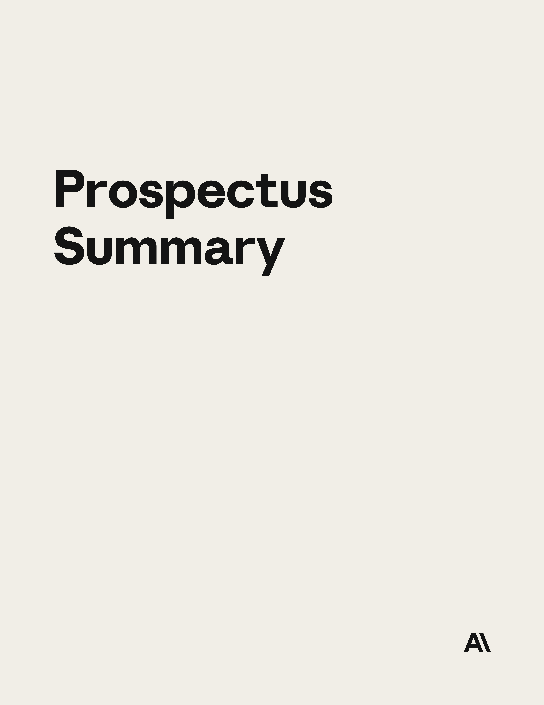

# Table of Contents

|  |
| --- |
|  |

Through and including (the 25th day after the date of this prospectus), all dealers effecting transactions in these securities, whether or not participating in this offering, may be required to deliver a prospectus. This is in addition to a dealer’s obligation to deliver a prospectus when acting as an underwriter and with respect to an unsold allotment or subscription.

|  |
| --- |
|  |

Neither we nor the selling stockholders, nor any of the underwriters, have authorized anyone to provide any information or to make any representations other than those contained in this prospectus or in any free writing prospectuses prepared by or on behalf of us to which we may have referred you in connection with this offering. Neither we nor the selling stockholders, nor any of the underwriters, take responsibility for, or can provide any assurance as to the reliability of, any other information that others may give you. This prospectus is an offer to sell only the shares offered hereby, but only under circumstances and in jurisdictions where it is lawful to do so. The information contained in this prospectus is current only as of its date, regardless of the time of delivery of this prospectus or of any sale of our Class A common stock. Our business, financial condition, results of operations, and prospects may have changed since such date.

For investors outside the United States: This offering includes public offerings in Australia, Canada, certain member states of the European Economic Area, Japan, Switzerland, and the United Kingdom. We do not currently intend to list our Class A common stock on any exchange in such jurisdictions. Neither we nor the selling stockholders, nor any of the underwriters, have done anything that would permit this offering or possession or distribution of this prospectus in any jurisdiction where action for that purpose is required, other than in the United States and the jurisdictions listed above. Persons outside the United States who come into possession of this prospectus must inform themselves about, and observe any restrictions relating to, the offering of the shares of our Class A common stock and the distribution of this prospectus outside the United States.

1

# Select Defined Terms

The following are abbreviations, acronyms, and definitions of certain terms used in this prospectus:

“agent loop” refers to the iterative cycle in which an AI agent receives a task, takes an action, such as planning

a project, running code, or calling a tool, observes the result, and decides its next step, with this cycle repeating until the task is complete. The agent loop is the core execution pattern underlying agentic AI behavior.

“agentic AI” refers to AI systems that, with varying degrees of autonomy, can plan, determine, and sequence

actions and execute them to accomplish defined objectives, including through interaction with external tools, services, datasets, and environments on behalf of a user.

“AI” refers to artificial intelligence, a machine-based system that learns or is trained from data and, for explicit

or implicit objectives and with varying levels of autonomy, processes that data to infer patterns, generate outputs—such as predictions, content, recommendations, and decisions—and act upon physical or virtual environments.

“AI accelerators” refer to processors purpose-built or adapted for the large-scale computations required to

pre-train, post-train, refine, and run AI models. These processors are significantly more efficient and faster than general-purpose processors for AI workloads.

“API” refers to application programming interface, a standardized interface that allows external software to

access a system’s capabilities programmatically. AI model providers may offer APIs that allow software developers to send inputs to an AI model and receive outputs, enabling integration into the software developers’ products and workflows.

“Applied AI” refers to a discipline and organizational function focused on embedding AI capabilities directly

into production business environments to address specific customer requirements. Applied AI teams, which include forward-deployed engineers, work with enterprises to design and deploy custom solutions, specialized workflows, and domain-specific implementations tailored to a customer’s own systems and processes.

“closing the loop” refers to a development cycle in which successive versions of an AI model assist in building

the next, with the goal of compounding capability gains over time.

“compute” refers to the computational processing resources used to train and run AI models, including,

without limitation, specialized AI accelerators, memory, networking, storage, and power systems that are deployed in data centers or other physical computing environments.

“compute multipliers” refer to algorithmic and methodological improvements in training and inference that

increase the effective output of a given amount of compute.

“computer use” refers to an AI capability that allows a model to observe and interact with a graphical user

interface, such as clicking, typing, and navigating applications, similar to how a human operator would.

“Constitutional AI” refers to an approach to training AI models using a set of written principles, which we

refer to as Claude’s constitution, currently organized around four priorities: being broadly safe, broadly ethical, compliant with our guidelines, and genuinely helpful. Under Constitutional AI, our models evaluate, critique, and revise their own responses against these principles, enabling us to define and control model behavior through auditable principles, rather than relying solely on fixed rule-based instructions or human reviewers.

“context window” refers to the maximum amount of text, code, or other content, measured in tokens, that an

AI model can process in a given request, encompassing instructions, prior conversation history, user input, and the model’s output.

“CSP” refers to a cloud services provider, a technology company that owns and operates large-scale cloud

computing infrastructure and provides on-demand compute, storage, and networking. CSPs may also serve as distribution channels through which AI products and services are made available to customers. The largest

2

CSPs, sometimes referred to as hyperscalers, operate at global scale with significant infrastructure and market concentration.

“customer” refers to a prosumer or an organization that uses our models, platform, or applications.

“customers with $100,000 or more of revenue on a TTM basis,” “customers with $1 million or more of revenue on a TTM basis,” and “customers with $10 million or more of revenue on a TTM basis” each refer to customers contributing revenue equal to or greater than the applicable dollar amount

during the trailing twelve-month (“TTM”) period ending on the measurement date. For purposes of this metric, we define a customer as a distinct organization, identified by aggregating the accounts that we determine belong to the same organization based on internal records and available data. We do not separately define or internally track a category of “enterprise” customers, and our customers are not segmented or measured internally by reference to whether a given customer is an “enterprise.” Because spending $100,000 or more on our products is generally characteristic of organizational rather than individual usage, we use the number of and revenue from customers with $100,000 or more of revenue on a TTM basis as our measure of enterprise adoption and engagement with Claude throughout this prospectus, including in references to “enterprise customers” and “enterprise adoption.”

“frontier AI” refers to AI systems at the current leading edge of capability and safety, performing at or near

the highest levels of any existing system across a broad range of tasks.

“hallucinations” refer to outputs in which an AI model generates factually incorrect or fabricated information

with apparent confidence.

“inference” refers to the process by which a trained AI model processes an input and generates an output.

Inference occurs each time a user or agent interacts with an AI system.

“interleaved thinking” refers to a capability whereby an AI model interposes discrete reasoning steps

between successive tool calls within a single response, rather than confining its reasoning to a single planning phase at the outset.

“interpretability” refers to research into how and why AI models produce specific outputs, with the goal of

making model behavior more transparent and verifiable, especially in high-stakes applications.

“knowledge work” refers to complex cognitive work and related professional activities, including obtaining,

producing, analyzing, and communicating information through tasks such as coding, drafting analyses, synthesizing research, building financial models, and managing and automating documents and workflows.

“LLMs” refer to large language models, or AI models trained primarily on large datasets to understand and

generate natural language and computer code.

“mechanistic interpretability” refers to a subfield of interpretability research focused on reverse-

engineering the internal computations of neural networks. Rather than inferring model behavior from inputs and outputs alone, mechanistic interpretability seeks to identify the specific features and circuits within a model that give rise to its behavior with the goal of making model reasoning auditable at the mechanism level and detecting failure modes, including deceptive or unsafe behavior, that may not surface in standard testing.

“model weights” refer to the numerical parameters encoding a trained AI model’s behavior, which are the

primary intellectual asset of a frontier AI developer, representing the accumulated investment in compute, data, and research.

“multi-agent orchestration” refers to an architecture in which multiple AI agents collaborate on a shared

task, with one coordinating while others execute subtasks in parallel, enabling more complex, long-horizon work than a single agent can complete alone.

“Net Revenue Retention” reflects customer expansion, contraction, and churn as of a measurement date.

We calculate Net Revenue Retention by dividing the Qualified Customers’ Current Period revenue by their Base Period revenue. A Qualified Customer is a customer with at least $1 of revenue during the Base Period, excluding subscribers to our Claude Pro and Max plans, whose fixed-price subscriptions do not reflect the

3

expansion and contraction behavior this metric is intended to capture. The Base Period is the three months ending a year prior to the measurement date. The Current Period is the three months ending as of the measurement date.

“open-weight” refers to an AI model whose trained model weights, or the numerical parameters encoding the

model’s learned behavior, are publicly released, allowing third parties to download, run, and modify the model, subject to the terms of the model’s license, without necessarily providing access to the underlying training data or code.

“pay-for-intelligence” or “consumption” refers to our revenue model under which customers pay for their

usage of our intelligence service, which is metered in tokens and priced according to the model selected.

“persistent,” in the context of AI applications, refers to denoting data, state, or context that is continuously

retained beyond the boundary of a single operation, session, or interaction, remaining accessible for reuse across subsequent steps, sessions, or workflows without requiring reinitialization.

“post-training” refers to the collection of techniques applied to a pre-trained model to refine its behavior,

including reinforcement learning, supervised refinement methods, and other alignment methods. Post-training is the stage in which much of the work to make a frontier model helpful, accurate, and safe is performed, including the application of safety and alignment techniques.

“pre-training” refers to the initial stage of training an AI model, in which the model learns general patterns

and representations from large-scale datasets of text, code, and other data, typically by predicting the next token in a sequence. The output of pre-training is a base model with broad capabilities that has not yet been adapted for any specific deployment context.

“primitives” refer to the foundational, modular building blocks of a software system from which more

complex applications and workflows are constructed.

“prompt injection” refers to an adversarial technique in which malicious instructions are embedded in

content an AI model is asked to process, such as websites, documents, or tool outputs, with the aim of overriding or manipulating the model’s intended behavior, typically without the user’s knowledge.

“prosumers” refer to individual users who subscribe to AI tools to perform knowledge work.

“reinforcement learning” refers to a machine learning approach in which a model learns to perform a task

by taking actions, receiving feedback signals called rewards, and adjusting its behavior to maximize the rewards it accrues over time. In contemporary AI development, reinforcement learning is widely used to refine model behavior after pre-training, including to improve helpfulness, accuracy, and adherence to safety guidelines.

“RLHF” refers to reinforcement learning from human feedback, a specific form of reinforcement learning in

which human evaluators rate the model’s responses, and those ratings are used as the reward signal to guide training.

“Run-Rate Revenue” is an operating metric that refers to the estimated annualized value of our revenue-

generating activity as of a measurement date, calculated as the sum of (i) our consumption-based fees during the trailing 28-day period ended on the measurement date, multiplied by 13, and (ii) our aggregate monthly subscription fees as of the measurement date, multiplied by 12. For purposes of calculating Run-Rate Revenue, consumption-based fees and subscription-based fees are derived from customer usage and active subscriptions.

“SIs” refer to systems integrators, or third-party technology and professional services firms that design, build,

and deploy integrated solutions for customers by combining products and services from multiple technology vendors into unified systems tailored to customer needs.

“tokens” refer to numeric units into which an AI model converts the data it processes, including text, images,

audio, and video, the number of which varies by the model and tokenizer applied. Tokens are the smallest individual units of a language model and can correspond to words, subwords, characters, or bytes. A tokenizer is the component of a model that converts customer inputs into the sequence of tokens the model processes and then converts the processed tokens into the outputs provided to customers.



5

```flowui
component: Sources
```
