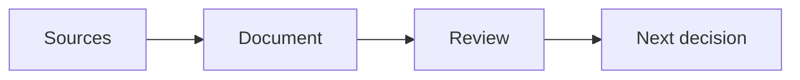

# Using Flow

## Read, work and keep the result

Flow stores your documents as Markdown in folders you choose. Ordinary text, lists, tables, links and images remain readable elsewhere. Flow’s chart, diagram and living-data blocks stay in the file too; other readers may show those blocks as source unless they support them.

| Your task | Use in Flow |
| --- | --- |
| Change a business record or simple setting | Table editor on the named input table |
| Compare sources and a draft | Two panes |
| Find a passage | Search, including available related matches |
| Improve or summarise a document | Agency, then inspect the proposed changes |
| Maintain recurring source data | Saved Jobs and a Gather definition |
| Inspect how a calculation works | Edit Definition and its intermediate results |
| Understand a change | Review Changes and History |

## New from Web Page

**＋ ▸ New from Web Page…** (or File ▸ New from Web Page…) brings a page on the web into the current folder as a document. Type its address and press **Read Page**: Flow reads the page and shows it as the document it will be, with a line saying what came in (words, headings, tables, code, callouts, pictures) and what was left out (the site's navigation, footers, sign-up forms and link panels). Nothing is written until you press **Add**. Pictures land in the folder's `assets/`; the front matter names the page (`source:`), when it was read, and its author and licence when the page states them; and a Sources block closes the document.

**Keep it updated** decides what happens next:

- **Follow the source** (the default) adds a `follow-source` Job. Each Jobs run reads the page again; a change where you have not edited comes in as a change you keep or revert, and a change where you have edited is listed in the morning with both texts, never written over yours.
- **Check when I ask** follows only when you run the document's Jobs.
- **Snapshot** reads the page once.

A page drawn by its own scripts may read empty when fetched; open it in a tab and press **Save as Document**, which uses the page as the tab has drawn it. Flow honours a site's robots.txt, sends no cookies, never runs the page's scripts, and follows only `https` pages on the web, never one on your own network.

### A whole work from its contents page

When the page you read is the contents page of a book or a set of documentation, the task says so (*This page lists 14 pages of one work*) and offers **Bring In All 14…**. The list shows each page with its number and title, under the work's parts when it has them, ticked; a page whose address a document in the destination already follows reads *Already here* and is not read again. **Read Pages** reads the ticked pages one at a time, on the same site only, with **Stop** beside the progress; then one line states the total and names any page not brought in. **In a new folder**, named for the work, is on by default. **Add** writes every page with its place (`order:`, and `part:` when the work has parts) and a `README.md` that lists them with links to the files, then opens the README. The sidebar and Publish list such a folder README first, then in the author's order. **Just This Page** goes back to importing the one page.

### Before you rely on an import

Anything you bring in, from a web page, Word, Excel, PowerPoint or a PDF, gets a checklist in the Workbench's **Sources** tab: whether the source states a licence, whom to credit, what was left out, pictures without a description, links that leave the folder, tables to compare with the source, and whether the document follows its page. Each item says its evidence in one sentence, and the checkbox is yours: the ribbon shows *Imported · 3 to check* until every item is settled, and the list then folds to one line. An item opens again if its evidence changes, for instance when a follow brings in a picture without a description. **Walk Through with Chat** takes the open items one at a time; Chat may read the source again and propose a fix for you to keep or revert in Review, and it never ticks an item for you. The checklist lives beside the document, never in it, so it is not published.

## Plain text, with structure

Write *emphasis*, **strong text**, `inline code`, and [web links](https://orionfold.com/flow/). Use headings to give a reader a route through the work.

- [ ] A question still open
- [x] A completed task

> Preserve the source’s wording when quoting, and distinguish it from your interpretation.

A footnote can carry a method or limitation.[^method]

[^method]: This is a formatting example, not a research source.

---

## Tables, charts and diagrams

Use a table’s **Open in the table editor** control to work with its rows and columns. **View ▸ Edit Table** opens the document’s first table. The Guide’s input pages name the table to change; their living reports show the results. A chart fence keeps its data, chart type and encodings as readable text. [[Charts Gallery]] offers linked categories and a working example with two views of the same editable table.



Flow binds charts and tables to local files. A Gather definition can filter, join, calculate and aggregate those rows before the document redraws. A changing chart does not automatically validate the authored conclusion around it.

## Search

Search finds words across every open folder, and the sidebar's **Best** results add **Related matches** beside them. Today Related matches use Apple's on-device sentence model: they never leave this Mac, they match at the scale of a sentence rather than a page, and they are not available in every language. When they are not there, the results say why.

## Ask your folder in Chat

Chat answers from the folder it works in, the nearest folder above your document that has a README. Before each reply Flow searches that folder for the words of your message and gives the model up to six passages, with the file each came from. The reply links each fact to its file, and a **From this folder** row under it lists those files; a click opens one. When the folder does not say, Chat says so rather than answering from memory. The web joins only when you ask Chat to search it.

An empty Chat reads *Answers from* the folder's title, with how many documents it holds. A folder describes itself in its README's front matter, which GitHub and every Markdown app read too:

```yaml
title: The Pricing Playbook
author: A. Writer
version: 2.1
license: CC-BY-4.0
summary: How we price, from plans to renewals
questions: [How do we price a new plan?, Who approves a discount?]
```

Every key is optional. Up to six `questions` are kept, and the empty Chat offers the first four as buttons under *Ask* and the title. The reading order is not written here; it stays each document's `order:`. A folder whose README has no title or questions gets a **Describe this folder** button in Chat, which proposes these keys from what the folder's pages say; the change waits in Review Changes like any Chat edit, and the rest of the README is left as it was.

## Share a folder through GitHub

A folder can travel with its updates. **File ▸ New from GitHub…** (or **＋ ▸ New from GitHub…**) brings in a folder someone has put on GitHub: paste its address, the repository or one folder in it such as `github.com/owner/repository/tree/main/folder`, and press **Read Folder**. Flow lists the folder and shows what you are about to bring in: how many files and how large, the version, and the licence its README or licence file states. Nothing is written until you press **Add**, and the new folder opens on its README. Hidden files and links are left out, and nothing in the folder ever runs.

The folder remembers where it came from. Right-click it in the sidebar and choose **Check for Updates…**: Flow asks GitHub for the newer version and lists what changed, document by document. A document you have not touched is replaced, a new one is added, and one you have edited is replaced only if you tick it after comparing. When your edits and the author's are in different parts, the row reads *Keeps your edits* and the update adds theirs to yours. Flow never checks on its own, and a folder brought in from an address that names one exact version stays at that version.

To share a folder, choose **Publish Folder…** and the **GitHub Repository** row. Flow sends the folder's documents and pictures to the repository you name as one version, with the GitHub token the Publish task keeps in your Keychain, and creates the repository, public, when it is not there. Publishing again sends only what changed. Flow will not publish over a repository someone else has changed since your last publish, or one that already holds files Flow did not put there. Anyone can then bring your folder in with **New from GitHub…** and its address. The Flow Guide arrives the same way: **Flow Guide Updates…** is this check on the Guide's own folder.

## Jobs and definitions have different jobs

| Editor | Question it answers |
| --- | --- |
| Table | Which business records or input values should change? |
| Jobs | What should this document do, and which source or definition should it use? |
| Definition | How should named inputs become a useful set of rows or values? |

A document can carry an acceptance checklist the reader ticks and signs: select the text that names what was delivered and choose **Agency ▸ Sign-off**; the proposal arrives in Review Changes like any edit. Pressing **Sign off** on the card shows what Flow will record, then writes one signed record beside the document, never into it. The card's **⊟** opens the component editor, where you add items and fields without touching the text; **Format ▸ Insert Component…** places a fresh checklist after the caret. [[Client Brief]] carries one. Every block Flow draws this way — a table, a chart, a diagram, a picture, a diff, a folder, a callout, side by side or under one title — is on [[Components]], each with the plain Markdown that does the same job.

On the main document, choose **File ▸ Edit Jobs…** to edit its Jobs. To inspect or edit a calculation, open the linked saved definition first, then choose **File ▸ Edit Definition…**. A definition belongs to the document/folder that carries it; it is not a global schema for all your work.

## Use the right model for the work

Settings ▸ Models shows local and cloud routes. A document action’s reasoning control (**Agency ▸ Reasoning for Next Action**) uses Recommended, On or Off when that route supports the choice. On Claude Opus 5.5, Opus 5 and Sonnet 5 the choice sets how hard the model thinks: Recommended picks a level for the action, On asks for more, and Off asks for the least the model allows. Opus 5.5 always thinks a little. Turning reasoning on can change time and resource use; inspect the output, not just the setting. Model Arena is a separate workspace with published evidence, not a live stream of your Mac’s telemetry.

## Keep the folder portable

Store essential images and sources inside the workspace. Use unique page names for local double-bracket links. To adapt a Guide example, copy the whole folder, add it to Flow, and follow its Make it yours section. [[Files Flow Writes]] names every file Flow adds beside your documents, and how to read each one without Flow.

Review the chosen sources and route before using private material. The examples do not send email, publish content or connect to a CRM, medical-record or procurement system.

## What leaves your Mac

Flow is built so that nothing has to leave this Mac, which makes the list of times it reaches the network short enough to print. As of Flow 1.7, this is all of it, and every line is something you started, can switch off, or whose outcome you control:

| When | Where | What is sent | Your switch |
| --- | --- | --- | --- |
| Flow looks for a new version: at launch, then at most once every six hours | orionfold.com | The request for the update list, carrying Flow's version and the updater's name, as any web request does | Flow ▸ Check for Updates… runs it by hand |
| You press Flow Guide Updates… | github.com (the Guide's public home) | A request for the Guide's list of documents, then only the documents you accept; no token | Only when you press it |
| You press Buy Flow Pro or Manage Plan… in Settings ▸ Billing | orionfold.supabase.co (Orionfold's billing service) | The plan and seat count you chose, or your licence file so the server can answer for it | Only when you press it |
| Once a day, when a night run finishes or when Flow opens after a night that did not run, and only for a day that has already ended | Orionfold's measurement service | Counts and settings for one finished day, including how often plan offers were seen and whether the payment page opened. No document content, names, paths or personal information, and nothing that identifies you or this Mac | Settings ▸ Observations ▸ What leaves this Mac; the same screen shows the exact bytes before they leave |
| You run a model through Ollama or LM Studio on this Mac | This Mac | Your prompt and the text you selected, when you approve a run | Settings ▸ Models ▸ On this Mac, one switch; a runtime pointed at another machine is refused |
| You add a cloud provider's key | That provider | Your prompt and the text you selected, when you approve a run; the meter shows it first | Settings ▸ Models ▸ Cloud, the key is the switch; remove the key and it is off |
| You refresh a provider's price list, or first set up OpenRouter | openrouter.ai | A request for public prices; nothing about you | Only when you ask |
| You import a model | huggingface.co | The download request for the model you chose | Only when you press it |
| You publish to GitHub Pages, or a folder to a GitHub repository | api.github.com (GitHub, under your own account) | The document's pages, pictures, charts and data, or the folder's own files, to the repository you named, with the token you gave; only what changed since last time | Only when you press it; Forget the token in the Publish task and it is off |
| A document embeds an image by web address | That address | The request for the image, when the document is shown | Write the image into the folder instead, and nothing is fetched |
| You open a web address in a pane | That address | What any browser sends to load a page | Only when you enter one |
| You bring in a folder with New from GitHub…, or press Check for Updates… on one | github.com (the folder's repository) | A request for the folder's list of files, then only the files that changed; nothing about you, and no token | Only when you press it; Flow never checks on its own |
| You read a page with New from Web Page, and on each Jobs run of a document that follows it | That page's site | The request for its robots.txt, the page and its pictures, naming Flow as the reader; no cookies | Only when you press Read Page; choose Snapshot, or remove the document's `follow-source` Job, and it is never read again |
| A run looks something up on the web, with web lookups on | The address the model chose | The request for that page, as any web request does, not your document, though the address is chosen from what it says | Settings ▸ Flow System ▸ Web Lookups, off until you turn it on |
| A run, a Job that names web among its sources, or a Chat message that asks searches the web, with web lookups on and a search provider chosen | The provider you chose: Exa (api.exa.ai), Tavily (api.tavily.com), or your own SearXNG server | A few words chosen from your document, or from your Chat message, as the search, with your key; Flow then fetches the pages it reads, as in the line above | Settings ▸ General ▸ Web Lookups ▸ Search provider, None until you choose one |

That is the whole list. As of Flow 1.7, Flow keeps no usage statistics, sends no crash reports, carries no analytics or advertising code, has no install identifier, and never checks a licence online to keep working. If a future Flow offers to share counts or crash reports with Orionfold, it will be a switch that starts off, and this table will list it beside the others.

Need to tell us about a problem? Help ▸ Copy Diagnostics… puts a short block on the clipboard: the Flow and macOS versions, the kind of Mac, which domains are on, and the last crash's summary if there is one, with no paths, titles, or names in it. You see the exact text before it is copied, and it goes nowhere until you paste it.

## Document properties travel with the file

```yaml
title: My working brief
tags: [review, weekly]
```

Frontmatter keeps document properties such as the title and tags, plus Flow’s saved Jobs and Definition configuration. Those declarations travel with the Markdown file. Business rows and simple business settings live in the input tables, so everyday changes do not require YAML editing. Use the existing title, tag, Jobs and Definition controls for the properties they support; Source remains available for advanced declarations. Flow does not yet have a general form for every custom property. [[Files Flow Writes]] lists every key Flow writes.

Keep the named heading and column names when replacing sample rows. Use Definition editing if you want to change what is read or calculated. Follow [[Night Shift Handbook]] for the complete refresh cycle.
