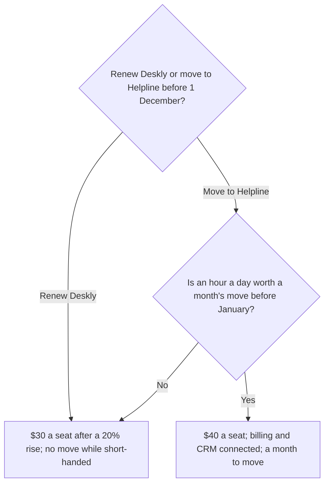

# Skills — Decide

[[Skills Gallery]] · Next: [[Skills — Plan]]

**Choose between things, and say why.** These five skills turn a discussion of choices into something a reader can decide from: a brief with a recommendation, options side by side, a weighted score, a value-and-effort map, and the value a change creates. Each section shows a short passage, then everything one run of the skill returned. The heading, the chart or diagram, and any table or form under it all come back together, as one change for your review. The passages and numbers are fictional teaching examples.

## Decision Brief

The decision, the options, a recommendation and its sources. Use it when a document is working towards a decision. **One run returns a short written brief with an options table and a decision tree.**

**What it read**

> Our support desk contract renews on 1 December. Deskly has been fine, but the price goes up 20%. Helpline would connect to billing as well as the CRM, which the support lead says would save an hour a day, but moving takes a month and the team is short-handed until January. Finance's quote puts Deskly at $30 a seat after the rise and Helpline at $40.

**What it drew**

### Decision

Do we renew Deskly before 1 December, or move to Helpline?

### Context

Deskly's price rises 20% at the 1 December renewal. The team is short-handed until January, which matters for any move.

### Options

| Option | What it means | For | Against |
| --- | --- | --- | --- |
| Renew Deskly | Stay at $30 a seat | No move while short-handed | Price up 20% |
| Move to Helpline | $40 a seat, a month to move | Connects to billing too; an hour a day saved | A month's move while short-handed |

### Decision tree



### Recommendation

No recommendation yet: the text weighs Helpline's hour a day against a month's move during a short-handed period without choosing. It turns on whether that hour a day is worth a month's move before January.

### Risks

- Renewing for a long term locks in the 20% rise.
- Moving now lands the month's work on a short-handed team.

### Sources

- Finance's quote for both desks.
- The support lead's estimate of an hour a day.

To run it on your own words, select a passage like this one, open **Elements**, and press **Decision Brief** under **Skills**.

## Option Comparison

Options side by side on the facts that tell them apart. Use it when a document is choosing between a few ways forward. **One run returns a table, and a chart when the options share one measure in one unit; otherwise it says why there is none.**

**What it read**

> For the new analytics stack we can build on our warehouse, which the data team prices at $120k in the first year and four months of work; rent a hosted product at $40k a year, live in three weeks, though our data then leaves our cloud; or keep the spreadsheets we have, which costs nothing new but cannot handle next year's volume.

**What it drew**

### The spreadsheets cost nothing new but cannot grow; renting is the cheapest change

| Option | First-year cost | Time to live | Data stays in our cloud |
| --- | --- | --- | --- |
| Build on the warehouse | $120k | Four months | Yes |
| Rent a hosted product | $40k | Three weeks | No |
| Keep the spreadsheets | Nothing new | Already live | Yes |

```chart
chartType: Bar Chart
title: Renting costs a third of building in the first year
source: The data team's pricing
data:
  - {option: Build on the warehouse, cost: 120000}
  - {option: Rent a hosted product, cost: 40000}
  - {option: Keep the spreadsheets, cost: 0}
encodings:
  x: {field: option}
  y: {field: cost}
```

Renting costs $80k less than building but the data leaves our cloud, and the spreadsheets, which cost nothing new, cannot handle next year's volume.

To run it on your own words, select a passage like this one, open **Elements**, and press **Option Comparison** under **Skills**.

## Scorecard

Each candidate scored against weighted criteria, then signed off. Use it when a document compares a few candidates against stated criteria. **One run returns a table and a sign-off form.**

**What it read**

> We shortlisted two support desks. Price matters most, then the integrations, then setup time. Helpline is $40 a seat and needs a month to set up, but connects to our CRM and billing. Deskly is $25 a seat and sets up in a week, though it only connects to the CRM.

**What it drew**

### Deskly leads on price and setup; Helpline on integrations

The text ranks the criteria, so the weights are rank-sum: price 3 parts, integrations 2, setup 1, of 6.

| Criterion | Weight | Helpline | Deskly |
| --- | ---: | ---: | ---: |
| Price | 50 | 2 | 4 |
| Integrations | 33 | 5 | 3 |
| Setup time | 17 | 2 | 5 |
| **Total** | 100 | **3.0** | **3.8** |

- Price: $40 a seat against $25.
- Integrations: Helpline connects to the CRM and billing; Deskly to the CRM only.
- Setup: a month against a week.

```flowui
component: Form
title: Scorecard sign-off · Support desk shortlist
subtitle: Confirm before the choice goes to purchasing
fields:
  - label: Confirmed
    bind: done
    type: checklist
    options:
      - The criteria match what we need
      - The weights follow our priorities
      - Each score has its reason
  - label: Signed by
    bind: signer
decision: {label: Sign off, action: sign-off}
```

To run it on your own words, select a passage like this one, open **Elements**, and press **Scorecard** under **Skills**.

## Opportunity Map

Initiatives placed by value and effort, with the case for each. Use it when a document lists options to prioritise. **One run returns a chart of value against effort and a table.**

**What it read**

> This quarter we could ship self-serve intake, which support says would remove a third of their tickets and takes one engineer two weeks. A billing rewrite would fix the invoicing errors finance complains about but needs three engineers for a quarter and a migration. A dark-mode theme is a common request with little revenue behind it; a designer estimates a week. Replatforming search onto a new engine would cut hosting cost slightly and take two months of the platform team.

**What it drew**

### One quick win leads the list

```chart
chartType: Scatter Plot
title: Self-serve intake is the clear quick win
source: Quarter planning notes
data:
  - {initiative: Self-serve intake, effort: 2, value: 8, quadrant: Quick win}
  - {initiative: Billing rewrite, effort: 9, value: 7, quadrant: Big bet}
  - {initiative: Dark mode, effort: 2, value: 3, quadrant: Fill-in}
  - {initiative: Search replatform, effort: 8, value: 3, quadrant: Reconsider}
semantic_types:
  effort: {semanticType: Score, intrinsicDomain: [1, 10]}
  value: {semanticType: Score, intrinsicDomain: [1, 10]}
encodings:
  x: {field: effort}
  y: {field: value}
  color: {field: quadrant}
```

| Initiative | Value | Effort | Quadrant | Why |
| --- | ---: | ---: | --- | --- |
| Self-serve intake | 8 | 2 | Quick win | Removes a third of support tickets for two engineer-weeks. |
| Billing rewrite | 7 | 9 | Big bet | Fixes finance's invoicing errors but takes three engineers a quarter and a migration. |
| Dark mode | 3 | 2 | Fill-in | Often asked for, little revenue, about a designer-week. |
| Search replatform | 3 | 8 | Reconsider | A slight hosting saving for two months of the platform team. |

To run it on your own words, select a passage like this one, open **Elements**, and press **Opportunity Map** under **Skills**.

## Value Model

The value a change creates, from its stated assumptions. Use it when a document argues that something is worth doing and gives numbers for it. **One run returns a table of its assumptions and a chart.**

**What it read**

> Support handles about 1,200 tickets a month. Their lead estimates self-serve intake would remove a third of them. Finance puts the loaded cost of a ticket at $18.

**What it drew**

### Self-serve intake saves about $86,400 a year

1,200 tickets a month × a third removed × $18 a ticket = $7,200 a month, or $86,400 a year.

| Assumption | Value | Unit | From |
| --- | ---: | --- | --- |
| Tickets a month | 1,200 | tickets | Support |
| Share removed | 1/3 | of tickets | Support's lead |
| Cost per ticket | 18 | $ | Finance |

```chart
chartType: Bar Chart
title: Self-serve intake removes a third of the yearly ticket cost
source: Support volume, the lead's estimate and finance's ticket cost
highlight: Saved
data:
  - {part: Ticket cost today, dollars: 259200}
  - {part: Saved, dollars: 86400}
  - {part: Remaining, dollars: 172800}
encodings:
  x: {field: part}
  y: {field: dollars}
```

To run it on your own words, select a passage like this one, open **Elements**, and press **Value Model** under **Skills**.

Back: [[Skills Gallery]] · Next: [[Skills — Plan]]
