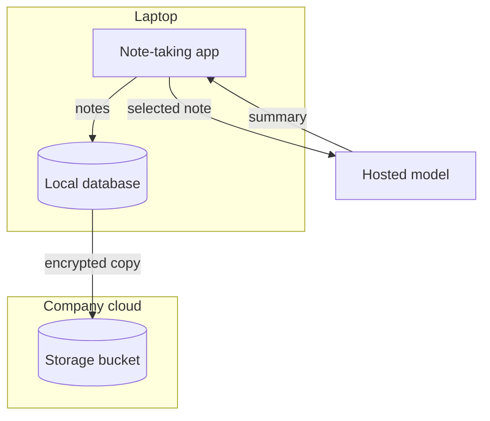
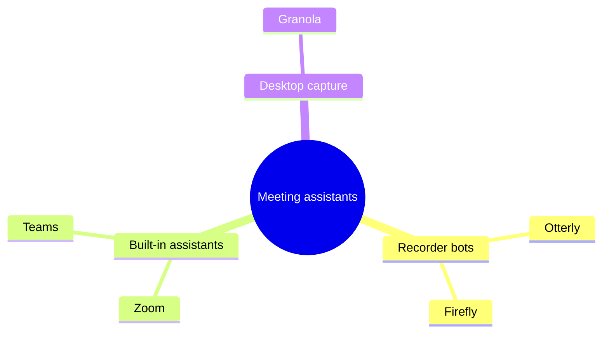

# Skills — Explain

[[Skills Gallery]] · Next: [[Skills — Living Example]]

**Show how something is built or works.** These six skills draw how a thing is put together or behaves. The last four draw figures you can press or step through, and an exercise a learner works through and signs. Each section shows a short passage, then everything one run of the skill returned. The heading, the chart or diagram, and any table or form under it all come back together, as one change for your review. The passages and numbers are fictional teaching examples.

## Architecture Diagram

The parts of a system, where they run, and what flows between. Use it when a document explains how a product, service or pipeline is put together. **One run returns only a diagram of the parts and their flows.**

**What it read**

> The note-taking app keeps every note in a local database on the laptop. When a person asks for a summary, the app sends the selected note to a hosted model and writes the summary back into the note. Sync sends encrypted copies of the database to the company's storage bucket in its own cloud account.

**What it drew**

### A note leaves the laptop twice: for a summary, and encrypted for sync



Crossing a boundary: the selected note to the hosted model, the summary back, and the encrypted copy to the company's bucket.

To run it on your own words, select a passage like this one, open **Elements**, and press **Architecture Diagram** under **Skills**.

## Landscape Map

Who is in a market or field, grouped, with each one's source. Use it when a document surveys a market, a field or a set of alternatives. **One run returns a mind map and a table.**

**What it read**

> Meeting assistants split three ways. Recorder bots such as Otterly and Firefly join the call as a participant (per each vendor's site). Built-in assistants come with the meeting tool itself: Zoom's and Teams' own (their 2026 release notes). Desktop capture tools such as Granola record from the laptop without joining the call.

**What it drew**

### Meeting assistants split three ways



| Player | Group | Defining fact | Source |
| --- | --- | --- | --- |
| Otterly | Recorder bots | Joins the call as a participant | The vendor's site |
| Firefly | Recorder bots | Joins the call as a participant | The vendor's site |
| Zoom | Built-in assistants | Comes with the meeting tool | 2026 release notes |
| Teams | Built-in assistants | Comes with the meeting tool | 2026 release notes |
| Granola | Desktop capture | Records from the laptop without joining | The text |

To run it on your own words, select a passage like this one, open **Elements**, and press **Landscape Map** under **Skills**.

## System Explainer

A system's parts, its flows, and what a failure changes. Use it when a document describes how components, teams or stages pass work to each other. **One run returns an animated visual you step through, with parts you can press.**

**What it read**

> Customers place orders on the storefront, which writes each order to the order queue. The fulfilment service takes orders from the queue, asks the inventory service to reserve the stock, then sends a pick request to the warehouse. The queue is the single point of failure: if it goes down, the storefront keeps taking orders but cannot hand them on, so they wait in its retry buffer and nothing reaches the warehouse until the queue recovers.

**What it drew**

```figure
<svg xmlns="http://www.w3.org/2000/svg" viewBox="0 0 680 300" role="img" aria-label="An order goes from the storefront to the order queue, then to fulfilment, which reserves stock with inventory and sends a pick request to the warehouse; if the queue goes down, orders wait in the storefront's retry buffer and nothing reaches the warehouse." data-flow-state="normal failed">
  <title>Orders reach the warehouse through one queue</title>
  <style>
    .part { fill: #ffffff; stroke: #8e8e93; stroke-width: 1.5 }
    .name { font: 600 14px system-ui, sans-serif; fill: #1d1d1f; text-anchor: middle }
    .label { font: 12px system-ui, sans-serif; fill: #3a3a3c; text-anchor: middle }
    .flow { fill: none; stroke: #0a7aff; stroke-width: 2.5 }
    .queue { cursor: pointer }
    .hint { font: 12px system-ui, sans-serif; fill: #6e6e73 }
    .note { font: 600 12px system-ui, sans-serif; fill: #d70015; visibility: hidden }
    .failed .queue rect { stroke: #d70015; stroke-width: 3; fill: #fff1f1 }
    .failed .depends { stroke: #d70015; stroke-dasharray: 5 4 }
    .failed .note { visibility: visible }
    .failed .hint { visibility: hidden }
  </style>
  <defs>
    <marker id="head" viewBox="0 0 10 10" refX="9" refY="5" markerWidth="6" markerHeight="6" orient="auto-start-reverse"><path d="M0 0 L10 5 L0 10 z" fill="#0a7aff"/></marker>
  </defs>
  <rect width="680" height="300" rx="14" fill="#f5f5f7"/>
  <rect class="part" x="20" y="50" width="120" height="56" rx="10"/>
  <text class="name" x="80" y="83">Storefront</text>
  <g class="queue" data-flow-press="state=failed" aria-label="The order queue: press to see it fail">
    <rect class="part" x="190" y="50" width="120" height="56" rx="10"/>
    <text class="name" x="250" y="83">Order queue</text>
  </g>
  <rect class="part" x="360" y="50" width="120" height="56" rx="10"/>
  <text class="name" x="420" y="83">Fulfilment</text>
  <rect class="part" x="360" y="190" width="120" height="56" rx="10"/>
  <text class="name" x="420" y="223">Inventory</text>
  <rect class="part" x="540" y="50" width="120" height="56" rx="10"/>
  <text class="name" x="600" y="83">Warehouse</text>
  <g data-flow-step="1">
    <line class="flow" x1="140" y1="78" x2="186" y2="78" marker-end="url(#head)"/>
    <text class="label" x="165" y="132">writes each order</text>
  </g>
  <g data-flow-step="2">
    <line class="flow depends" x1="310" y1="78" x2="356" y2="78" marker-end="url(#head)"/>
    <text class="label" x="335" y="40">takes orders</text>
  </g>
  <g data-flow-step="3">
    <line class="flow" x1="420" y1="106" x2="420" y2="186" marker-end="url(#head)"/>
    <text class="label" x="490" y="152">reserves the stock</text>
  </g>
  <g data-flow-step="4">
    <line class="flow depends" x1="480" y1="78" x2="536" y2="78" marker-end="url(#head)"/>
    <text class="label" x="510" y="40">sends a pick request</text>
  </g>
  <text class="hint" x="20" y="284">Press the order queue to see what happens when it goes down.</text>
  <text class="note" x="20" y="200">Orders wait in the storefront's retry buffer</text>
  <text class="note" x="20" y="284">Nothing reaches the warehouse until the queue recovers.</text>
</svg>
```

To run it on your own words, select a passage like this one, open **Elements**, and press **System Explainer** under **Skills**.

## Visual Explainer

One idea from the text, drawn so it builds step by step. Use it when a passage explains how something works and a reader would follow it faster as a picture. **One run returns an animated visual you step through.**

**What it read**

> When the app needs a product page it first asks the cache. If the cache has the page, it comes back in a few milliseconds. If not, that is a miss: the app reads the page from the database, which takes about 200 ms, stores it in the cache with a ten-minute expiry, and returns it. The next request for the same page is a hit.

**What it drew**

```figure
<svg xmlns="http://www.w3.org/2000/svg" viewBox="0 0 640 260" role="img" aria-label="The app asks the cache first; a miss reads the database, the page is stored in the cache for ten minutes, and the next request for it is a hit.">
  <title>A miss reads the database once, then the cache answers</title>
  <style>
    .box { fill: #ffffff; stroke: #8e8e93; stroke-width: 1.5 }
    .name { font: 600 15px system-ui, sans-serif; fill: #1d1d1f; text-anchor: middle }
    .label { font: 600 13px system-ui, sans-serif; fill: #1d1d1f }
    .line { font: 12px system-ui, sans-serif; fill: #6e6e73 }
    .flow { fill: none; stroke: #8e8e93; stroke-width: 2 }
    .hit { fill: none; stroke: #0a7aff; stroke-width: 3; stroke-dasharray: 6 4; animation: travel 1s linear infinite }
    @keyframes travel { to { stroke-dashoffset: -10 } }
  </style>
  <defs>
    <marker id="head" viewBox="0 0 10 10" refX="9" refY="5" markerWidth="7" markerHeight="7" orient="auto-start-reverse"><path d="M0 0 L10 5 L0 10 z" fill="#8e8e93"/></marker>
    <marker id="hit-head" viewBox="0 0 10 10" refX="9" refY="5" markerWidth="6" markerHeight="6" orient="auto-start-reverse"><path d="M0 0 L10 5 L0 10 z" fill="#0a7aff"/></marker>
  </defs>
  <rect width="640" height="260" rx="14" fill="#f5f5f7"/>
  <rect class="box" x="30" y="30" width="140" height="64" rx="10"/>
  <text class="name" x="100" y="67">App</text>
  <rect class="box" x="250" y="30" width="140" height="64" rx="10"/>
  <text class="name" x="320" y="67">Cache</text>
  <rect class="box" x="470" y="30" width="140" height="64" rx="10"/>
  <text class="name" x="540" y="67">Database</text>
  <g data-flow-step="1">
    <line class="flow" x1="170" y1="50" x2="246" y2="50" marker-end="url(#head)"/>
    <text class="label" x="30" y="150">1. Ask the cache first</text>
    <text class="line" x="30" y="168">It first asks the cache.</text>
  </g>
  <g data-flow-step="2">
    <path class="flow" d="M100 94 C100 122 540 122 540 98" marker-end="url(#head)"/>
    <text class="label" x="330" y="150">2. A miss reads the database</text>
    <text class="line" x="330" y="168">which takes about 200 ms</text>
  </g>
  <g data-flow-step="3">
    <line class="flow" x1="470" y1="62" x2="394" y2="62" marker-end="url(#head)"/>
    <text class="label" x="30" y="210">3. Stored in the cache</text>
    <text class="line" x="30" y="228">with a ten-minute expiry</text>
  </g>
  <g data-flow-step="4">
    <line class="hit" x1="170" y1="76" x2="244" y2="76" marker-end="url(#hit-head)"/>
    <text class="label" x="330" y="210">4. The next request is a hit</text>
    <text class="line" x="330" y="228">back in a few milliseconds</text>
  </g>
</svg>
```

To run it on your own words, select a passage like this one, open **Elements**, and press **Visual Explainer** under **Skills**.

## Isometric Figure

A layered stack in depth; press a layer to read what it does. Use it when a document describes something built in layers — a technology stack, an organisation's tiers, a product's levels. **One run returns an interactive visual: press a layer to lift it and read what it does.**

**What it read**

> Our product rests on three layers. At the bottom, the data platform stores every customer event and keeps it for two years. On top of it, the model layer turns those events into forecasts each night. The app layer, on top, shows each team its forecast and lets them adjust it.

**What it drew**

```figure
<svg xmlns="http://www.w3.org/2000/svg" viewBox="0 0 640 390" role="img" aria-label="Three layers: the data platform at the bottom stores every customer event, the model layer on it turns events into forecasts each night, and the app layer on top shows each team its forecast." data-flow-state="all data model app">
  <title>The product rests on three layers</title>
  <style>
    .slab { cursor: pointer; transition: transform 0.2s }
    .top { fill: #d6e6fb }
    .left { fill: #a9c8ef }
    .right { fill: #86afe3 }
    .slab path { stroke: #ffffff; stroke-width: 1 }
    .name { font: 600 13px system-ui, sans-serif; fill: #10324f; text-anchor: middle }
    .note { font: 13px system-ui, sans-serif; fill: #1d1d1f; visibility: hidden }
    .note-title { font-weight: 600 }
    .hint { font: 12px system-ui, sans-serif; fill: #6e6e73 }
    .data .slab-data, .model .slab-model, .app .slab-app { transform: translateY(-14px) }
    .data .slab-data .top, .model .slab-model .top, .app .slab-app .top { fill: #64a8ff }
    .data .note-data, .model .note-model, .app .note-app { visibility: visible }
    .data .hint, .model .hint, .app .hint { visibility: hidden }
  </style>
  <rect width="640" height="390" rx="14" fill="#f5f5f7"/>
  <g class="slab slab-data" data-flow-press="state=data" aria-label="The data platform">
    <path class="left" d="M60 280 L200 350 L200 372 L60 302 z"/>
    <path class="right" d="M200 350 L340 280 L340 302 L200 372 z"/>
    <path class="top" d="M200 210 l140 70 l-140 70 l-140 -70 z"/>
    <text class="name" x="200" y="322">Data platform</text>
  </g>
  <g class="slab slab-model" data-flow-press="state=model" aria-label="The model layer">
    <path class="left" d="M60 190 L200 260 L200 282 L60 212 z"/>
    <path class="right" d="M200 260 L340 190 L340 212 L200 282 z"/>
    <path class="top" d="M200 120 l140 70 l-140 70 l-140 -70 z"/>
    <text class="name" x="200" y="232">Model layer</text>
  </g>
  <g class="slab slab-app" data-flow-press="state=app" aria-label="The app layer">
    <path class="left" d="M60 100 L200 170 L200 192 L60 122 z"/>
    <path class="right" d="M200 170 L340 100 L340 122 L200 192 z"/>
    <path class="top" d="M200 30 l140 70 l-140 70 l-140 -70 z"/>
    <text class="name" x="200" y="142">App layer</text>
  </g>
  <text class="hint" x="380" y="200">Press a layer to read what it does.</text>
  <text class="note note-data" x="380" y="300"><tspan class="note-title">Data platform</tspan><tspan x="380" dy="20">Stores every customer event</tspan><tspan x="380" dy="18">and keeps it for two years.</tspan></text>
  <text class="note note-model" x="380" y="210"><tspan class="note-title">Model layer</tspan><tspan x="380" dy="20">Turns those events into</tspan><tspan x="380" dy="18">forecasts each night.</tspan></text>
  <text class="note note-app" x="380" y="120"><tspan class="note-title">App layer</tspan><tspan x="380" dy="20">Shows each team its forecast</tspan><tspan x="380" dy="18">and lets them adjust it.</tspan></text>
</svg>
```

To run it on your own words, select a passage like this one, open **Elements**, and press **Isometric Figure** under **Skills**.

## Guided Exercise

A passage turned into steps a learner works through and signs. Use it when a document teaches something a reader should try for themselves. **One run returns only a form a learner works through and signs.**

**What it read**

> A good problem statement names who has the problem, what they are trying to do, and what gets in the way — before it mentions any solution. Write it in one sentence, then test it by asking whether a customer would recognise it.

**What it drew**

### Try it: write a problem statement

Work through the prompts for a problem you are looking at now.

```flowui
component: Form
title: Exercise · Writing a problem statement
subtitle: For a problem you are working on now
fields:
  - {label: Who has the problem, bind: who}
  - {label: What they are trying to do, bind: goal}
  - {label: What gets in the way, bind: obstacle}
  - {label: Your problem statement in one sentence, bind: statement}
  - label: Check your statement
    bind: done
    type: checklist
    options:
      - It names who, what and the obstacle
      - It mentions no solution
      - A customer would recognise it
  - {label: Your name, bind: signer}
decision: {label: Sign off, action: sign-off}
```

To run it on your own words, select a passage like this one, open **Elements**, and press **Guided Exercise** under **Skills**.

Back: [[Skills Gallery]] · Next: [[Skills — Living Example]]
