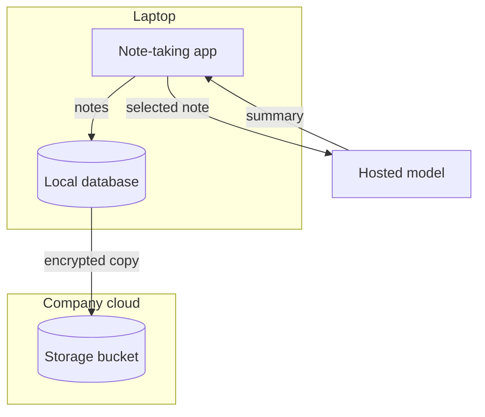
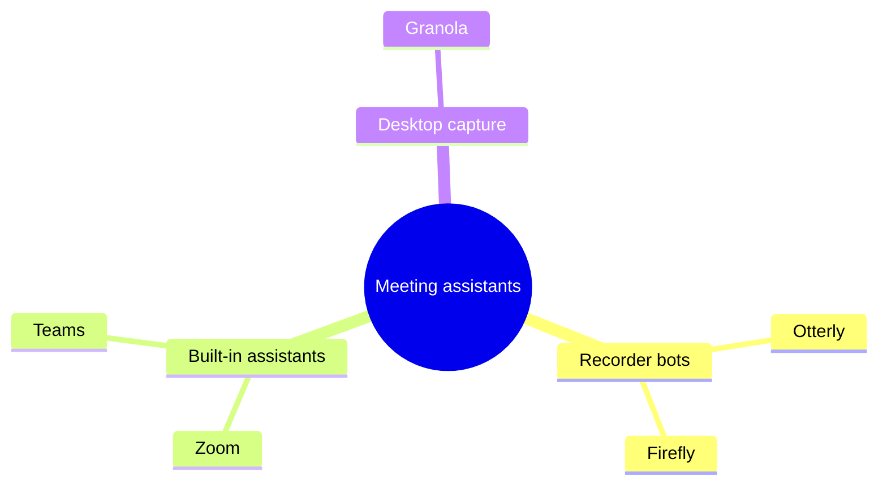

# Skills — Explain

[[Skills Gallery]] · Next: [[Skills — Present]]

**Show how something is built or works.** These seven skills draw how a thing is put together, behaves or measures up. The last five draw figures you can press or step through, and an exercise a learner works through and signs. Each section shows a short passage, then everything one run of the skill returned. The heading, the chart or diagram, and any table or form under it all come back together, as one change for your review. The passages and numbers are fictional teaching examples.

## Architecture Diagram

The parts of a system, where they run, and what flows between. Use it when a document explains how a product, service or pipeline is put together. **One run returns only a diagram of the parts and their flows.**

**What it read**

> The note-taking app keeps every note in a local database on the laptop. When a person asks for a summary, the app sends the selected note to a hosted model and writes the summary back into the note. Sync sends encrypted copies of the database to the company's storage bucket in its own cloud account.

**What it drew**

### A note leaves the laptop twice: for a summary, and encrypted for sync



Crossing a boundary: the selected note to the hosted model, the summary back, and the encrypted copy to the company's bucket.

To run it on your own words, select a passage like this one, open **Elements**, and press **Architecture Diagram** under **Skills**.

## Landscape Map

Who is in a market or field, grouped, with each one's source. Use it when a document surveys a market, a field or a set of alternatives. **One run returns a mind map and a table.**

**What it read**

> Meeting assistants split three ways. Recorder bots such as Otterly and Firefly join the call as a participant (per each vendor's site). Built-in assistants come with the meeting tool itself: Zoom's and Teams' own (their 2026 release notes). Desktop capture tools such as Granola record from the laptop without joining the call.

**What it drew**

### Meeting assistants split three ways



| Player | Group | Defining fact | Source |
| --- | --- | --- | --- |
| Otterly | Recorder bots | Joins the call as a participant | The vendor's site |
| Firefly | Recorder bots | Joins the call as a participant | The vendor's site |
| Zoom | Built-in assistants | Comes with the meeting tool | 2026 release notes |
| Teams | Built-in assistants | Comes with the meeting tool | 2026 release notes |
| Granola | Desktop capture | Records from the laptop without joining | The text |

To run it on your own words, select a passage like this one, open **Elements**, and press **Landscape Map** under **Skills**.

## System Explainer

A system's parts, its flows, and what a failure changes. Use it when a document describes how components, teams or stages pass work to each other. **One run returns an animated visual you step through, with parts you can press.**

**What it read**

> Customers place orders on the storefront, which writes each order to the order queue. The fulfilment service takes orders from the queue, asks the inventory service to reserve the stock, then sends a pick request to the warehouse. The queue is the single point of failure: if it goes down, the storefront keeps taking orders but cannot hand them on, so they wait in its retry buffer and nothing reaches the warehouse until the queue recovers.

**What it drew**

```figure
<svg xmlns="http://www.w3.org/2000/svg" viewBox="0 0 680 300" role="img" aria-label="An order goes from the storefront to the order queue, then to fulfilment, which reserves stock with inventory and sends a pick request to the warehouse; if the queue goes down, orders wait in the storefront's retry buffer and nothing reaches the warehouse." data-flow-state="normal failed">
  <title>Orders reach the warehouse through one queue</title>
  <style>
    .part { fill: #ffffff; stroke: #8e8e93; stroke-width: 1.5 }
    .name { font: 600 14px system-ui, sans-serif; fill: #1d1d1f; text-anchor: middle }
    .label { font: 12px system-ui, sans-serif; fill: #3a3a3c; text-anchor: middle }
    .flow { fill: none; stroke: #0a7aff; stroke-width: 2.5 }
    .queue { cursor: pointer }
    .hint { font: 12px system-ui, sans-serif; fill: #6e6e73 }
    .note { font: 600 12px system-ui, sans-serif; fill: #d70015; visibility: hidden }
    .failed .queue rect { stroke: #d70015; stroke-width: 3; fill: #fff1f1 }
    .failed .depends { stroke: #d70015; stroke-dasharray: 5 4 }
    .failed .note { visibility: visible }
    .failed .hint { visibility: hidden }
    @media (prefers-color-scheme: dark) {
      .part { fill: #2c2c2e }
      .name { fill: #f5f5f7 }
      .label { fill: #d1d1d6 }
      .hint { fill: #aeaeb2 }
      .note { fill: #ff6961 }
      .failed .queue rect { stroke: #ff6961; fill: #3a1d1f }
    }
  </style>
  <defs>
    <marker id="head" viewBox="0 0 10 10" refX="9" refY="5" markerWidth="6" markerHeight="6" orient="auto-start-reverse"><path d="M0 0 L10 5 L0 10 z" fill="#0a7aff"/></marker>
  </defs>
  <rect class="part" x="20" y="50" width="120" height="56" rx="10"/>
  <text class="name" x="80" y="83">Storefront</text>
  <g class="queue" data-flow-press="state=failed" aria-label="The order queue: press to see it fail">
    <rect class="part" x="190" y="50" width="120" height="56" rx="10"/>
    <text class="name" x="250" y="83">Order queue</text>
  </g>
  <rect class="part" x="360" y="50" width="120" height="56" rx="10"/>
  <text class="name" x="420" y="83">Fulfilment</text>
  <rect class="part" x="360" y="190" width="120" height="56" rx="10"/>
  <text class="name" x="420" y="223">Inventory</text>
  <rect class="part" x="540" y="50" width="120" height="56" rx="10"/>
  <text class="name" x="600" y="83">Warehouse</text>
  <g data-flow-step="1">
    <line class="flow" x1="140" y1="78" x2="186" y2="78" marker-end="url(#head)"/>
    <text class="label" x="165" y="132">writes each order</text>
  </g>
  <g data-flow-step="2">
    <line class="flow depends" x1="310" y1="78" x2="356" y2="78" marker-end="url(#head)"/>
    <text class="label" x="335" y="40">takes orders</text>
  </g>
  <g data-flow-step="3">
    <line class="flow" x1="420" y1="106" x2="420" y2="186" marker-end="url(#head)"/>
    <text class="label" x="490" y="152">reserves the stock</text>
  </g>
  <g data-flow-step="4">
    <line class="flow depends" x1="480" y1="78" x2="536" y2="78" marker-end="url(#head)"/>
    <text class="label" x="510" y="40">sends a pick request</text>
  </g>
  <text class="hint" x="20" y="284">Press the order queue to see what happens when it goes down.</text>
  <text class="note" x="20" y="200">Orders wait in the storefront's retry buffer</text>
  <text class="note" x="20" y="284">Nothing reaches the warehouse until the queue recovers.</text>
</svg>
```

To run it on your own words, select a passage like this one, open **Elements**, and press **System Explainer** under **Skills**.

## Visual Explainer

One idea from the text, drawn so it builds step by step. Use it when a passage explains how something works and a reader would follow it faster as a picture. **One run returns an animated visual you step through.**

**What it read**

> When the app needs a product page it first asks the cache. If the cache has the page, it comes back in a few milliseconds. If not, that is a miss: the app reads the page from the database, which takes about 200 ms, stores it in the cache with a ten-minute expiry, and returns it. The next request for the same page is a hit.

**What it drew**

```figure
<svg xmlns="http://www.w3.org/2000/svg" viewBox="0 0 640 260" role="img" aria-label="The app asks the cache first; a miss reads the database, the page is stored in the cache for ten minutes, and the next request for it is a hit.">
  <title>A miss reads the database once, then the cache answers</title>
  <style>
    .box { fill: #ffffff; stroke: #8e8e93; stroke-width: 1.5 }
    .name { font: 600 15px system-ui, sans-serif; fill: #1d1d1f; text-anchor: middle }
    .label { font: 600 13px system-ui, sans-serif; fill: #1d1d1f }
    .line { font: 12px system-ui, sans-serif; fill: #6e6e73 }
    .flow { fill: none; stroke: #8e8e93; stroke-width: 2 }
    .hit { fill: none; stroke: #0a7aff; stroke-width: 3; stroke-dasharray: 6 4; animation: travel 1s linear infinite }
    @keyframes travel { to { stroke-dashoffset: -10 } }
    @media (prefers-color-scheme: dark) {
      .box { fill: #2c2c2e }
      .name, .label { fill: #f5f5f7 }
      .line { fill: #aeaeb2 }
    }
  </style>
  <defs>
    <marker id="head" viewBox="0 0 10 10" refX="9" refY="5" markerWidth="7" markerHeight="7" orient="auto-start-reverse"><path d="M0 0 L10 5 L0 10 z" fill="#8e8e93"/></marker>
    <marker id="hit-head" viewBox="0 0 10 10" refX="9" refY="5" markerWidth="6" markerHeight="6" orient="auto-start-reverse"><path d="M0 0 L10 5 L0 10 z" fill="#0a7aff"/></marker>
  </defs>
  <rect class="box" x="30" y="30" width="140" height="64" rx="10"/>
  <text class="name" x="100" y="67">App</text>
  <rect class="box" x="250" y="30" width="140" height="64" rx="10"/>
  <text class="name" x="320" y="67">Cache</text>
  <rect class="box" x="470" y="30" width="140" height="64" rx="10"/>
  <text class="name" x="540" y="67">Database</text>
  <g data-flow-step="1">
    <line class="flow" x1="170" y1="50" x2="246" y2="50" marker-end="url(#head)"/>
    <text class="label" x="30" y="150">1. Ask the cache first</text>
    <text class="line" x="30" y="168">It first asks the cache.</text>
  </g>
  <g data-flow-step="2">
    <path class="flow" d="M100 94 C100 122 540 122 540 98" marker-end="url(#head)"/>
    <text class="label" x="330" y="150">2. A miss reads the database</text>
    <text class="line" x="330" y="168">which takes about 200 ms</text>
  </g>
  <g data-flow-step="3">
    <line class="flow" x1="470" y1="62" x2="394" y2="62" marker-end="url(#head)"/>
    <text class="label" x="30" y="210">3. Stored in the cache</text>
    <text class="line" x="30" y="228">with a ten-minute expiry</text>
  </g>
  <g data-flow-step="4">
    <line class="hit" x1="170" y1="76" x2="244" y2="76" marker-end="url(#hit-head)"/>
    <text class="label" x="330" y="210">4. The next request is a hit</text>
    <text class="line" x="330" y="228">back in a few milliseconds</text>
  </g>
</svg>
```

To run it on your own words, select a passage like this one, open **Elements**, and press **Visual Explainer** under **Skills**.

## Isometric Figure

A layered stack in depth; press a layer to read what it does. Use it when a document describes something built in layers — a technology stack, an organisation's tiers, a product's levels. **One run returns an interactive visual: press a layer to lift it and read what it does.**

**What it read**

> Our product rests on three layers. At the bottom, the data platform stores every customer event and keeps it for two years. On top of it, the model layer turns those events into forecasts each night. The app layer, on top, shows each team its forecast and lets them adjust it.

**What it drew**

```figure
<svg xmlns="http://www.w3.org/2000/svg" viewBox="0 0 720 540" role="img" aria-label="Three layers: the data platform at the bottom stores every customer event, the model layer on it turns events into forecasts each night, and the app layer on top shows each team its forecast." data-flow-state="all data model app">
  <title>The product rests on three layers</title>
  <defs>
    <linearGradient id="sheen" x1="0" y1="0" x2="0" y2="1">
      <stop offset="0" stop-color="#ffffff" stop-opacity="0.7"/>
      <stop offset="0.6" stop-color="#ffffff" stop-opacity="0"/>
    </linearGradient>
  </defs>
  <style>
    .slab { cursor: pointer; transition: transform 0.2s }
    .slab path { stroke: #ffffff; stroke-opacity: 0.7; stroke-width: 1 }
    .top { fill-opacity: 0.85 }
    .sheen { fill: url(#sheen) }
    .c0 .top { fill: #d3f2ee } .c0 .left { fill: #2bb3a3; fill-opacity: 0.55 } .c0 .right { fill: #2bb3a3; fill-opacity: 0.8 } .c0 .obj { fill: #2bb3a3 }
    .c1 .top { fill: #e4defd } .c1 .left { fill: #7b61ff; fill-opacity: 0.55 } .c1 .right { fill: #7b61ff; fill-opacity: 0.8 } .c1 .obj { fill: #7b61ff }
    .c2 .top { fill: #d6e6fb } .c2 .left { fill: #2f80ed; fill-opacity: 0.55 } .c2 .right { fill: #2f80ed; fill-opacity: 0.8 } .c2 .obj { fill: #2f80ed }
    .obj { fill-opacity: 0.9 } .obj.alt { fill-opacity: 0.65 }
    .obj-top { fill: #ffffff; fill-opacity: 0.6 }
    .hole { fill: #ffffff; fill-opacity: 0.8 }
    .obj-line { stroke: #ffffff; stroke-width: 3; stroke-linecap: round; fill: none }
    .name { font: 600 13px system-ui, sans-serif; fill: #1d1d1f; text-anchor: middle }
    .note { font: 13px system-ui, sans-serif; fill: #1d1d1f; visibility: hidden }
    .note-title { font-weight: 600 }
    .hint { font: 12px system-ui, sans-serif; fill: #6e6e73 }
    .data .slab-data, .model .slab-model, .app .slab-app { transform: translateY(-14px) }
    .data .slab-data .top, .model .slab-model .top, .app .slab-app .top { fill-opacity: 1; stroke: #0a84ff; stroke-width: 2 }
    .data .note-data, .model .note-model, .app .note-app { visibility: visible }
    .data .hint, .model .hint, .app .hint { visibility: hidden }
    @media (prefers-color-scheme: dark) {
      .name, .note { fill: #f5f5f7 }
      .hint { fill: #98989d }
      .c0 .top { fill: #2bb3a3; fill-opacity: 0.35 }
      .c1 .top { fill: #7b61ff; fill-opacity: 0.35 }
      .c2 .top { fill: #2f80ed; fill-opacity: 0.35 }
    }
  </style>
  <g class="slab slab-data c0" data-flow-press="state=data" aria-label="Data platform">
    <path class="left" d="M70 400 L230 480 L230 500 L70 420 z"/>
    <path class="right" d="M230 480 L390 400 L390 420 L230 500 z"/>
    <path class="top" d="M230 320 l160 80 l-160 80 l-160 -80 z"/>
    <path class="sheen" d="M230 320 l160 80 l-160 80 l-160 -80 z"/>
    <path class="obj" d="M126 392 v-12 a24 12 0 0 0 48 0 v12 a24 12 0 0 1 -48 0 z"/>
    <path class="obj" d="M126 377 v-12 a24 12 0 0 0 48 0 v12 a24 12 0 0 1 -48 0 z"/>
    <path class="obj" d="M126 362 v-12 a24 12 0 0 0 48 0 v12 a24 12 0 0 1 -48 0 z"/>
    <ellipse class="obj-top" cx="150" cy="350" rx="24" ry="12"/>
    <text class="name" x="280" y="400">Data platform</text>
  </g>
  <g class="slab slab-model c1" data-flow-press="state=model" aria-label="Model layer">
    <path class="left" d="M70 260 L230 340 L230 360 L70 280 z"/>
    <path class="right" d="M230 340 L390 260 L390 280 L230 360 z"/>
    <path class="top" d="M230 180 l160 80 l-160 80 l-160 -80 z"/>
    <path class="sheen" d="M230 180 l160 80 l-160 80 l-160 -80 z"/>
    <g transform="matrix(1 0.5 -1 0.5 142 244)"><path class="obj" d="M21.6 -3.9 L21.6 3.9 L16.8 3.6 L14.4 9.3 L18.1 12.5 L12.5 18.1 L9.3 14.4 L3.6 16.8 L3.9 21.6 L-3.9 21.6 L-3.6 16.8 L-9.3 14.4 L-12.5 18.1 L-18.1 12.5 L-14.4 9.3 L-16.8 3.6 L-21.6 3.9 L-21.6 -3.9 L-16.8 -3.6 L-14.4 -9.3 L-18.1 -12.5 L-12.5 -18.1 L-9.3 -14.4 L-3.6 -16.8 L-3.9 -21.6 L3.9 -21.6 L3.6 -16.8 L9.3 -14.4 L12.5 -18.1 L18.1 -12.5 L14.4 -9.3 L16.8 -3.6 z"/><circle class="hole" r="7"/></g>
    <g transform="matrix(1 0.5 -1 0.5 172 264)"><path class="obj alt" d="M13.6 -3.3 L13.6 3.3 L10.5 3.1 L7.9 7.6 L9.7 10.1 L3.9 13.4 L2.6 10.6 L-2.6 10.6 L-3.9 13.4 L-9.7 10.1 L-7.9 7.6 L-10.5 3.1 L-13.6 3.3 L-13.6 -3.3 L-10.5 -3.1 L-7.9 -7.6 L-9.7 -10.1 L-3.9 -13.4 L-2.6 -10.6 L2.6 -10.6 L3.9 -13.4 L9.7 -10.1 L7.9 -7.6 L10.5 -3.1 z"/><circle class="hole" r="5"/></g>
    <text class="name" x="280" y="260">Model layer</text>
  </g>
  <g class="slab slab-app c2" data-flow-press="state=app" aria-label="App layer">
    <path class="left" d="M70 120 L230 200 L230 220 L70 140 z"/>
    <path class="right" d="M230 200 L390 120 L390 140 L230 220 z"/>
    <path class="top" d="M230 40 l160 80 l-160 80 l-160 -80 z"/>
    <path class="sheen" d="M230 40 l160 80 l-160 80 l-160 -80 z"/>
    <path class="obj" d="M124 118 l0 -40 l52 -18 l0 40 z"/>
    <path class="obj-line" d="M134 108 l0 -10 M145 104 l0 -16 M156 100 l0 -22 M167 96 l0 -12"/>
    <text class="name" x="280" y="120">App layer</text>
  </g>
  <text class="hint" x="430" y="260">Press a layer to read what it does.</text>
  <text class="note note-data" x="430" y="406"><tspan class="note-title">Data platform</tspan><tspan x="430" dy="20">Stores every customer event</tspan><tspan x="430" dy="18">and keeps it for two years.</tspan></text>
  <text class="note note-model" x="430" y="266"><tspan class="note-title">Model layer</tspan><tspan x="430" dy="20">Turns those events into</tspan><tspan x="430" dy="18">forecasts each night.</tspan></text>
  <text class="note note-app" x="430" y="126"><tspan class="note-title">App layer</tspan><tspan x="430" dy="20">Shows each team its forecast</tspan><tspan x="430" dy="18">and lets them adjust it.</tspan></text>
</svg>
```

To run it on your own words, select a passage like this one, open **Elements**, and press **Isometric Figure** under **Skills**.

## Field-Notes Diagram

A technical idea's numbers drawn to scale, field-notes style. Use it when a passage explains a technical concept through measurements, sizes, costs, timings or counts, and a reader should see their proportions. **One run returns an animated infographic you step through.**

**What it read**

> A product page takes 2.4 seconds to load. Looking up the address takes 0.1 s, opening the connection and its encryption 0.3 s, and the server takes 1.2 s to answer. Downloading the images and scripts then takes 0.5 s, and drawing the page 0.3 s. The server's answer is half of the wait, and it is the part worth fixing first.

**What it drew**

### The server's answer is half of a 2.4 s page load

```figure
<svg xmlns="http://www.w3.org/2000/svg" viewBox="0 0 600 400" role="img" aria-label="A 2.4 second page load: address lookup 0.1 s, connection and encryption 0.3 s, server answer 1.2 s, downloads 0.5 s, drawing 0.3 s. The server's 1.2 s is half the wait.">
  <title>The server's answer is half of a 2.4 s page load</title>
  <style>
    .eyebrow { font: 600 15px ui-monospace, Menlo, monospace; letter-spacing: 0.18em; fill: #5b6170; text-anchor: middle }
    .label { font: 600 16px ui-monospace, Menlo, monospace; fill: #1d2230 }
    .thesis-label { font: 700 16px ui-monospace, Menlo, monospace; fill: #0e9e98 }
    .value { font: 13px ui-monospace, Menlo, monospace; fill: #5b6170 }
    .bar { fill: url(#plain); stroke: #2b5fc4; stroke-width: 1; transform-box: fill-box; transform-origin: left center }
    .thesis { fill: url(#primary); stroke: #0e9e98; stroke-width: 2; transform-box: fill-box; transform-origin: left center }
    .wash { fill: #0e9e98; fill-opacity: 0.08 }
    .rule { stroke: #5b6170; stroke-width: 1; stroke-dasharray: 4 6 }
    .anchor { font: 13px ui-monospace, Menlo, monospace; letter-spacing: 0.08em; fill: #5b6170 }
    .plain-top { stop-color: #2b5fc4; stop-opacity: 0.42 }
    .plain-bottom { stop-color: #2b5fc4; stop-opacity: 0.14 }
    .primary-top { stop-color: #0e9e98; stop-opacity: 0.55 }
    .primary-bottom { stop-color: #0e9e98; stop-opacity: 0.18 }
    @media (prefers-color-scheme: dark) {
      .eyebrow, .value, .anchor { fill: #8b929c }
      .label { fill: #e9ecf0 }
      .thesis-label, .wash { fill: #14c8c0 }
      .bar { stroke: #7aa2f7 }
      .thesis { stroke: #14c8c0 }
      .rule { stroke: #8b929c }
      .plain-top, .plain-bottom { stop-color: #7aa2f7 }
      .primary-top, .primary-bottom { stop-color: #14c8c0 }
    }
    @media (prefers-reduced-motion: no-preference) {
      g:not(.flow-figure-ahead) .bar, g:not(.flow-figure-ahead) .thesis { animation: grow 0.6s cubic-bezier(0.2, 0.8, 0.2, 1) both }
      g:not(.flow-figure-ahead) .rise { animation: rise 0.5s ease-out both }
      g:not(.flow-figure-ahead) .d1 { animation-delay: 0.1s }
      g:not(.flow-figure-ahead) .d2 { animation-delay: 0.2s }
      g:not(.flow-figure-ahead) .d3 { animation-delay: 0.3s }
      g:not(.flow-figure-ahead) .d4 { animation-delay: 0.4s }
    }
    @keyframes grow { from { transform: scaleX(0) } }
    @keyframes rise { from { opacity: 0; transform: translateY(12px) } }
  </style>
  <defs>
    <linearGradient id="plain" x1="0" y1="0" x2="0" y2="1"><stop class="plain-top" offset="0"/><stop class="plain-bottom" offset="1"/></linearGradient>
    <linearGradient id="primary" x1="0" y1="0" x2="0" y2="1"><stop class="primary-top" offset="0"/><stop class="primary-bottom" offset="1"/></linearGradient>
  </defs>
  <text class="eyebrow" x="300" y="44">WHERE A 2.4 S PAGE LOAD GOES</text>
  <g data-flow-step="1">
    <text class="label rise" x="24" y="106">Address lookup</text>
    <rect class="bar" x="200" y="87" width="27.5" height="26" rx="3"/>
    <text class="value rise" x="237.5" y="105">0.1 s</text>
    <text class="label rise d1" x="24" y="156">Connection</text>
    <rect class="bar d1" x="200" y="137" width="82.5" height="26" rx="3"/>
    <text class="value rise d1" x="292.5" y="155">0.3 s</text>
    <text class="label rise d2" x="24" y="256">Downloads</text>
    <rect class="bar d2" x="200" y="237" width="137.5" height="26" rx="3"/>
    <text class="value rise d2" x="347.5" y="255">0.5 s</text>
    <text class="label rise d3" x="24" y="306">Drawing</text>
    <rect class="bar d3" x="200" y="287" width="82.5" height="26" rx="3"/>
    <text class="value rise d3" x="292.5" y="305">0.3 s</text>
  </g>
  <g data-flow-step="2">
    <rect class="wash" x="12" y="178" width="576" height="44" rx="4"/>
    <text class="thesis-label rise" x="24" y="206">Server answer</text>
    <rect class="thesis" x="200" y="187" width="330" height="26" rx="3"/>
    <text class="value rise" x="540" y="205">1.2 s</text>
    <line class="rule" x1="24" y1="345" x2="576" y2="345"/>
    <text class="anchor rise d4" x="24" y="375">SERVER ANSWER: 1.2 OF 2.4 S, HALF THE WAIT</text>
  </g>
</svg>
```

Each bar's length is its number, to the same scale, and the one number the passage stresses is the only one in colour.

To run it on your own words, select a passage like this one, open **Elements**, and press **Field-Notes Diagram** under **Skills**.

## Guided Exercise

A passage turned into steps a learner works through and signs. Use it when a document teaches something a reader should try for themselves. **One run returns only a form a learner works through and signs.**

**What it read**

> A good problem statement names who has the problem, what they are trying to do, and what gets in the way — before it mentions any solution. Write it in one sentence, then test it by asking whether a customer would recognise it.

**What it drew**

### Try it: write a problem statement

Work through the prompts for a problem you are looking at now.

```flowui
component: Form
title: Exercise · Writing a problem statement
subtitle: For a problem you are working on now
fields:
  - label: Who has the problem
    bind: who
  - label: What they are trying to do
    bind: goal
  - label: What gets in the way
    bind: obstacle
  - label: Your problem statement in one sentence
    bind: statement
  - label: Check your statement
    bind: done
    type: checklist
    options:
      - It names who, what and the obstacle
      - It mentions no solution
      - A customer would recognise it
  - label: Your name
    bind: signer
decision: {label: Sign off, action: sign-off}
```

To run it on your own words, select a passage like this one, open **Elements**, and press **Guided Exercise** under **Skills**.

Back: [[Skills Gallery]] · Next: [[Skills — Present]]
