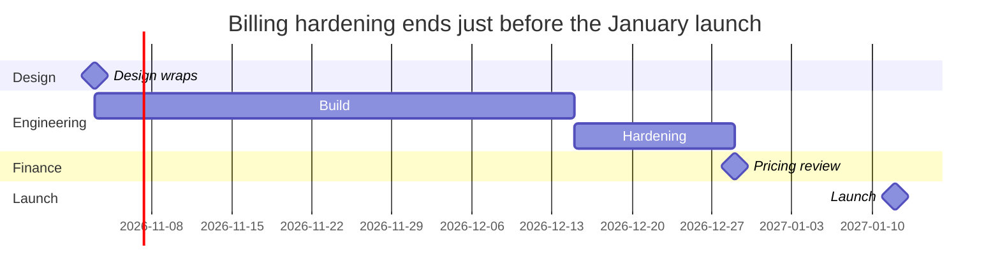
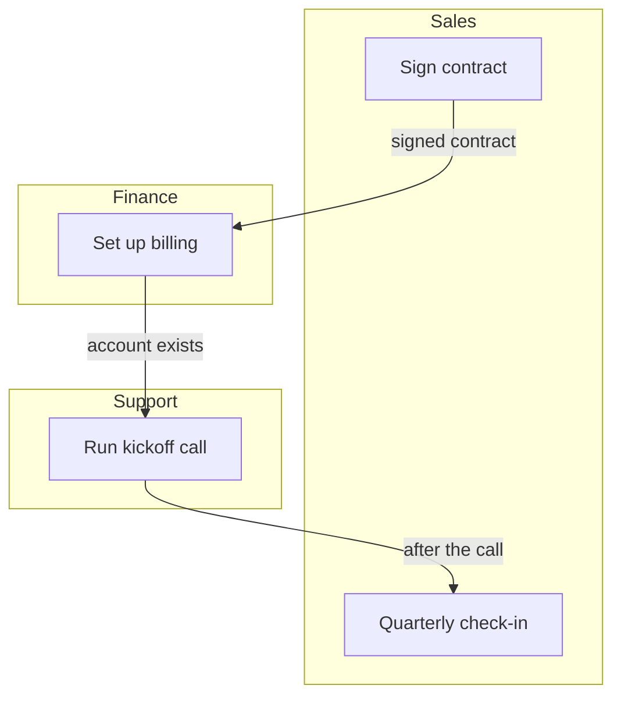

# Skills — Plan

[[Skills Gallery]] · Next: [[Skills — Explain]]

**Lay out the work, its owners and its risks.** These four skills turn plans in prose into a schedule, a hand-off map, a log of what could go wrong, and a range of outcomes. Each section shows a short passage, then everything one run of the skill returned. The heading, the chart or diagram, and any table or form under it all come back together, as one change for your review. The passages and numbers are fictional teaching examples.

## Roadmap

Work laid out over time, by workstream, with its milestones. Use it when a document plans work with dates, durations or a sequence. **One run returns only a timeline chart.**

**What it read**

> Design for the new billing flow wraps on 3 November 2026. Engineering starts the same day and needs six weeks, then two weeks of hardening. Finance wants a pricing review once hardening is done, and the launch is set for 12 January 2027. Marketing will start the launch page in December.

**What it drew**

### Billing hardening ends just before the January launch



Not placed: the marketing launch page has a month (December) but no length.

To run it on your own words, select a passage like this one, open **Elements**, and press **Roadmap** under **Skills**.

## Delegation Map

Who does each step, and where the work changes hands. Use it when a document describes a process that several people or teams share. **One run returns only a flowchart of who does each step.**

**What it read**

> A new customer's contract is signed by sales, who send it to finance to set up billing. Finance tells support once the account exists, and support runs the kickoff call. After the call, support hands the customer back to sales for the quarterly check-in. Finance says the hand-off from sales often arrives without the billing contact.

**What it drew**

### Three hand-offs, one of them missing a contact



Three hand-offs cross lanes; finance says the first often arrives without the billing contact.

To run it on your own words, select a passage like this one, open **Elements**, and press **Delegation Map** under **Skills**.

## Register

Risks, issues or decisions logged with an owner and a check. Use it when a document raises things someone must keep an eye on. **One run returns only a table.**

**What it read**

> The migration depends on the vendor's export tool, which failed twice in testing; the platform lead is chasing them and wants it working by the 14 November dry run. Legal has not yet confirmed the new data residency terms. If the dry run slips, the January launch slips with it, which marketing says would be costly.

**What it drew**

### Risk register · Data migration

| ID | Item | Likelihood | Impact | Owner | Check |
| --- | --- | --- | --- | --- | --- |
| R1 | The vendor's export tool fails again in the migration. | High | High | Platform lead | Working by the 14 November dry run |
| R2 | The dry run slips, and the January launch with it. | Not stated | High | Unassigned | At the 14 November dry run |
| R3 | The new data residency terms are not confirmed in time. | Not stated | Not stated | Legal | Next review |

To run it on your own words, select a passage like this one, open **Elements**, and press **Register** under **Skills**.

## Scenario Model

Low, base and high cases from stated ranges, and a choice. Use it when a document plans against an uncertain number. **One run returns a chart and a form.**

**What it read**

> We expect 40 new customers next quarter, though sales says it could be anywhere from 25 to 60. Each brings about $3,000 in the quarter. The support hire we are weighing costs $60,000 a quarter.

**What it drew**

### Even the low case covers the support hire

- Low: 25 customers × $3,000 = $75,000.
- Base: 40 customers × $3,000 = $120,000.
- High: 60 customers × $3,000 = $180,000.

```chart
chartType: Bar Chart
title: Even the low case covers the $60,000 support hire
source: Sales' range and the revenue per customer
highlight: Base
data:
  - {case: Low, revenue: 75000}
  - {case: Base, revenue: 120000}
  - {case: High, revenue: 180000}
encodings:
  x: {field: case}
  y: {field: revenue}
```

```flowui
component: Form
title: Planning case · Next quarter
subtitle: Which case the hiring plan follows
fields:
  - label: Case
    bind: verdict
    type: choice
    options:
      - Low
      - Base
      - High
  - label: Reason
    bind: reason
  - label: Decided by
    bind: signer
decision: {label: Record decision, action: decide}
```

To run it on your own words, select a passage like this one, open **Elements**, and press **Scenario Model** under **Skills**.

Back: [[Skills Gallery]] · Next: [[Skills — Explain]]
