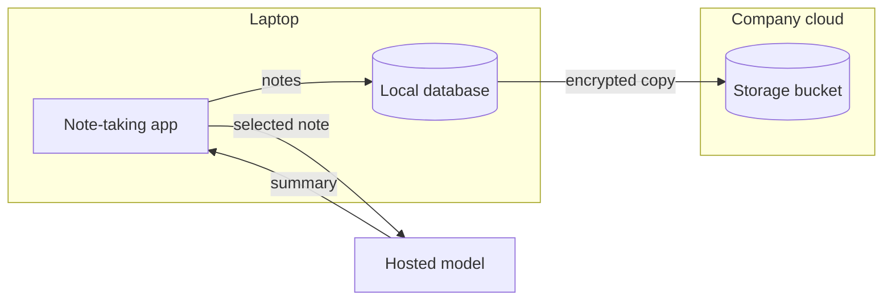

# Worked example — Architecture Diagram

## Input

> The note-taking app keeps every note in a local database on the laptop.
> When a person asks for a summary, the app sends the selected note to a
> hosted model and writes the summary back into the note. Sync sends
> encrypted copies of the database to the company's storage bucket in its
> own cloud account.

## Output

### A note leaves the laptop twice: for a summary, and encrypted for sync

Crossing a boundary: the selected note to the hosted model, the summary
back, and the encrypted copy to the company's bucket.
