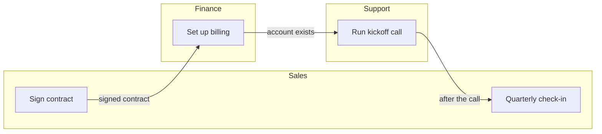

# Worked example — Delegation Map

## Input

> A new customer's contract is signed by sales, who send it to finance to
> set up billing. Finance tells support once the account exists, and
> support runs the kickoff call. After the call, support hands the
> customer back to sales for the quarterly check-in. Finance says the
> hand-off from sales often arrives without the billing contact.

## Output

### Three hand-offs, one of them missing a contact

Three hand-offs cross lanes; finance says the first often arrives without
the billing contact.
