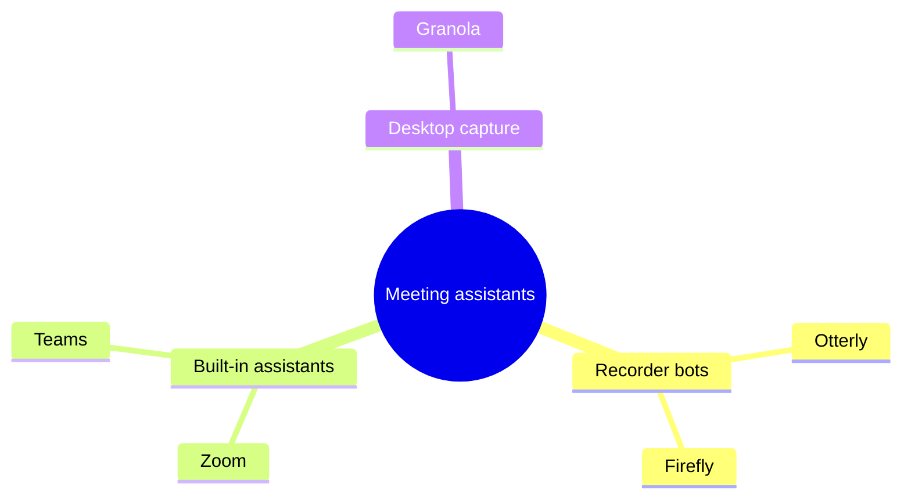

# Worked example — Landscape Map

## Input

> Meeting assistants split three ways. Recorder bots such as Otterly and
> Firefly join the call as a participant (per each vendor's site).
> Built-in assistants come with the meeting tool itself: Zoom's and
> Teams' own (their 2026 release notes). Desktop capture tools such as
> Granola record from the laptop without joining the call.

## Output

### Meeting assistants split three ways

| Player | Group | Defining fact | Source |
| --- | --- | --- | --- |
| Otterly | Recorder bots | Joins the call as a participant | The vendor's site |
| Firefly | Recorder bots | Joins the call as a participant | The vendor's site |
| Zoom | Built-in assistants | Comes with the meeting tool | 2026 release notes |
| Teams | Built-in assistants | Comes with the meeting tool | 2026 release notes |
| Granola | Desktop capture | Records from the laptop without joining | The text |
