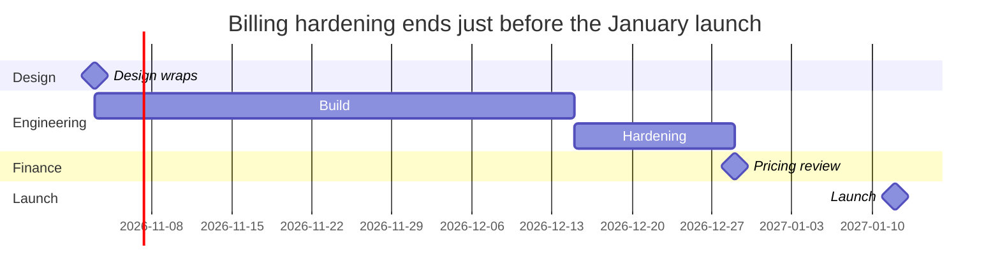

# Worked example — Roadmap

## Input

> Design for the new billing flow wraps on 3 November 2026. Engineering
> starts the same day and needs six weeks, then two weeks of hardening.
> Finance wants a pricing review once hardening is done, and the launch
> is set for 12 January 2027. Marketing will start the launch page in
> December.

## Output

### Billing hardening ends just before the January launch

Not placed: the marketing launch page has a month (December) but no
length.
